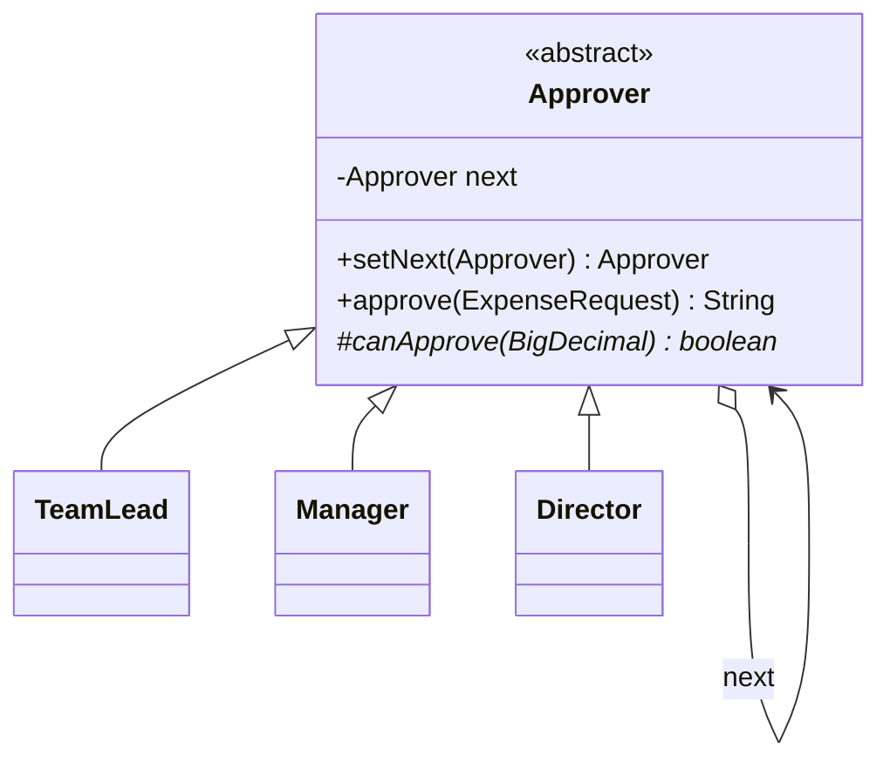
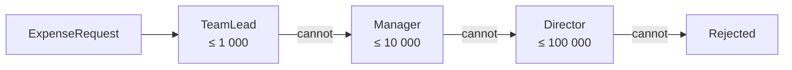

# Chain of Responsibility

> 🇹🇷 [Türkçe](../../tr/behavioral/chain-of-responsibility.md) · **Category:** Behavioral · **Code:** [`behavioral/chainofresponsibility`](../../../src/main/java/designpatterns/behavioral/chainofresponsibility)

## Intent

Avoid coupling the sender of a request to its receiver by giving **more than one object a chance
to handle the request**. Chain the receiving objects and pass the request along the chain until
an object handles it.

## Problem

Expense approval: a team lead approves up to 1 000 TL, a manager up to 10 000 TL, a director up to
100 000 TL. Putting this into one method with `if/else if` couples the employee to every approver,
and changing the hierarchy means editing that method.

## Solution

Each approver is a **handler** with a reference to the next handler. A handler either processes
the request or forwards it. The client only knows the first handler.





| Role | Class |
|---|---|
| Handler | [`Approver`](../../../src/main/java/designpatterns/behavioral/chainofresponsibility/Approver.java) |
| Concrete handlers | [`TeamLead`](../../../src/main/java/designpatterns/behavioral/chainofresponsibility/TeamLead.java), [`Manager`](../../../src/main/java/designpatterns/behavioral/chainofresponsibility/Manager.java), [`Director`](../../../src/main/java/designpatterns/behavioral/chainofresponsibility/Director.java) |
| Request | [`ExpenseRequest`](../../../src/main/java/designpatterns/behavioral/chainofresponsibility/ExpenseRequest.java) |

```java
Approver chain = new TeamLead();
chain.setNext(new Manager()).setNext(new Director());
chain.approve(new ExpenseRequest("cem", "conference trip", new BigDecimal("8500")));
// -> "Manager approved 8500 TL for conference trip"
```

Demo: [`ChainOfResponsibilityDemo.java`](../../../src/main/java/designpatterns/behavioral/chainofresponsibility/ChainOfResponsibilityDemo.java)

Before / after: [refactoring example](../refactoring.md#chain-of-responsibility)

## Two variations

1. **Stop at the first handler** (used here, classic GoF): exactly one handler processes the request.
2. **Pipeline / filter chain**: every handler does its part and passes the request on
   (authentication → logging → compression). Servlet filters work like this.

## When to use

- More than one object may handle a request and the handler is not known in advance.
- The set of handlers and their order should be configurable at runtime.

## Pros and cons

| ✅ Pros | ❌ Cons |
|---|---|
| Sender and receivers are decoupled | A request may reach the end unhandled |
| Add/remove/reorder handlers freely | Harder to debug and trace |
| Single Responsibility per handler | Long chains may hurt performance |

## Real world usage

- `jakarta.servlet.Filter` / `FilterChain`, Spring Security filter chain
- `java.util.logging.Logger` passing records to parent loggers
- Exception handling: a `try/catch` stack is a chain of responsibility
- Spring `HandlerInterceptor`, Netty `ChannelPipeline`

## Related patterns

- Often used with **Composite**: a request is passed up from a child to its parent.
- **Command** objects are often the requests passed along a chain.
- **Decorator** has a similar recursive structure but every decorator always delegates and cannot
  stop the flow.
