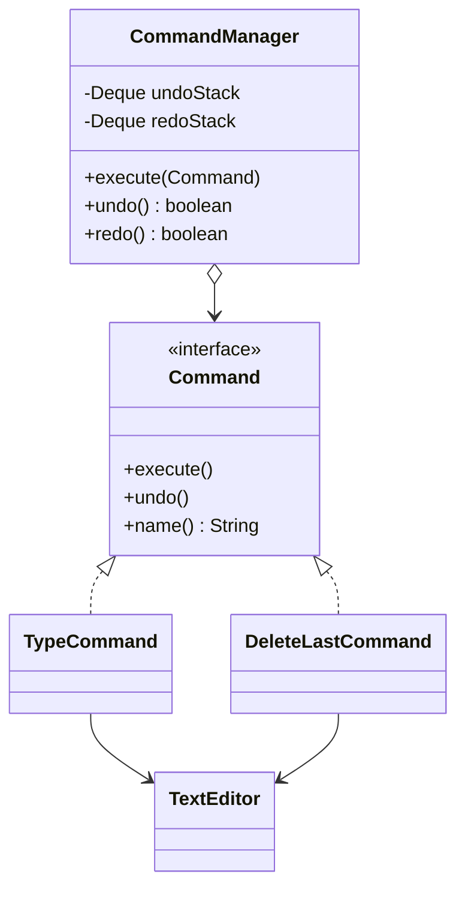

# Command

> 🇹🇷 [Türkçe](../../tr/behavioral/command.md) · **Category:** Behavioral · **Code:** [`behavioral/command`](../../../src/main/java/designpatterns/behavioral/command)

## Intent

**Encapsulate a request as an object**, thereby letting you parameterize clients with different
requests, queue or log requests, and support **undoable operations**.

## Problem

A text editor has buttons, menu items and keyboard shortcuts that do the same things. We also
need **undo/redo**. If the buttons call the editor directly, the logic is duplicated and nothing
remembers *what* was done, so it cannot be undone.

## Solution

Turn every action into an object implementing `Command` with `execute()` and `undo()`. The command
stores everything it needs (receiver, parameters, the state required for undo). An **invoker**
executes commands and keeps them in a history stack.



| Role | Class |
|---|---|
| Command | [`Command`](../../../src/main/java/designpatterns/behavioral/command/Command.java) |
| Concrete commands | [`TypeCommand`](../../../src/main/java/designpatterns/behavioral/command/TypeCommand.java), [`DeleteLastCommand`](../../../src/main/java/designpatterns/behavioral/command/DeleteLastCommand.java) |
| Receiver | [`TextEditor`](../../../src/main/java/designpatterns/behavioral/command/TextEditor.java) |
| Invoker | [`CommandManager`](../../../src/main/java/designpatterns/behavioral/command/CommandManager.java) |

```java
manager.execute(new TypeCommand(editor, "Hello"));
manager.execute(new DeleteLastCommand(editor, 2));
manager.undo();   // the deleted characters come back
manager.redo();
```

Demo: [`CommandDemo.java`](../../../src/main/java/designpatterns/behavioral/command/CommandDemo.java)

## When to use

- Undo/redo, transactional behaviour, macros (a list of commands).
- Queueing, scheduling or executing requests remotely (job queues, message brokers).
- Logging requests so the system can be rebuilt after a crash (event sourcing).
- Decoupling UI elements from business logic.

## Pros and cons

| ✅ Pros | ❌ Cons |
|---|---|
| Invoker and receiver are decoupled | One class per action (lambdas help for simple commands) |
| Undo/redo, queues, macros, logging | Undo needs careful state handling |
| Open/Closed: new commands without changing existing code | |

## Real world usage

- `java.lang.Runnable` and `java.util.concurrent.Callable` submitted to an `ExecutorService`
- `javax.swing.Action`
- Spring Batch steps, CQRS command handlers, message queue consumers

## Related patterns

- **Memento** can store the state a command needs for undo.
- **Chain of Responsibility** can pass commands along a chain.
- **Strategy** also wraps behaviour in an object, but a command represents *an action to perform*,
  while a strategy is *a way of doing the same thing*.
- **Prototype** helps to copy commands into the history.
