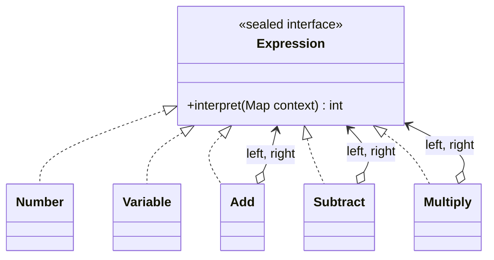

# Interpreter

> 🇹🇷 [Türkçe](../../tr/behavioral/interpreter.md) · **Category:** Behavioral · **Code:** [`behavioral/interpreter`](../../../src/main/java/designpatterns/behavioral/interpreter)

## Intent

Given a language, define a **representation for its grammar** along with an interpreter that uses
the representation to interpret sentences in the language.

## Problem

Users of a pricing system want to write their own small formulas, e.g.
`price quantity * discount -`. Hard coding every formula is impossible.

## Solution

Represent every grammar rule with a class. **Terminal expressions** (numbers, variables) are the
leaves; **non-terminal expressions** (add, subtract, multiply) contain other expressions. The
sentence becomes an **abstract syntax tree** (AST) and `interpret(context)` evaluates it recursively.

```text
expression ::= number | variable | expression expression operator
operator   ::= '+' | '-' | '*'
```



`"price quantity * discount -"` is parsed into:

```text
        Subtract
        /      \
   Multiply   Variable(discount)
    /     \
price   quantity
```

| Role | Class |
|---|---|
| Abstract expression | [`Expression`](../../../src/main/java/designpatterns/behavioral/interpreter/Expression.java) (sealed interface) |
| Terminal expressions | `Expression.Number`, `Expression.Variable` (records) |
| Non-terminal expressions | `Expression.Add`, `Expression.Subtract`, `Expression.Multiply` |
| Context | `Map<String, Integer>` with variable values |
| Parser (client) | [`ExpressionParser`](../../../src/main/java/designpatterns/behavioral/interpreter/ExpressionParser.java) |

Demo: [`InterpreterDemo.java`](../../../src/main/java/designpatterns/behavioral/interpreter/InterpreterDemo.java)

## When to use

- The grammar is **simple** and efficiency is not the main concern: rule engines, filters,
  search queries, configuration DSLs.
- For complex grammars use a parser generator (ANTLR, JavaCC) instead.

## Pros and cons

| ✅ Pros | ❌ Cons |
|---|---|
| Easy to change and extend the grammar | Complex grammars become hard to maintain |
| Each rule is a small, testable class | Slow compared to compiled solutions |

## Real world usage

- `java.util.regex.Pattern` (compiles a regex into a tree of nodes)
- `java.text.Format` subclasses, Spring Expression Language (SpEL), JPQL / HQL, SQL engines

## Related patterns

- The AST is a **Composite**.
- **Iterator** can traverse the tree, **Visitor** can add operations (pretty print, optimize, type check).
- **Flyweight** can share terminal symbols.
