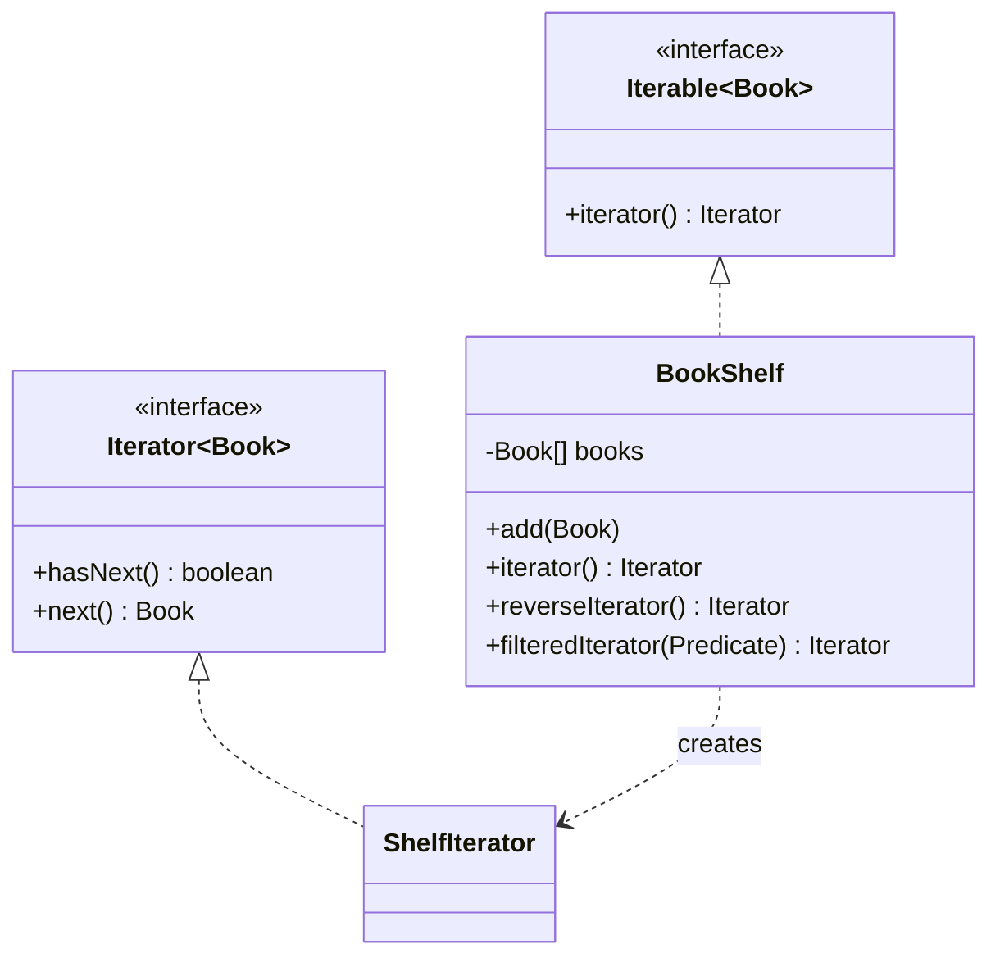

# Iterator

> 🇹🇷 [Türkçe](../../tr/behavioral/iterator.md) · **Category:** Behavioral · **Code:** [`behavioral/iterator`](../../../src/main/java/designpatterns/behavioral/iterator)

## Intent

Provide a way to **access the elements of an aggregate object sequentially without exposing its
underlying representation**.

## Problem

A `BookShelf` stores books in an array today; tomorrow it may be a linked list or a tree. If
clients loop over the array directly, every change of the internal structure breaks them. We also
want different traversals: forward, backward, filtered.

## Solution

Move the traversal into a separate **iterator** object that keeps its own cursor. The collection
returns iterators; clients use only `hasNext()` / `next()`. Implementing `Iterable` also makes the
collection usable in a `for-each` loop.



| Role | Class |
|---|---|
| Iterator | `java.util.Iterator<Book>` |
| Concrete iterator | `BookShelf.ShelfIterator` (inner class) |
| Aggregate | `java.lang.Iterable<Book>` |
| Concrete aggregate | [`BookShelf`](../../../src/main/java/designpatterns/behavioral/iterator/BookShelf.java) |

```java
for (Book book : shelf) { ... }                              // forward
Iterator<Book> it = shelf.reverseIterator();                 // backward
Iterator<Book> modern = shelf.filteredIterator(b -> b.year() > 2000);
```

Demo: [`IteratorDemo.java`](../../../src/main/java/designpatterns/behavioral/iterator/IteratorDemo.java)

## Internal vs external iterators

- **External iterator** (`Iterator`) – the client controls the traversal with `hasNext/next`.
- **Internal iterator** (`forEach`, Stream API) – the collection controls the traversal, the
  client provides a function. `Spliterator` adds support for parallel traversal.

## When to use

- Hide the internal structure of a collection.
- Provide several traversal algorithms for the same collection.
- Provide a uniform way to traverse different collections.

## Pros and cons

| ✅ Pros | ❌ Cons |
|---|---|
| Collections and traversal algorithms are separate | Overkill for simple collections |
| Multiple traversals can run at the same time (each iterator has its own state) | Can be less efficient than direct access |

## Real world usage

- Everything in `java.util` that implements `Iterable`; `Iterator`, `ListIterator`, `Spliterator`
- `java.util.Scanner`, `java.sql.ResultSet`, `DirectoryStream`

## Related patterns

- **Composite** trees are traversed with iterators.
- **Factory Method**: `iterator()` is a factory method returning a collection specific iterator.
- **Memento** can store the iteration state.
- **Visitor** can be combined with Iterator to process every element.
