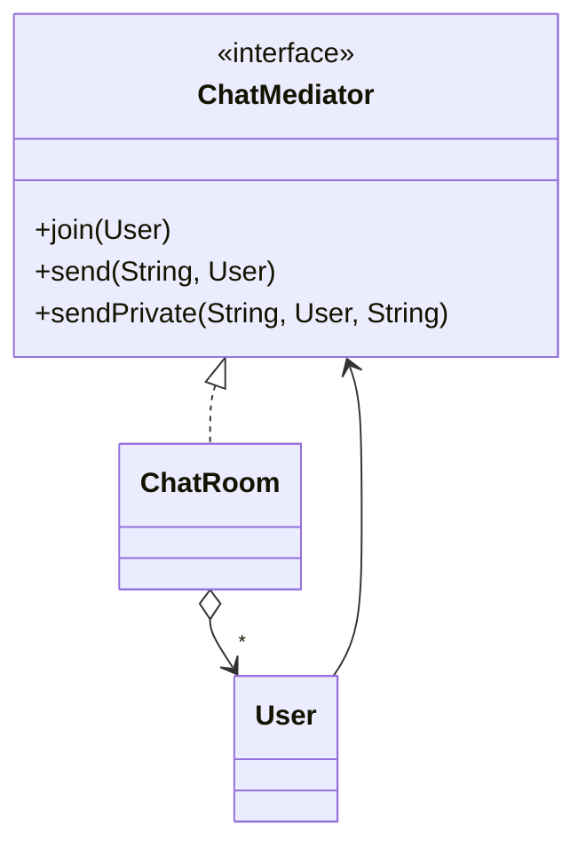

# Mediator

> 🇹🇷 [Türkçe](../../tr/behavioral/mediator.md) · **Category:** Behavioral · **Code:** [`behavioral/mediator`](../../../src/main/java/designpatterns/behavioral/mediator)

## Intent

Define an object that **encapsulates how a set of objects interact**. Mediator promotes loose
coupling by keeping objects from referring to each other explicitly.

## Problem

In a chat, if every user holds references to all other users, *n* users need *n × (n-1)*
connections. Rules like "block spam" or "private messages" would be scattered across all users.

## Solution

Users (colleagues) talk only to a **mediator** (the chat room). The mediator knows all users and
contains all communication rules. Many-to-many relationships become one-to-many.



| Role | Class |
|---|---|
| Mediator | [`ChatMediator`](../../../src/main/java/designpatterns/behavioral/mediator/ChatMediator.java) |
| Concrete mediator | [`ChatRoom`](../../../src/main/java/designpatterns/behavioral/mediator/ChatRoom.java) |
| Colleague | [`User`](../../../src/main/java/designpatterns/behavioral/mediator/User.java) |

```java
ChatMediator room = new ChatRoom();
User cem = new User("Cem", room);
User ayse = new User("Ayşe", room);
cem.send("Hello everyone!");          // the room decides who receives it
```

Demo: [`MediatorDemo.java`](../../../src/main/java/designpatterns/behavioral/mediator/MediatorDemo.java)

## When to use

- Objects communicate in complex ways and the dependencies are hard to understand.
- You want to reuse a component that currently depends on too many other components.
- UI dialogs where fields affect each other, air traffic control, chat rooms, workflow engines.

## Pros and cons

| ✅ Pros | ❌ Cons |
|---|---|
| Fewer dependencies between components | The mediator can grow into a god object |
| Communication rules in one place | Single point of failure |
| Components are easier to reuse | |

## Real world usage

- `java.util.Timer` (schedules tasks), `java.util.concurrent.ExecutorService`
- Spring MVC `DispatcherServlet`
- Message brokers / event buses, MediatR-style libraries

## Related patterns

- **Facade** simplifies a subsystem but the subsystem doesn't know the facade; colleagues know
  their mediator.
- **Observer** is often used to implement the communication between mediator and colleagues.
- **Chain of Responsibility**, **Command**, **Mediator** and **Observer** all address ways of
  connecting senders and receivers.
