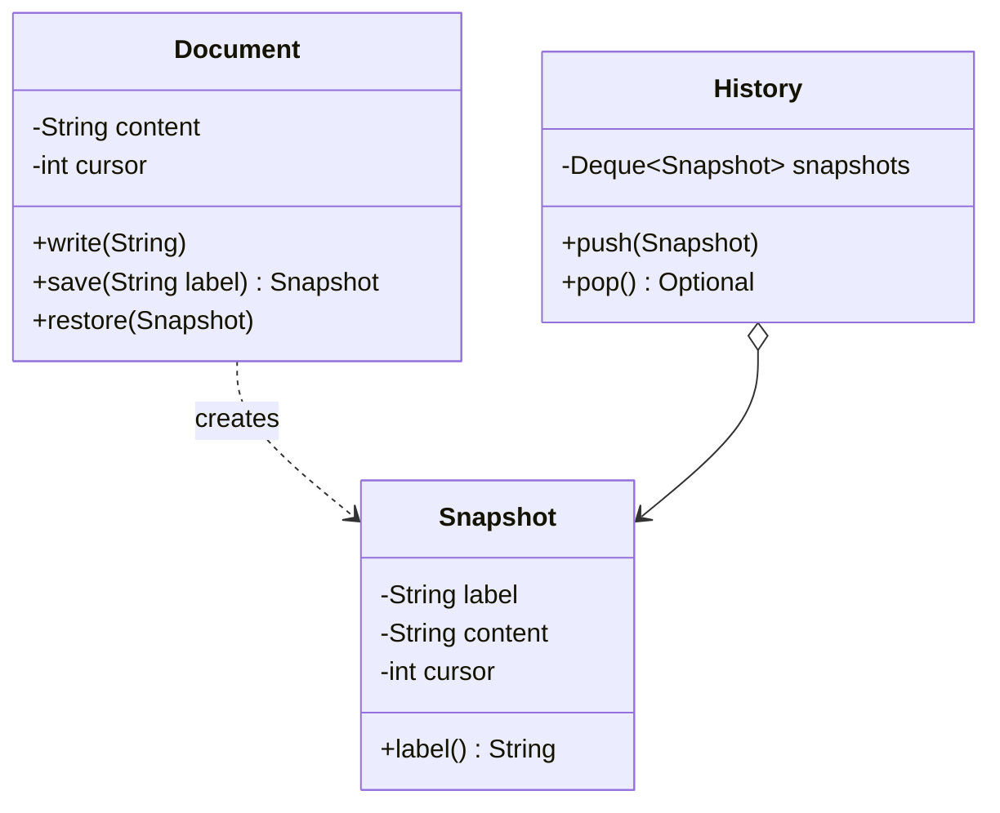

# Memento

> 🇹🇷 [Türkçe](../../tr/behavioral/memento.md) · **Category:** Behavioral · **Code:** [`behavioral/memento`](../../../src/main/java/designpatterns/behavioral/memento)

## Intent

Without violating encapsulation, **capture and externalize an object's internal state** so that
the object can be restored to this state later.

## Problem

A document editor needs "restore previous version". To save the state, some other object would
need to read the document's private fields — breaking encapsulation — or the fields must be made
public.

## Solution

The object whose state is saved (**originator**) creates the snapshot itself. The snapshot
(**memento**) is immutable and opaque: only the originator can read it. A **caretaker** stores
mementos but never looks inside them.



| Role | Class |
|---|---|
| Originator | [`Document`](../../../src/main/java/designpatterns/behavioral/memento/Document.java) |
| Memento | `Document.Snapshot` (nested, private constructor and fields) |
| Caretaker | [`History`](../../../src/main/java/designpatterns/behavioral/memento/History.java) |

```java
history.push(document.save("v1"));
document.write("Oops! ");
history.pop().ifPresent(document::restore);
```

Because `Snapshot` is a nested class, `Document` can read its private fields while the caretaker
can only call `label()`.

Demo: [`MementoDemo.java`](../../../src/main/java/designpatterns/behavioral/memento/MementoDemo.java)

## When to use

- Undo/redo, checkpoints, "save game", rolling back a transaction.
- Direct access to the object's fields would break encapsulation.

## Pros and cons

| ✅ Pros | ❌ Cons |
|---|---|
| Snapshots without breaking encapsulation | Memory usage when snapshots are big or frequent |
| Simplifies the originator (history is kept elsewhere) | Caretakers must manage the lifecycle (delete old snapshots) |

## Real world usage

- `java.io.Serializable` used to persist and restore object state
- Undo in editors, game save systems, database transactions / savepoints

## Related patterns

- **Command** + Memento: the command stores a memento for undo.
- **Iterator** can use a memento to capture the iteration state.
- **Prototype** can be a simpler alternative when the object is simple to copy.
