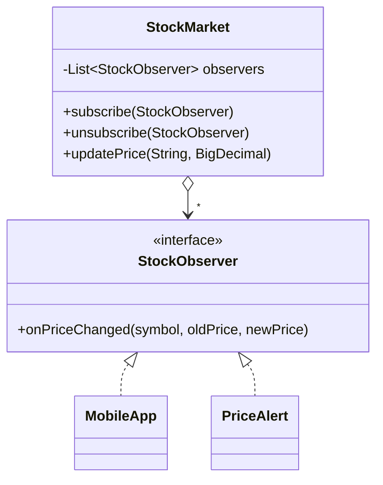

# Observer

> 🇹🇷 [Türkçe](../../tr/behavioral/observer.md) · **Category:** Behavioral · **Code:** [`behavioral/observer`](../../../src/main/java/designpatterns/behavioral/observer)

## Intent

Define a **one-to-many dependency** between objects so that when one object changes state, all its
dependents are **notified and updated automatically**. Also known as *Publish/Subscribe*.

## Problem

When a stock price changes, the mobile app must refresh, price alerts must be checked and the change
must be logged. If the stock market calls these classes directly, it depends on all of them and
must be changed for every new consumer. Polling ("has the price changed?") wastes resources.

## Solution

The **subject** keeps a list of **observers** that implement a common interface. Observers
subscribe/unsubscribe at runtime. On every change the subject notifies all of them.



| Role | Class |
|---|---|
| Subject (publisher) | [`StockMarket`](../../../src/main/java/designpatterns/behavioral/observer/StockMarket.java) |
| Observer (subscriber) | [`StockObserver`](../../../src/main/java/designpatterns/behavioral/observer/StockObserver.java) |
| Concrete observers | [`MobileApp`](../../../src/main/java/designpatterns/behavioral/observer/MobileApp.java), [`PriceAlert`](../../../src/main/java/designpatterns/behavioral/observer/PriceAlert.java), a lambda |

```java
market.subscribe(new MobileApp());
market.subscribe((symbol, oldPrice, newPrice) -> log(symbol)); // lambda observer
market.updatePrice("THYAO", new BigDecimal("301.25"));         // everybody is notified
```

Demo: [`ObserverDemo.java`](../../../src/main/java/designpatterns/behavioral/observer/ObserverDemo.java)

Before / after: [refactoring example](../refactoring.md#observer)

## Push vs pull

- **Push** (used here): the subject sends the changed data to observers.
- **Pull**: the subject only says "something changed" and observers query what they need.

## Pitfalls

- **Memory leaks** (lapsed listener problem): forgetting to unsubscribe keeps observers alive.
- Notification order is not guaranteed; observers should not depend on each other.
- An exception in one observer can stop the others — handle errors in the subject.
- Modifying the observer list during notification → `CopyOnWriteArrayList` is used here.

## When to use

- A change in one object requires changing others, and you don't know how many there are.
- Event driven systems, UI events, domain events, reactive streams.

## Pros and cons

| ✅ Pros | ❌ Cons |
|---|---|
| Open/Closed: new subscribers without changing the publisher | Unexpected update cascades |
| Loose coupling, relationships at runtime | Memory leaks if not unsubscribed |

## Real world usage

- `java.beans.PropertyChangeListener`, Swing/JavaFX event listeners
- `java.util.concurrent.Flow` (Reactive Streams), RxJava, Project Reactor
- Spring `ApplicationEventPublisher` + `@EventListener`
- `java.util.Observer` / `Observable` exist but are **deprecated since Java 9**

## Related patterns

- **Mediator** often uses Observer for communication.
- **Singleton** event buses are common.
- **Chain of Responsibility**, **Command**, **Mediator** and **Observer** are all ways of
  connecting senders and receivers.
