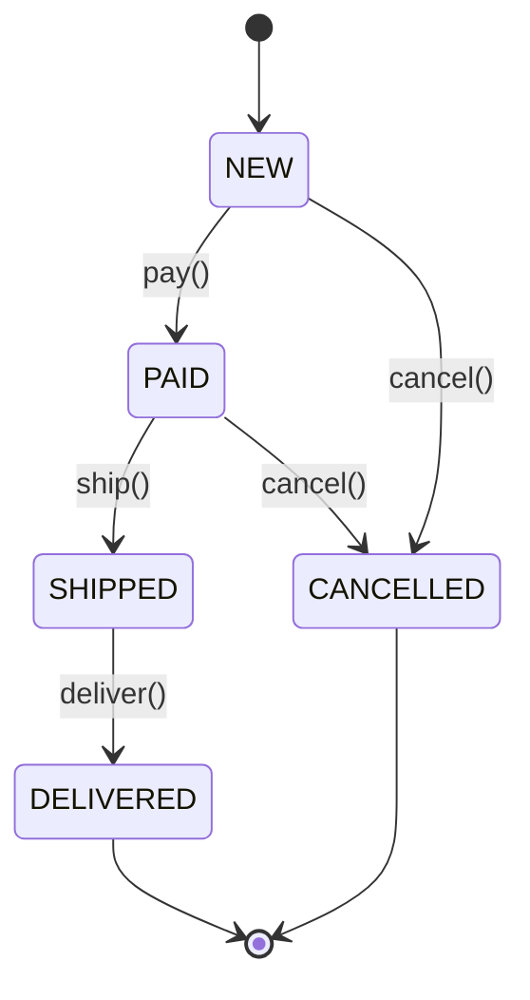
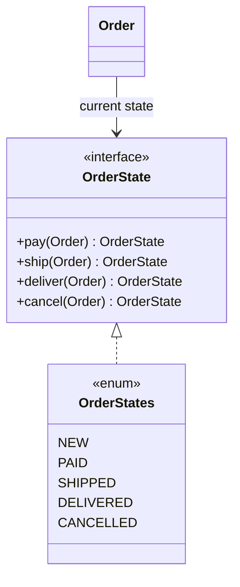

# State

> 🇹🇷 [Türkçe](../../tr/behavioral/state.md) · **Category:** Behavioral · **Code:** [`behavioral/state`](../../../src/main/java/designpatterns/behavioral/state)

## Intent

Allow an object to **alter its behaviour when its internal state changes**. The object will appear
to change its class.

## Problem

An order goes through `NEW → PAID → SHIPPED → DELIVERED`, and can be `CANCELLED` before shipping.
Every method (`pay`, `ship`, `deliver`, `cancel`) would contain a `switch (status)` with the same
cases. Adding a new state means editing every method, and invalid transitions are easy to miss.

## Solution

Create one class (here: one enum constant) per state. Each state implements only the transitions
it allows and returns the next state. The context (`Order`) delegates to its current state object.





| Role | Class |
|---|---|
| Context | [`Order`](../../../src/main/java/designpatterns/behavioral/state/Order.java) |
| State | [`OrderState`](../../../src/main/java/designpatterns/behavioral/state/OrderState.java) (default methods throw) |
| Concrete states | [`OrderStates`](../../../src/main/java/designpatterns/behavioral/state/OrderStates.java) enum constants |

```java
public void pay() {
    state = state.pay(this);   // no switch here
}
```

Demo: [`StateDemo.java`](../../../src/main/java/designpatterns/behavioral/state/StateDemo.java)

Before / after: [refactoring example](../refactoring.md#state)

## When to use

- An object behaves differently depending on its state, and there are many states.
- Methods are full of conditionals on a status field.
- Workflows, order/payment lifecycles, TCP connections, vending machines, game characters.

## Pros and cons

| ✅ Pros | ❌ Cons |
|---|---|
| State specific code is in one place | Overkill for 2-3 simple states |
| Invalid transitions are explicit | More classes |
| New states without changing the context | |

## Real world usage

- Spring State Machine
- `java.lang.Thread.State` (as data), lifecycle of JSF/servlets
- Order/payment flows in e-commerce systems

## Related patterns

- **Strategy** has the same structure. Strategies are usually chosen by the *client* and don't
  know each other; states change *themselves* and know the next state.
- States are often **Singletons** / **Flyweights** (stateless enum constants here).
