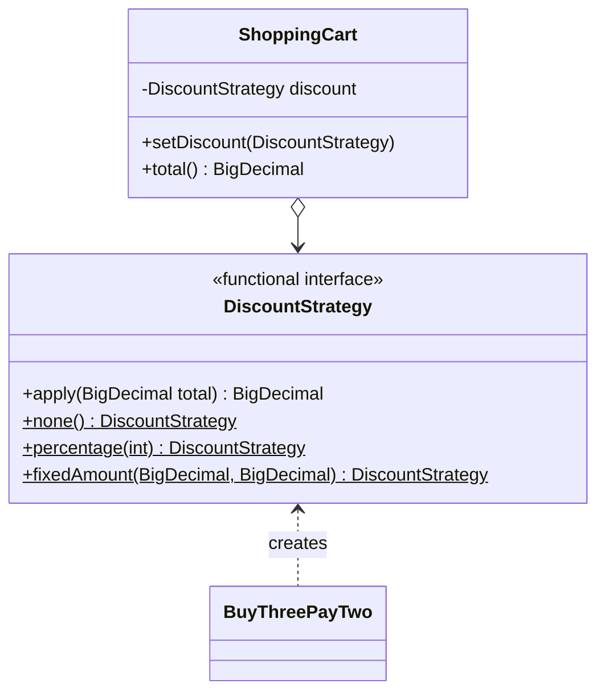

# Strategy

> 🇹🇷 [Türkçe](../../tr/behavioral/strategy.md) · **Category:** Behavioral · **Code:** [`behavioral/strategy`](../../../src/main/java/designpatterns/behavioral/strategy)

## Intent

Define a **family of algorithms**, encapsulate each one, and make them **interchangeable**.
Strategy lets the algorithm vary independently from clients that use it.

## Problem

A shopping cart supports different campaigns: none, 10% off, 200 TL off over 1500 TL,
buy 3 pay 2, Black Friday... A `switch (campaign)` in `total()` grows with each campaign and the
cart class has to change every time marketing has a new idea.

## Solution

Extract each algorithm into its own object implementing a common interface. The context (cart)
holds a reference to a strategy and delegates to it. The strategy can be replaced at runtime.
In modern Java a strategy with one method is a **functional interface**, so lambdas work too.



| Role | Class |
|---|---|
| Strategy | [`DiscountStrategy`](../../../src/main/java/designpatterns/behavioral/strategy/DiscountStrategy.java) |
| Concrete strategies | `none()`, `percentage()`, `fixedAmount()`, [`BuyThreePayTwo`](../../../src/main/java/designpatterns/behavioral/strategy/BuyThreePayTwo.java), any lambda |
| Context | [`ShoppingCart`](../../../src/main/java/designpatterns/behavioral/strategy/ShoppingCart.java) |

```java
cart.setDiscount(DiscountStrategy.percentage(10));
cart.setDiscount(total -> total.subtract(new BigDecimal("50"))); // ad-hoc strategy
```

Demo: [`StrategyDemo.java`](../../../src/main/java/designpatterns/behavioral/strategy/StrategyDemo.java)

Before / after: [refactoring example](../refactoring.md#strategy)

## When to use

- Several variants of an algorithm should be selectable at runtime.
- A class has a big conditional that selects one of several behaviours.
- You want to isolate algorithm details from the business logic (Open/Closed).

## Pros and cons

| ✅ Pros | ❌ Cons |
|---|---|
| Swap algorithms at runtime | Clients must know the differences between strategies |
| Replaces inheritance with composition | Overkill if there are only a couple of stable algorithms |
| Open/Closed; easy to unit test each strategy | |

## Real world usage

- `java.util.Comparator` passed to `List.sort()` / `Collections.sort()`
- `java.util.concurrent.RejectedExecutionHandler`, `javax.servlet.http.HttpServlet` methods
- Spring: `PasswordEncoder`, `ResourceLoader`, `AuthenticationProvider`, injecting different beans of one interface

## Related patterns

- **State** – same structure, different intent (see the State page).
- **Template Method** uses inheritance to vary parts of an algorithm; Strategy uses composition to
  vary the whole algorithm.
- **Decorator** changes the skin of an object, Strategy changes its guts.
- **Command** – both wrap behaviour in an object.
