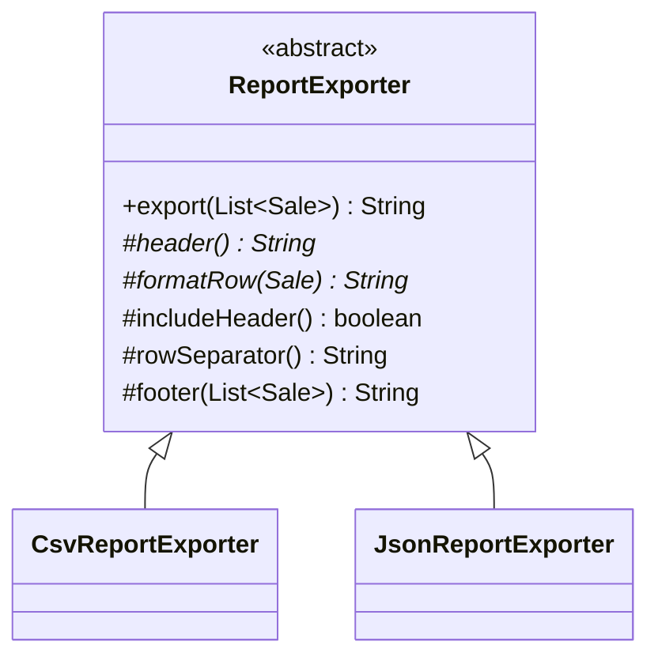

# Template Method

> 🇹🇷 [Türkçe](../../tr/behavioral/template-method.md) · **Category:** Behavioral · **Code:** [`behavioral/templatemethod`](../../../src/main/java/designpatterns/behavioral/templatemethod)

## Intent

Define the **skeleton of an algorithm** in an operation, deferring some steps to subclasses.
Template Method lets subclasses redefine certain steps without changing the algorithm's structure.

## Problem

Sales reports are exported as CSV and JSON. Both exporters filter invalid rows, write a header,
format each row and write a footer — only the formatting differs. Copy-pasting the flow into each
exporter means fixing every bug twice.

## Solution

Put the algorithm in a **final** method of an abstract class (the template method). Steps that
vary are `abstract` methods (**primitive operations**) or overridable methods with a default
(**hooks**).



| Role | Class |
|---|---|
| Abstract class | [`ReportExporter`](../../../src/main/java/designpatterns/behavioral/templatemethod/ReportExporter.java) |
| Concrete classes | [`CsvReportExporter`](../../../src/main/java/designpatterns/behavioral/templatemethod/CsvReportExporter.java), [`JsonReportExporter`](../../../src/main/java/designpatterns/behavioral/templatemethod/JsonReportExporter.java) |

```java
// simplified version of ReportExporter.export()
public final String export(List<Sale> sales) {          // the template method
    List<Sale> valid = filterInvalid(sales);
    if (includeHeader()) out.append(header());           // hook + primitive
    valid.forEach(sale -> out.append(formatRow(sale)));  // primitive
    out.append(footer(valid));                           // hook
}
```

Demo: [`TemplateMethodDemo.java`](../../../src/main/java/designpatterns/behavioral/templatemethod/TemplateMethodDemo.java)

## The Hollywood Principle

*"Don't call us, we'll call you."* The base class calls the subclass methods, not the other way
around. Subclasses only fill in the gaps.

## When to use

- Several classes contain the same algorithm with small differences.
- You want subclasses to extend only particular steps, not the whole algorithm.
- Frameworks: the framework owns the flow, applications provide the steps.

## Pros and cons

| ✅ Pros | ❌ Cons |
|---|---|
| Removes duplicated code | Based on inheritance (tight coupling, single base class) |
| Algorithm structure is protected (`final`) | Can violate Liskov if subclasses suppress steps |
| Hooks provide controlled extension points | More steps = harder to maintain |

## Real world usage

- `java.io.InputStream#read(byte[], int, int)` uses the abstract `read()`
- `java.util.AbstractList` / `AbstractMap` (you implement `get` and `size`, the rest is provided)
- `jakarta.servlet.http.HttpServlet#service()` calls `doGet`, `doPost`...
- Spring `JdbcTemplate`, `RestTemplate`, `AbstractController`

## Related patterns

- **Factory Method** is often a step of a template method.
- **Strategy** varies the whole algorithm by composition, Template Method varies parts by
  inheritance. Modern code often prefers Strategy (pass lambdas as steps).
