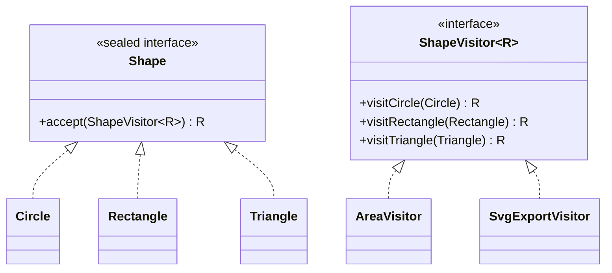

# Visitor

> 🇹🇷 [Türkçe](../../tr/behavioral/visitor.md) · **Category:** Behavioral · **Code:** [`behavioral/visitor`](../../../src/main/java/designpatterns/behavioral/visitor)

## Intent

Represent an **operation to be performed on the elements of an object structure**. Visitor lets
you define a new operation without changing the classes of the elements on which it operates.

## Problem

A drawing app has circles, rectangles and triangles. Today we need area calculation, tomorrow SVG
export, next week JSON export and bounding box calculation. Adding a method to every shape class for
every new operation pollutes the shapes with unrelated concerns.

## Solution

Put each operation into a **visitor** class with one `visitX` method per element type. Elements
only have one method, `accept(visitor)`, which calls the right `visitX`. This trick is called
**double dispatch**: the executed method depends on both the visitor type and the element type.



| Role | Class |
|---|---|
| Visitor | [`ShapeVisitor`](../../../src/main/java/designpatterns/behavioral/visitor/ShapeVisitor.java) |
| Concrete visitors | [`AreaVisitor`](../../../src/main/java/designpatterns/behavioral/visitor/AreaVisitor.java), [`SvgExportVisitor`](../../../src/main/java/designpatterns/behavioral/visitor/SvgExportVisitor.java) |
| Element | [`Shape`](../../../src/main/java/designpatterns/behavioral/visitor/Shape.java) |
| Concrete elements | [`Circle`](../../../src/main/java/designpatterns/behavioral/visitor/Circle.java), [`Rectangle`](../../../src/main/java/designpatterns/behavioral/visitor/Rectangle.java), [`Triangle`](../../../src/main/java/designpatterns/behavioral/visitor/Triangle.java) |

```java
// Circle
public <R> R accept(ShapeVisitor<R> visitor) {
    return visitor.visitCircle(this);   // second dispatch
}
```

Demo: [`VisitorDemo.java`](../../../src/main/java/designpatterns/behavioral/visitor/VisitorDemo.java)

## Modern Java alternative

With **sealed interfaces** and **pattern matching for switch** (Java 21) you can often skip the
`accept` boilerplate. The compiler still checks that every type is handled:

```java
double perimeter = switch (shape) {
    case Circle c    -> 2 * Math.PI * c.radius();
    case Rectangle r -> 2 * (r.width() + r.height());
    case Triangle t  -> t.base() + t.height() + Math.hypot(t.base(), t.height());
};
```

## When to use

- You need many unrelated operations on a stable set of element classes (ASTs, documents, shapes).
- The element hierarchy rarely changes but new operations are added often.

## Pros and cons

| ✅ Pros | ❌ Cons |
|---|---|
| New operations without changing elements (Open/Closed) | Adding a new **element** type means changing every visitor |
| Related behaviour grouped in one class | Visitors may need access to private fields of elements |
| Can accumulate state while traversing | More complex than a simple method |

## Real world usage

- `java.nio.file.FileVisitor` with `Files.walkFileTree()`
- `javax.lang.model.element.ElementVisitor` (annotation processing)
- Compilers, ASM bytecode library (`ClassVisitor`), JSqlParser

## Related patterns

- Often used on a **Composite** structure, together with an **Iterator**.
- **Interpreter** ASTs commonly use visitors for operations.
- **Command** – a visitor is like a more powerful command that can work on different object types.
