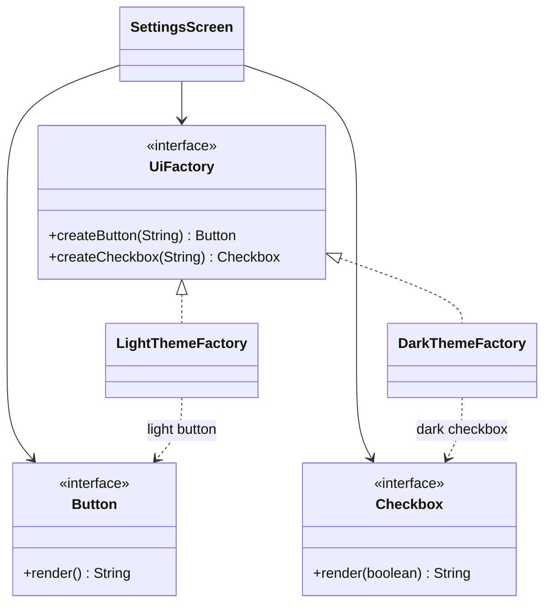

# Abstract Factory

> 🇹🇷 [Türkçe](../../tr/creational/abstract-factory.md) · **Category:** Creational · **Code:** [`creational/abstractfactory`](../../../src/main/java/designpatterns/creational/abstractfactory)

## Intent

Provide an interface for creating **families of related or dependent objects** without specifying
their concrete classes.

## Problem

A UI has buttons and checkboxes, and two themes: light and dark. A dark button next to a light
checkbox looks broken. If the screen code calls `new DarkButton()` and `new LightCheckbox()`
directly, nothing prevents this mix, and adding a third theme means editing every screen.

## Solution

Declare an interface with one creation method per product (`createButton`, `createCheckbox`).
Each theme implements the interface and creates only its own products. The client receives a
factory and never mentions a concrete theme class, so the products are always consistent.



| Role | Class |
|---|---|
| Abstract factory | [`UiFactory`](../../../src/main/java/designpatterns/creational/abstractfactory/UiFactory.java) |
| Concrete factories | [`LightThemeFactory`](../../../src/main/java/designpatterns/creational/abstractfactory/LightThemeFactory.java), [`DarkThemeFactory`](../../../src/main/java/designpatterns/creational/abstractfactory/DarkThemeFactory.java) |
| Abstract products | [`Button`](../../../src/main/java/designpatterns/creational/abstractfactory/Button.java), [`Checkbox`](../../../src/main/java/designpatterns/creational/abstractfactory/Checkbox.java) |
| Client | [`SettingsScreen`](../../../src/main/java/designpatterns/creational/abstractfactory/SettingsScreen.java) |

```java
UiFactory factory = darkMode ? new DarkThemeFactory() : new LightThemeFactory();
SettingsScreen screen = new SettingsScreen(factory);   // never knows the theme
```

Since `Button` and `Checkbox` have a single abstract method, the concrete products are written as
lambdas in this example. In a real project they would usually be full classes.

Demo: [`AbstractFactoryDemo.java`](../../../src/main/java/designpatterns/creational/abstractfactory/AbstractFactoryDemo.java)

## When to use

- The code must work with several families of related products (themes, database vendors,
  operating systems, cloud providers) and must not depend on their concrete classes.
- You want to guarantee that products from different families are never mixed.

## Pros and cons

| ✅ Pros | ❌ Cons |
|---|---|
| Products of a family are guaranteed to be compatible | Adding a **new product type** (e.g. `Slider`) means changing every factory |
| Concrete classes are isolated from the client | Many interfaces and classes |
| Switching the whole family is a one line change | |

## Real world usage

- `javax.xml.parsers.DocumentBuilderFactory`, `javax.xml.transform.TransformerFactory`
- JDBC: a `Connection` creates matching `Statement`, `PreparedStatement`, `Blob`... for the same driver
- Swing pluggable look-and-feel (`UIManager`)

## Related patterns

- Concrete factories are often **Singletons** and are usually implemented with **Factory Methods**.
- **Builder** focuses on constructing one complex object step by step; Abstract Factory returns
  the product immediately.
- Abstract Factory can be an alternative to **Facade** for hiding platform specific classes.
