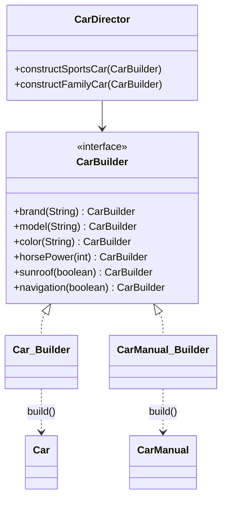

# Builder

> 🇹🇷 [Türkçe](../../tr/creational/builder.md) · **Category:** Creational · **Code:** [`creational/builder`](../../../src/main/java/designpatterns/creational/builder)

## Intent

Separate the construction of a complex object from its representation so that **the same
construction process can create different representations**.

## Problem

A car order has required fields (brand, model) and many optional ones (color, horse power,
sunroof, navigation...). The usual solutions are both bad:

- *Telescoping constructors*: `new Car("Audi", "A4", "Red", 150, true, false)` – what is `true`?
- *JavaBeans setters*: the object is mutable and can be used while half initialized.

## Solution

Move the construction into a separate **builder** object with one method per step. Each method
returns the builder, so calls can be chained. `build()` validates everything and returns an
**immutable** object. A **director** can store well known step sequences (sports car, family
car) and work with *any* builder.



| Role | Class |
|---|---|
| Builder | [`CarBuilder`](../../../src/main/java/designpatterns/creational/builder/CarBuilder.java) |
| Concrete builders | [`Car.Builder`](../../../src/main/java/designpatterns/creational/builder/Car.java), [`CarManual.Builder`](../../../src/main/java/designpatterns/creational/builder/CarManual.java) |
| Products | `Car` (immutable), `CarManual` (record) |
| Director | [`CarDirector`](../../../src/main/java/designpatterns/creational/builder/CarDirector.java) |

```java
Car car = Car.builder()
        .brand("BMW")
        .model("Z4")
        .color("Blue")
        .horsePower(340)
        .build();                       // validates required fields

CarManual.Builder manual = CarManual.builder();
new CarDirector().constructSportsCar(manual); // same steps, different product
```

Demo: [`BuilderDemo.java`](../../../src/main/java/designpatterns/creational/builder/BuilderDemo.java)

Before / after: [refactoring example](../refactoring.md#builder)

## Two flavours of Builder

1. **GoF Builder** – director + builder interface + several builders producing different
   representations (`Car` and `CarManual` here).
2. **Fluent / Effective Java Builder** – a static nested `Builder` class used to avoid
   telescoping constructors. This is what you see most often in Java code (and what Lombok's
   `@Builder` generates).

## When to use

- Objects with many optional parameters or with a complex, multi-step creation.
- You need immutable objects but don't want huge constructors.
- The same steps should produce different representations.

## Pros and cons

| ✅ Pros | ❌ Cons |
|---|---|
| Readable, self documenting creation code | More code (one extra class per product) |
| Immutable products, validation in one place | The builder duplicates the fields of the product |
| Step by step / deferred construction | |

## Real world usage

- `StringBuilder`, `java.util.stream.Stream.builder()`
- `java.net.http.HttpRequest.newBuilder()`, `HttpClient.newBuilder()`
- `Locale.Builder`, `ProcessBuilder`
- Lombok `@Builder`, Spring `UriComponentsBuilder`, `ResponseEntity.ok().body(...)`

## Related patterns

- **Abstract Factory** returns a product immediately; Builder builds it step by step.
- **Composite** trees are often created with builders.
- Builders can be **Singletons** or created via **Prototype**.
