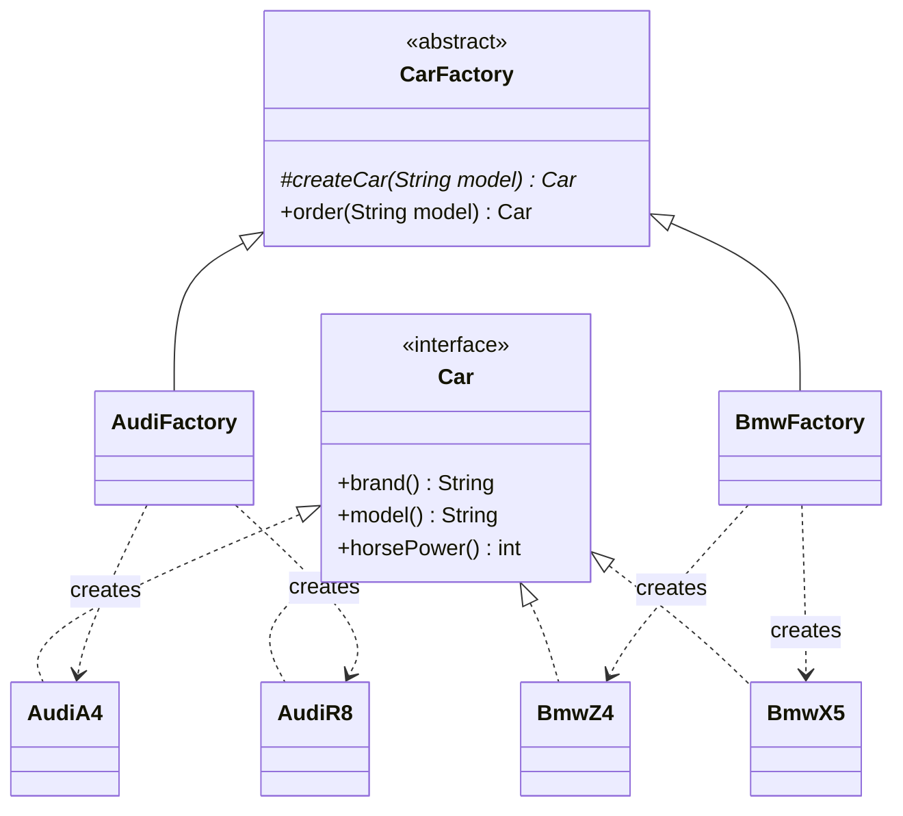

# Factory Method

> 🇹🇷 [Türkçe](../../tr/creational/factory-method.md) · **Category:** Creational · **Code:** [`creational/factorymethod`](../../../src/main/java/designpatterns/creational/factorymethod)

## Intent

Define an interface for creating an object, but **let subclasses decide which class to
instantiate**. Factory Method lets a class defer instantiation to subclasses.

## Problem

A car factory has a production process (create → quality check → register). The process is the
same for every brand, only the *created car* changes. Writing `if (brand.equals("Audi")) ...`
inside the process means you must edit tested code every time a new brand arrives
(Open/Closed Principle is violated).

## Solution

Move the `new` call into a separate, overridable method: the **factory method**. The base class
contains the shared logic and works only with the `Car` interface; each subclass overrides the
factory method and returns its own concrete car.



| Role | Class |
|---|---|
| Product | [`Car`](../../../src/main/java/designpatterns/creational/factorymethod/Car.java) |
| Concrete products | `AudiA4`, `AudiR8`, `BmwZ4`, `BmwX5` (records) |
| Creator | [`CarFactory`](../../../src/main/java/designpatterns/creational/factorymethod/CarFactory.java) |
| Concrete creators | [`AudiFactory`](../../../src/main/java/designpatterns/creational/factorymethod/AudiFactory.java), [`BmwFactory`](../../../src/main/java/designpatterns/creational/factorymethod/BmwFactory.java) |

```java
public abstract class CarFactory {
    protected abstract Car createCar(String model);   // factory method

    public final Car order(String model) {             // business logic
        Car car = createCar(model);
        qualityCheck(car);
        producedCars.add(car);
        return car;
    }
}
```

Demo: [`FactoryMethodDemo.java`](../../../src/main/java/designpatterns/creational/factorymethod/FactoryMethodDemo.java)

## Simple Factory vs Factory Method

A **simple factory** (`CarFactory.create("audi", "A4")` with a `switch` inside a static method) is
not a GoF pattern; it is just an encapsulated `switch`. It is fine for small cases, but adding a new
product still means editing that method. **Factory Method** uses inheritance instead: adding a brand
means adding a new subclass, without touching existing code.

## When to use

- You do not know beforehand the exact types your code will work with.
- You want to let users of your library/framework extend its internal components.
- You want to reuse existing objects (pooling/caching) instead of always creating new ones.

## Pros and cons

| ✅ Pros | ❌ Cons |
|---|---|
| Loose coupling between creator and concrete products | One subclass per product family, the hierarchy can grow |
| Open/Closed: new products without changing client code | Can be overkill for simple cases |
| Creation code in one place (Single Responsibility) | |

## Real world usage

- `java.util.Calendar.getInstance()`, `NumberFormat.getInstance()`
- `java.util.Collection.iterator()` – every collection returns its own iterator type
- `java.nio.charset.Charset.forName()`
- Spring: `FactoryBean#getObject()`

## Related patterns

- **Abstract Factory** is often implemented with several factory methods.
- **Template Method**: `order()` is a template method, `createCar()` is one of its steps.
- **Prototype** does not require subclassing but requires an initialized object to copy.

## Interview questions

- *Factory Method vs Abstract Factory?* Factory Method creates **one** product through
  inheritance; Abstract Factory creates a **family** of related products through composition
  (you pass a factory object to the client).
