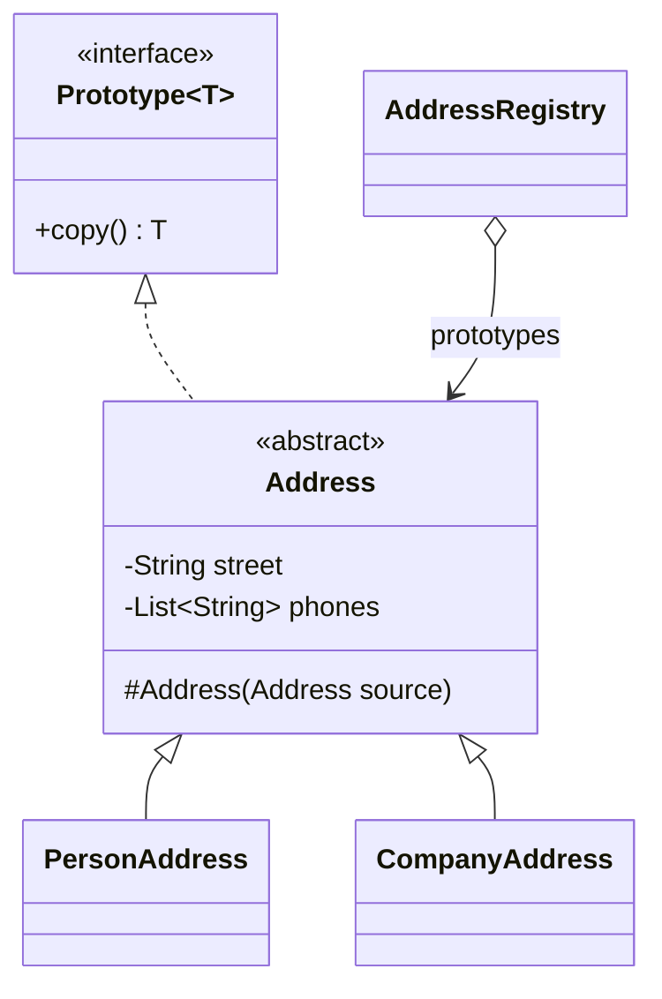

# Prototype

> 🇹🇷 [Türkçe](../../tr/creational/prototype.md) · **Category:** Creational · **Code:** [`creational/prototype`](../../../src/main/java/designpatterns/creational/prototype)

## Intent

Specify the kinds of objects to create using a **prototypical instance**, and create new objects
by **copying** this prototype.

## Problem

You want an exact copy of an object. Copying it from the outside is not always possible: some
fields are private, and the client may know only an interface (`Address`), not the concrete class
(`PersonAddress` or `CompanyAddress`). Creating a new object from scratch may also be expensive
(database queries, parsing, heavy configuration).

## Solution

Let the object copy itself. Every prototype implements a `copy()` method; the client calls it
without knowing the concrete type. A **registry** can keep pre-configured prototypes and return
copies on demand.



| Role | Class |
|---|---|
| Prototype | [`Prototype`](../../../src/main/java/designpatterns/creational/prototype/Prototype.java) |
| Concrete prototypes | [`PersonAddress`](../../../src/main/java/designpatterns/creational/prototype/PersonAddress.java), [`CompanyAddress`](../../../src/main/java/designpatterns/creational/prototype/CompanyAddress.java) |
| Registry | [`AddressRegistry`](../../../src/main/java/designpatterns/creational/prototype/AddressRegistry.java) |

```java
protected Address(Address source) {          // copy constructor
    this.street = source.street;
    this.phones = new ArrayList<>(source.phones); // deep copy of the mutable list
}

@Override
public PersonAddress copy() {
    return new PersonAddress(this);
}
```

Demo: [`PrototypeDemo.java`](../../../src/main/java/designpatterns/creational/prototype/PrototypeDemo.java)

## Shallow copy vs deep copy

- **Shallow copy** copies field values. Reference fields still point to the *same* objects
  (both addresses would share one phone list).
- **Deep copy** also copies the referenced mutable objects. Immutable objects (`String`, records,
  `List.of`) can safely be shared.

## Why not `Cloneable`?

The 2016 version of this repo declared its own empty `Cloneable` interface and used
`super.clone()`. `java.lang.Cloneable` is widely considered broken (Effective Java, Item 13):
it has no `clone()` method, `Object.clone()` is protected, throws a checked exception, makes
shallow copies and does not work with `final` fields. A **copy constructor** or a **copy factory
method** is simpler and safer.

## When to use

- Creating an object is expensive and similar objects are needed.
- The code should not depend on the concrete classes of the objects it copies.
- You want to reduce subclasses that only differ in their initial configuration.

## Pros and cons

| ✅ Pros | ❌ Cons |
|---|---|
| Copy objects without coupling to concrete classes | Deep copying object graphs with cycles is tricky |
| Avoid repeated, expensive initialization | Every class in the hierarchy must implement copying |
| Pre-built configurations in a registry | |

## Real world usage

- `Object.clone()`, `ArrayList(Collection)` copy constructors
- Spring `@Scope("prototype")` beans (a new instance per request – the name comes from this pattern)
- JavaScript's prototype based inheritance

## Related patterns

- **Abstract Factory** can store prototypes and clone them instead of using `new`.
- **Memento** can sometimes be implemented with Prototype when the state is simple.
- **Composite** and **Decorator** heavy designs benefit from Prototype to copy complex structures.
