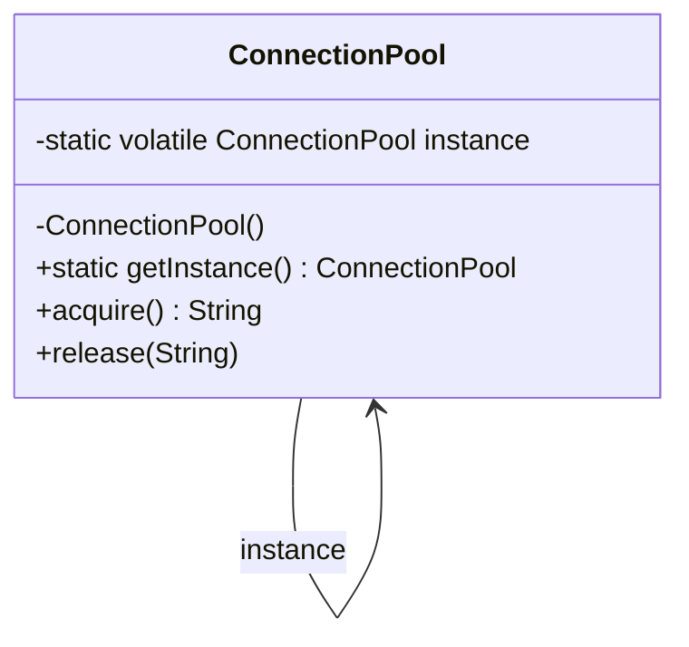

# Singleton

> 🇹🇷 [Türkçe](../../tr/creational/singleton.md) · **Category:** Creational · **Code:** [`creational/singleton`](../../../src/main/java/designpatterns/creational/singleton)

## Intent

Ensure a class has **only one instance** and provide a **global access point** to it.

## Problem

Some objects must exist exactly once in an application: a connection pool, a configuration
object, a cache, a logger. If every part of the code calls `new`, you end up with many pools,
each opening its own expensive connections, and with inconsistent state.

## Solution

1. Make the constructor `private` so nobody can call `new` from outside.
2. Keep the single instance in a `static` field.
3. Expose a `static` method (`getInstance()`) that creates the instance on the first call
   and returns the same object afterwards.



## Implementations in this repo

| Class | Technique | Lazy | Thread safe | Notes |
|---|---|---|---|---|
| [`ConnectionPool`](../../../src/main/java/designpatterns/creational/singleton/ConnectionPool.java) | Double-checked locking | ✅ | ✅ | The field **must** be `volatile` |
| [`AppSettings`](../../../src/main/java/designpatterns/creational/singleton/AppSettings.java) | Holder idiom (Bill Pugh) | ✅ | ✅ | No locking, JVM guarantees safety |
| [`IdGenerator`](../../../src/main/java/designpatterns/creational/singleton/IdGenerator.java) | `enum` | ❌ | ✅ | Safe against reflection and serialization |

```java
public static ConnectionPool getInstance() {
    ConnectionPool result = instance;
    if (result == null) {                       // 1st check, no lock
        synchronized (ConnectionPool.class) {
            result = instance;
            if (result == null) {               // 2nd check, with lock
                instance = result = new ConnectionPool();
            }
        }
    }
    return result;
}
```

> ⚠️ The original version of this repository (2016) used double-checked locking **without**
> `volatile`. Without it, the JVM may reorder instructions and another thread can see a
> reference to an object whose constructor has not finished yet.

Demo: [`SingletonDemo.java`](../../../src/main/java/designpatterns/creational/singleton/SingletonDemo.java)

## When to use

- Exactly one instance must exist and be shared (pool, registry, configuration).
- The instance must be created lazily, only when it is really needed.

## Pros and cons

| ✅ Pros | ❌ Cons |
|---|---|
| Guarantees a single instance | Global state, hidden dependencies |
| Lazy initialization is possible | Hard to unit test / mock |
| Global access point | Violates the Single Responsibility Principle (manages its own lifecycle) |
| | Needs extra care in multithreaded code |

## Real world usage

- `java.lang.Runtime.getRuntime()`
- `java.awt.Desktop.getDesktop()`
- Spring beans are singletons **per container** by default (`@Scope("singleton")`), but they are
  created by the container, not by a static method. This is usually the better choice: you get one
  instance without the testing problems.

## Related patterns

- **Abstract Factory**, **Builder** and **Prototype** are often implemented as singletons.
- **Facade** objects are frequently singletons because one facade is enough.
- **Flyweight** looks similar but has many shared instances, one per intrinsic state.

## Interview questions

- *Why is `volatile` needed in double-checked locking?* Object creation is not atomic
  (allocate → initialize → assign). Without `volatile` the assignment may be visible before
  initialization finishes.
- *How can a singleton be broken?* Reflection (`setAccessible(true)`), serialization
  (fix with `readResolve()`), cloning, and multiple class loaders. The `enum` version is immune
  to the first three.
- *Singleton vs static class?* A singleton can implement interfaces, be passed as a parameter,
  be lazily created and be replaced in tests; a utility class with static methods cannot.
