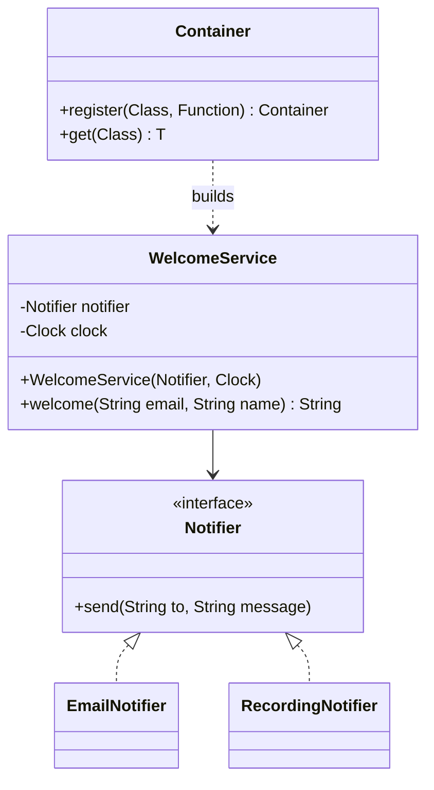

# Dependency Injection

> 🇹🇷 [Türkçe](../../tr/enterprise/dependency-injection.md) · **Category:** Enterprise · **Code:** [`enterprise/dependencyinjection`](../../../src/main/java/designpatterns/enterprise/dependencyinjection)

## Intent

An object **receives the objects it depends on** from the outside instead of creating or looking
them up itself. Who builds the object graph (your `main`, Spring, Guice...) is decided in one place,
the **composition root**.

## Problem

```java
public class WelcomeService {
    private final EmailNotifier notifier = new EmailNotifier();   // hard-wired
    public String welcome(String email, String name) {
        int hour = LocalTime.now().getHour();                     // hidden dependency on the system clock
        ...
    }
}
```

- You can't test it without sending real e-mails.
- You can't test "good evening" unless you run the test in the evening.
- Switching to SMS means editing this class (violates Open/Closed and Dependency Inversion).

## Solution

Depend on abstractions (`Notifier`, `java.time.Clock`) and take them **through the constructor**.
Something outside the class decides which implementations to pass.



| Role | Class |
|---|---|
| Service (client) | [`WelcomeService`](../../../src/main/java/designpatterns/enterprise/dependencyinjection/WelcomeService.java) |
| Abstraction | [`Notifier`](../../../src/main/java/designpatterns/enterprise/dependencyinjection/Notifier.java), `java.time.Clock` |
| Implementations | [`EmailNotifier`](../../../src/main/java/designpatterns/enterprise/dependencyinjection/EmailNotifier.java), [`RecordingNotifier`](../../../src/main/java/designpatterns/enterprise/dependencyinjection/RecordingNotifier.java) (test double) |
| Injector | [`Container`](../../../src/main/java/designpatterns/enterprise/dependencyinjection/Container.java) – a 30 line IoC container, or plain `main` |

```java
var service = new WelcomeService(new RecordingNotifier(), Clock.fixed(evening, UTC));
service.welcome("ayse@example.com", "Ayşe");   // "Good evening, Ayşe!" – deterministic, nothing sent
```

Demo: [`DependencyInjectionDemo.java`](../../../src/main/java/designpatterns/enterprise/dependencyinjection/DependencyInjectionDemo.java)

### Types of injection

| Type | How | Notes |
|---|---|---|
| **Constructor** | `new Service(dep)` | Preferred. Dependencies are mandatory, fields can be `final`, the object is never half-built. |
| Setter | `service.setDep(dep)` | For optional dependencies. Object can be used before it is ready. |
| Field | `@Autowired private Dep dep;` | Short, but hides dependencies and needs a framework or reflection in tests. Avoid. |

## When to use

- Almost always for services that talk to the outside world (DB, HTTP, mail, time, randomness).
- When you want to swap implementations per environment (test, dev, prod).
- Not needed for value objects, records, or pure helper functions.

## Pros and cons

| ✅ Pros | ❌ Cons |
|---|---|
| Testable: pass fakes / mocks | More types and wiring code |
| Loose coupling, Open/Closed | Framework "magic" can make the flow hard to follow |
| Configuration in one place | Runtime errors if the container can't resolve a dependency |

## Real world usage

- Spring (`@Component` + constructor injection), Jakarta CDI (`@Inject`), Google Guice, Dagger, Micronaut
- `java.util.ServiceLoader` is the JDK's lightweight service locator / plug-in mechanism

## Related patterns

- **Service Locator** – the opposite direction: the class *asks* a registry for its dependencies. It hides
  dependencies, so DI is usually preferred (see the [anti-patterns](../anti-patterns.md) page).
- **Factory / Abstract Factory** – a container is basically a big, configurable factory.
- **Strategy** – the injected dependency is very often a strategy.
- **Singleton** – containers give "singleton scope" without the static Singleton pattern.

## Interview questions

1. *What is the difference between Dependency Injection, Dependency Inversion and Inversion of Control?*
   – DIP is a design principle (depend on abstractions). IoC is the general idea of a framework calling
   your code. DI is one technique to implement IoC: dependencies are given to the object.
2. *Why is constructor injection recommended in Spring?* – immutability, mandatory dependencies, easy tests
   without Spring, and too many constructor parameters are a visible smell.
