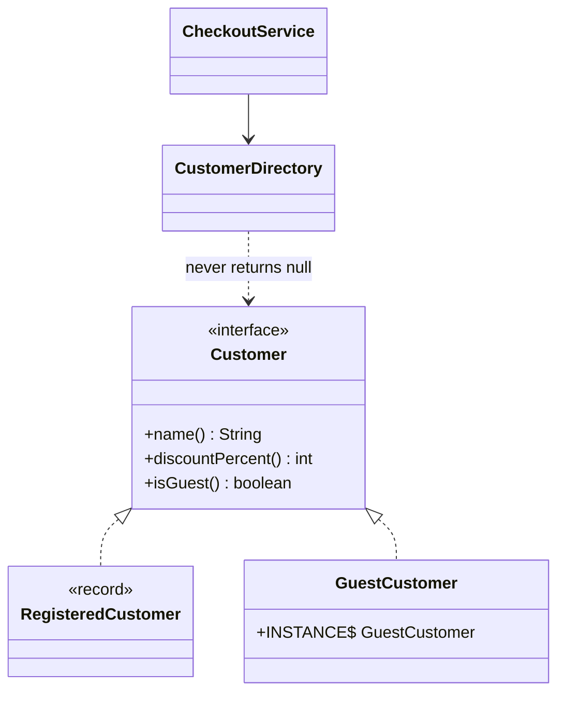

# Null Object

> 🇹🇷 [Türkçe](../../tr/enterprise/null-object.md) · **Category:** Behavioral (Bobby Woolf, *PLoPD 3*) · **Code:** [`enterprise/nullobject`](../../../src/main/java/designpatterns/enterprise/nullobject)

## Intent

Provide an object with **neutral, do-nothing behaviour** as a substitute for `null`, so clients don't need
to check for null.

## Problem

```java
Customer customer = directory.find(id);
String name = customer != null ? customer.name() : "Guest";
int discount = customer != null ? customer.discountPercent() : 0;
if (customer != null && customer.isVip()) { ... }
```

Null checks are repeated everywhere, and forgetting one means a `NullPointerException` in production.

## Solution

Create an implementation of the interface that represents "nothing": `GuestCustomer` has the name
"Guest" and 0% discount. The lookup returns it instead of `null`.



| Role | Class |
|---|---|
| Abstraction | [`Customer`](../../../src/main/java/designpatterns/enterprise/nullobject/Customer.java) |
| Real object | [`RegisteredCustomer`](../../../src/main/java/designpatterns/enterprise/nullobject/RegisteredCustomer.java) |
| Null object | [`GuestCustomer`](../../../src/main/java/designpatterns/enterprise/nullobject/GuestCustomer.java) – stateless, so a single shared instance |
| Client | [`CheckoutService`](../../../src/main/java/designpatterns/enterprise/nullobject/CheckoutService.java) |

Demo: [`NullObjectDemo.java`](../../../src/main/java/designpatterns/enterprise/nullobject/NullObjectDemo.java)

Before / after: [refactoring example](../refactoring.md#null-object)

## Null Object vs `Optional`

| | Null Object | `Optional<T>` |
|---|---|---|
| Message | "absence has a sensible default behaviour" | "absence must be handled by the caller" |
| Caller code | unchanged, no checks | `orElse`, `map`, `ifPresent`... |
| Good for | loggers, listeners, guest users, empty strategies | return values of finders where "not found" matters |

Don't use a null object when "not found" is an error the caller must notice – it would hide bugs.

## Pros and cons

| ✅ Pros | ❌ Cons |
|---|---|
| Removes repetitive null checks | Can hide real errors if misused |
| Polymorphism instead of conditionals | One more class per interface |

## Real world usage

- `Collections.emptyList()`, `Map.of()`, `InputStream.nullInputStream()`, `OutputStream.nullOutputStream()`,
  `Writer.nullWriter()` (Java 11+)
- SLF4J `NOPLogger`, Spring `NoOpCache`, `NoOpPasswordEncoder`

## Related patterns

- **Strategy** – a "do nothing" strategy (`DiscountStrategy.none()`) is a null object.
- **Singleton** – null objects are stateless, so one instance is shared.
- **Special Case** (Fowler) – the generalization: `UnknownCustomer`, `MissingAddress`...
