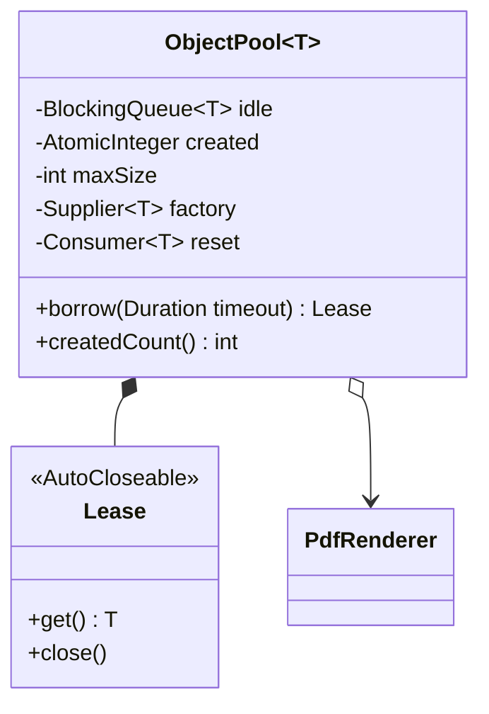

# Object Pool

> 🇹🇷 [Türkçe](../../tr/enterprise/object-pool.md) · **Category:** Creational · **Code:** [`enterprise/objectpool`](../../../src/main/java/designpatterns/enterprise/objectpool)

## Intent

**Reuse** a limited number of objects that are **expensive to create**, instead of creating and destroying
them for each request. Clients borrow an object and give it back when they are done.

## Problem

Creating a database connection, a TLS session or a PDF rendering engine takes hundreds of milliseconds and
lots of memory. Creating one per request is slow, and with a traffic spike thousands of them would bring
down the database or the JVM.

## Solution

The pool creates objects lazily up to `maxSize`. `borrow` returns an idle object, creates a new one if the
limit allows, or **waits** (with a timeout). Returning an object **resets** its state and puts it back.
Wrapping the borrowed object in an `AutoCloseable` lease makes returning it impossible to forget.



| Role | Class |
|---|---|
| Pool | [`ObjectPool<T>`](../../../src/main/java/designpatterns/enterprise/objectpool/ObjectPool.java) |
| Reusable object | [`PdfRenderer`](../../../src/main/java/designpatterns/enterprise/objectpool/PdfRenderer.java) |
| Client | try-with-resources block |

```java
try (var lease = pool.borrow(Duration.ofSeconds(1))) {
    lease.get().render("invoice.pdf");
}   // automatically back in the pool
```

In the demo 50 virtual threads share **3** renderers.

Demo: [`ObjectPoolDemo.java`](../../../src/main/java/designpatterns/enterprise/objectpool/ObjectPoolDemo.java)

## When to use

- Objects are expensive to create **and** you need to limit how many exist (connections, sockets, native resources).
- **Not** for ordinary objects: the JVM allocates and collects short-lived objects very fast; pooling them
  makes things slower and causes bugs (state leaking between users).
- With virtual threads, *threads* no longer need pooling; limit concurrency with a `Semaphore` instead.

## Pros and cons

| ✅ Pros | ❌ Cons |
|---|---|
| Avoids repeated expensive creation | Forgetting to return an object leaks it |
| Puts an upper bound on resource usage | State must be reset; dirty objects cause hard bugs |
| Smooths traffic spikes (callers wait) | Thread safety and sizing are hard to get right |

## Real world usage

- Database connection pools: **HikariCP** (Spring Boot default), Apache DBCP, c3p0
- `ThreadPoolExecutor` / `Executors.newFixedThreadPool` – a pool of threads
- Apache Commons Pool, Netty `PooledByteBufAllocator`, HTTP client connection pools

## Related patterns

- **Singleton** – the pool itself is usually a single shared instance.
- **Flyweight** – also shares objects, but flyweights are immutable and shared *simultaneously*; pooled
  objects are mutable and used by *one client at a time*.
- **Factory Method** – the pool uses a factory (`Supplier<T>`) to create objects.
