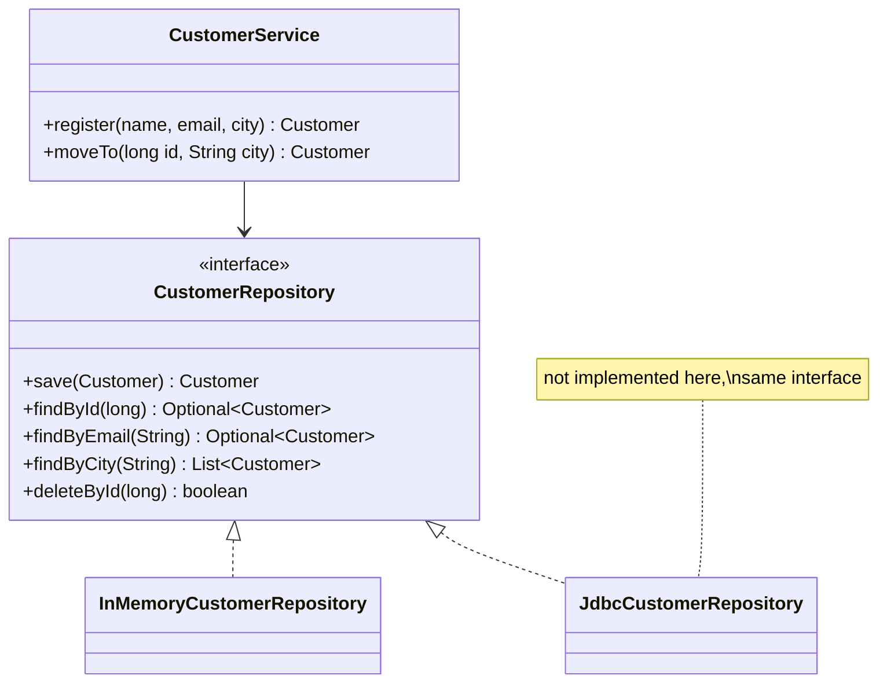

# Repository

> 🇹🇷 [Türkçe](../../tr/enterprise/repository.md) · **Category:** Enterprise (Martin Fowler, *PoEAA* / Eric Evans, *DDD*) · **Code:** [`enterprise/repository`](../../../src/main/java/designpatterns/enterprise/repository)

## Intent

Mediate between the domain and data mapping layers using a **collection-like interface** for
accessing domain objects. Business code says *"give me the customers in Istanbul"*, not *"run this SQL"*.

## Problem

SQL strings, JDBC code, ORM calls and caching logic spread through services. Changing the storage
(PostgreSQL → MongoDB, adding a cache) touches business code, and testing business rules needs a database.

## Solution

Define an interface in domain terms (`save`, `findById`, `findByCity`). Business services depend only on
this interface; one or more classes implement it for a specific storage technology.

| Role | Class |
|---|---|
| Domain object | [`Customer`](../../../src/main/java/designpatterns/enterprise/repository/Customer.java) |
| Repository | [`CustomerRepository`](../../../src/main/java/designpatterns/enterprise/repository/CustomerRepository.java) |
| Implementation | [`InMemoryCustomerRepository`](../../../src/main/java/designpatterns/enterprise/repository/InMemoryCustomerRepository.java) |
| Client | [`CustomerService`](../../../src/main/java/designpatterns/enterprise/repository/CustomerService.java) |

Demo: [`RepositoryDemo.java`](../../../src/main/java/designpatterns/enterprise/repository/RepositoryDemo.java)

## When to use

- Applications with real business logic (DDD, layered or hexagonal architecture).
- You want to unit test the domain with an in-memory repository.
- Usually **one repository per aggregate root** (`OrderRepository`, not `OrderLineRepository`).

## Pros and cons

| ✅ Pros | ❌ Cons |
|---|---|
| Business code independent of storage | Another layer for simple CRUD apps |
| Easy to test with in-memory fakes | Generic repositories (`Repository<T>` with 40 methods) leak storage details |
| Central place for queries and caching | Hiding the database completely can lead to N+1 and slow queries |

## Real world usage

- Spring Data: `interface CustomerRepository extends JpaRepository<Customer, Long>` – the implementation
  is generated from method names like `findByCity`.
- Jakarta Data (`@Repository`), Micronaut Data, Quarkus Panache

## Related patterns

- **DAO** – table/technology oriented (`CustomerDao.insert`). Repository is domain oriented and closer to a
  collection. In practice the names are often mixed.
- **Specification** – pass a specification instead of adding `findByXAndYAndZ` methods.
- **Unit of Work** – tracks changes and commits them together (JPA `EntityManager`).
- **Dependency Injection** – the service receives the repository.
