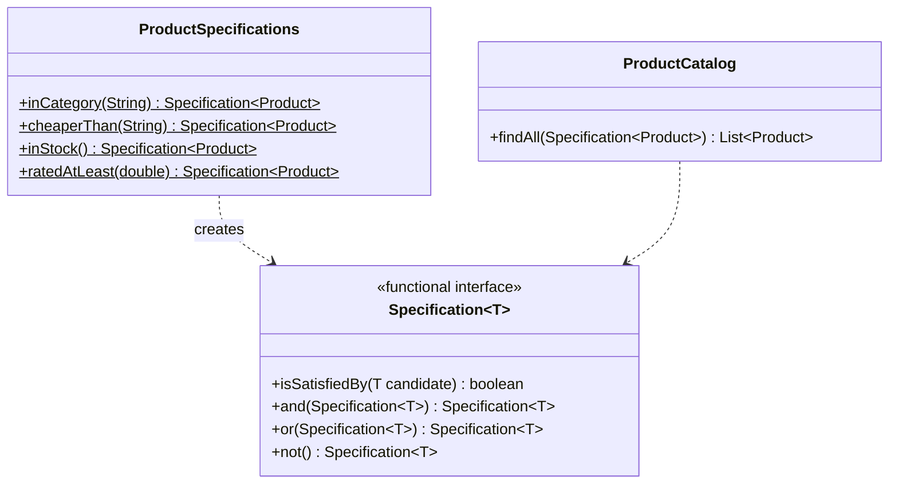

# Specification

> 🇹🇷 [Türkçe](../../tr/enterprise/specification.md) · **Category:** Enterprise (Eric Evans & Martin Fowler) · **Code:** [`enterprise/specification`](../../../src/main/java/designpatterns/enterprise/specification)

## Intent

Encapsulate a **business rule** in an object that answers *"does this candidate satisfy me?"* and can be
**combined** with other rules using `and`, `or` and `not`.

## Problem

Product search has filters: category, price, stock, rating... A repository ends up with methods like
`findByCategoryAndPriceLessThanAndStockGreaterThan`, and the same rule ("is in stock") is copied into
validation, search and reporting code.

## Solution

Each rule is a small object (here a functional interface, so a lambda). Default methods build composite
rules. One generic finder accepts any specification.



| Role | Class |
|---|---|
| Specification | [`Specification<T>`](../../../src/main/java/designpatterns/enterprise/specification/Specification.java) |
| Concrete specifications | [`ProductSpecifications`](../../../src/main/java/designpatterns/enterprise/specification/ProductSpecifications.java) |
| Composite specifications | `and` / `or` / `not` default methods |
| Client | [`ProductCatalog`](../../../src/main/java/designpatterns/enterprise/specification/ProductCatalog.java) |

```java
var cheapElectronics = inCategory("electronics").and(cheaperThan("500"));
var soldOutBooks     = inCategory("books").and(inStock().not());
catalog.findAll(cheapElectronics);
```

Demo: [`SpecificationDemo.java`](../../../src/main/java/designpatterns/enterprise/specification/SpecificationDemo.java)

## When to use

- Many combinable filtering or validation rules.
- The same rule is used for in-memory checks, database queries and validation.
- For simple, fixed filters a plain `Predicate` or a finder method is enough.

## Pros and cons

| ✅ Pros | ❌ Cons |
|---|---|
| Rules have names and are reusable | In-memory filtering doesn't scale; for databases the spec must be translated to a query |
| Combine rules without new methods | Extra abstraction for simple cases |
| Each rule is unit testable | |

## Real world usage

- `java.util.function.Predicate` with `and` / `or` / `negate` is the same idea in the JDK.
- Spring Data JPA `Specification<T>` + `JpaSpecificationExecutor` – rules become SQL `WHERE` clauses.
- QueryDSL / JPA Criteria predicates

## Related patterns

- **Composite** – `and`/`or`/`not` build a tree of specifications.
- **Interpreter** – a specification tree is a tiny boolean language.
- **Repository** – accepts specifications instead of many finder methods.
- **Strategy** – a specification is a strategy that returns a boolean.
