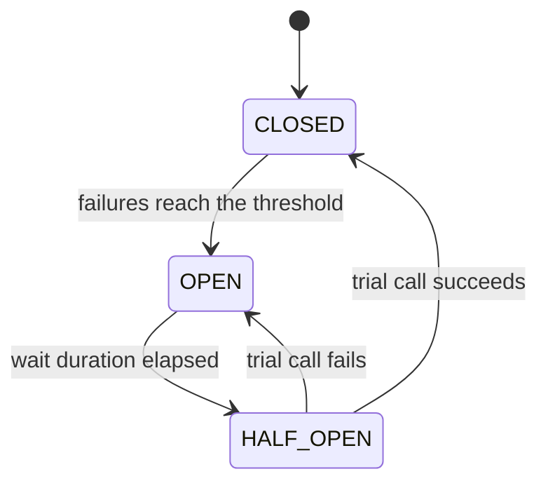

# Circuit Breaker

> 🇹🇷 [Türkçe](../../tr/microservice/circuit-breaker.md) · **Category:** Microservice / resilience (Michael Nygard, *Release It!*) · **Code:** [`microservice/circuitbreaker`](../../../src/main/java/designpatterns/microservice/circuitbreaker)

## Intent

Stop calling a remote service that keeps failing, **fail fast** for a while, and let it recover; then try
again carefully. Like the electrical fuse in your house.

## Problem

The exchange rate service is down. Every request to our service waits for the 30 second timeout, threads
pile up, our service runs out of resources and goes down too – a **cascading failure**. Meanwhile we keep
hammering the struggling service with retries so it can't recover.

## Solution

Wrap the remote call in a state machine:



- **CLOSED** – normal. Calls pass through; consecutive failures are counted.
- **OPEN** – calls are rejected immediately (`CallNotPermittedException`) or a **fallback** is returned
  (cached value, default, "try later" message). The remote service is not touched.
- **HALF_OPEN** – after the wait, one trial call decides whether to close or open again.

| Role | Class |
|---|---|
| Circuit breaker | [`CircuitBreaker`](../../../src/main/java/designpatterns/microservice/circuitbreaker/CircuitBreaker.java) |
| Protected remote call | [`ExchangeRateClient`](../../../src/main/java/designpatterns/microservice/circuitbreaker/ExchangeRateClient.java) |
| Rejection | [`CallNotPermittedException`](../../../src/main/java/designpatterns/microservice/circuitbreaker/CallNotPermittedException.java) |
| Time source | [`ManualClock`](../../../src/main/java/designpatterns/common/ManualClock.java) – the demo and tests "wait" 30 s instantly |

```java
BigDecimal rate = breaker.call(client::usdToTry, () -> cachedRate);
```

In the demo 6 calls are made while the service is down, but only 3 reach it; the rest are answered
instantly from the fallback.

Demo: [`CircuitBreakerDemo.java`](../../../src/main/java/designpatterns/microservice/circuitbreaker/CircuitBreakerDemo.java)

## When to use

- Every synchronous call to another service, database or third-party API that can be slow or down.
- Combine with **timeouts** (always), **retry with backoff** (for short glitches) and **bulkheads**
  (limit concurrent calls per dependency).

## Pros and cons

| ✅ Pros | ❌ Cons |
|---|---|
| Prevents cascading failures | Thresholds and durations need tuning |
| Gives the failing service time to recover | Fallback logic must make sense for the business |
| Fast response with fallback instead of long timeouts | Per-instance state: each replica opens separately |

## Real world usage

- **Resilience4j** (`@CircuitBreaker(name = "rates", fallbackMethod = "cachedRate")`), Spring Cloud Circuit Breaker
- Netflix Hystrix (retired, the pattern's popularizer), Istio / Envoy outlier detection, Polly (.NET)

## Related patterns

- **Proxy** – a circuit breaker is a proxy in front of the remote service.
- **State** – CLOSED / OPEN / HALF_OPEN is a textbook state machine.
- **Retry, Timeout, Bulkhead, Rate Limiter** – the other resilience patterns usually used together.
