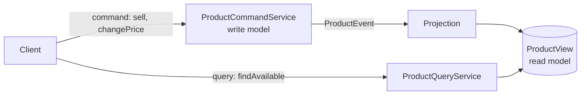

# CQRS (Command Query Responsibility Segregation)

> 🇹🇷 [Türkçe](../../tr/microservice/cqrs.md) · **Category:** Architecture (Greg Young, based on Bertrand Meyer's CQS) · **Code:** [`microservice/cqrs`](../../../src/main/java/designpatterns/microservice/cqrs)

## Intent

Use **different models for writing and reading**. Commands change state and enforce business rules;
queries read from a separate model shaped for the screens, kept up to date by events.

## Problem

One `Product` entity serves everything: validation for updates, product listing pages, search, admin
reports. Reads need joins, denormalized fields and different indexes; writes need consistency and rules.
The model becomes a compromise that is good at neither. Reads are often 100× more frequent than writes,
but both scale together.

## Solution

- **Command side** – validates (`price > 0`, `stock >= 0`), changes the write model, publishes events.
  Commands return nothing (or just an id).
- **Query side** – a *projection* listens to events and keeps `ProductView` rows ready for display
  (`"Wireless mouse – 450.00 TL (sold out)"`). Queries never change state.

| Role | Class |
|---|---|
| Command side / write model | [`ProductCommandService`](../../../src/main/java/designpatterns/microservice/cqrs/ProductCommandService.java) |
| Events | [`ProductEvent`](../../../src/main/java/designpatterns/microservice/cqrs/ProductEvent.java) (sealed interface + records) |
| Projection / query side | [`ProductQueryService`](../../../src/main/java/designpatterns/microservice/cqrs/ProductQueryService.java) |
| Read model | [`ProductView`](../../../src/main/java/designpatterns/microservice/cqrs/ProductView.java) |

The projection uses **pattern matching for `switch`** over the sealed event hierarchy: adding a new event
type without handling it is a compile error.

Demo: [`CqrsDemo.java`](../../../src/main/java/designpatterns/microservice/cqrs/CqrsDemo.java)

## Things to know

- Here events are dispatched synchronously. In production the read model is often in another store
  (Elasticsearch, Redis, a read replica) and updated asynchronously → **eventual consistency**: a user
  may not see their own change for a moment.
- CQRS does **not** require Event Sourcing or microservices; it can be as simple as separate read/write
  classes in one application.

## When to use

- Read and write workloads are very different (scale, shape, storage).
- Complex domain with many screens that need different views of the same data.
- **Not** for simple CRUD: it doubles the model and adds consistency problems.

## Pros and cons

| ✅ Pros | ❌ Cons |
|---|---|
| Each side is optimized and scaled independently | More code and moving parts |
| Simple, fast queries on denormalized data | Eventual consistency between sides |
| Write model focuses on business rules | Projections must be rebuilt when they change |

## Real world usage

- Axon Framework, EventStoreDB, Lagom; Spring Data with separate read repositories
- Read replicas + materialized views in PostgreSQL is "CQRS light"

## Related patterns

- **Event Sourcing** – stores events as the source of truth; projections build read models (often paired with CQRS).
- **Observer** – the projection observes the write side.
- **Transactional Outbox** – publishes the write side's events reliably.
- **Mediator** – libraries like MediatR / Axon route commands and queries to handlers.
