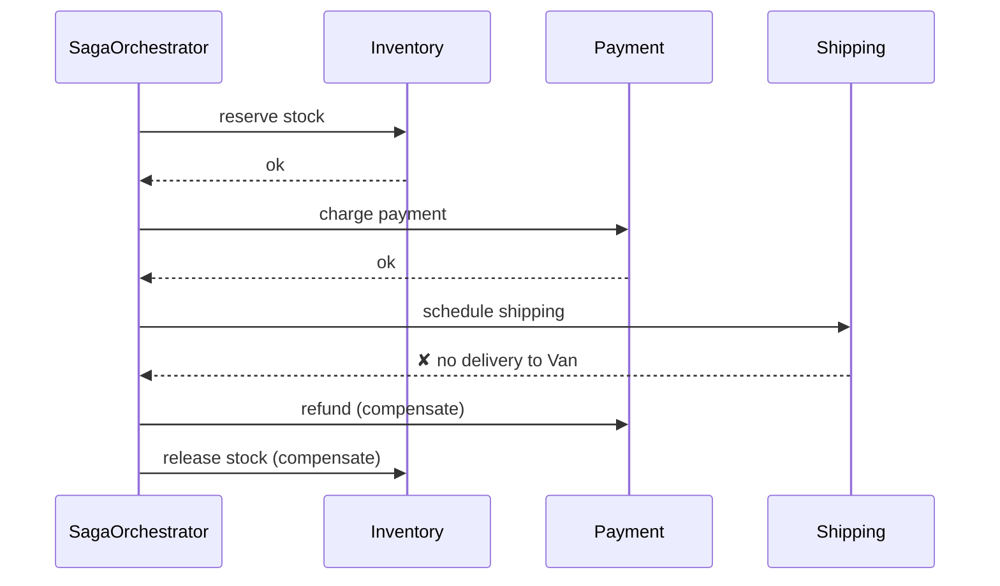

# Saga

> 🇹🇷 [Türkçe](../../tr/microservice/saga.md) · **Category:** Microservice / data consistency (Garcia-Molina & Salem, 1987; Chris Richardson) · **Code:** [`microservice/saga`](../../../src/main/java/designpatterns/microservice/saga)

## Intent

Keep data consistent across services **without a distributed transaction**: split the business transaction
into a sequence of local transactions, and if one fails, run **compensating transactions** that undo the
previous steps.

## Problem

Placing an order needs three services, each with its own database: inventory (reserve stock), payment
(charge the card) and shipping (schedule delivery). There is no single `BEGIN ... COMMIT` across them.
Two-phase commit (2PC) locks resources, needs every participant to support it and doesn't fit
HTTP/messaging-based microservices.

## Solution

Each step has an action and a compensation. The orchestrator runs the actions in order; when one fails,
it runs the compensations of the completed steps **in reverse order**.

| Role | Class |
|---|---|
| Step (action + compensation) | [`SagaStep`](../../../src/main/java/designpatterns/microservice/saga/SagaStep.java) |
| Orchestrator | [`SagaOrchestrator`](../../../src/main/java/designpatterns/microservice/saga/SagaOrchestrator.java) |
| Saga definition | [`PlaceOrderSaga`](../../../src/main/java/designpatterns/microservice/saga/PlaceOrderSaga.java) |
| Participants | [`InventoryService`](../../../src/main/java/designpatterns/microservice/saga/InventoryService.java), [`PaymentService`](../../../src/main/java/designpatterns/microservice/saga/PaymentService.java), [`ShippingService`](../../../src/main/java/designpatterns/microservice/saga/ShippingService.java) |

Demo: [`SagaDemo.java`](../../../src/main/java/designpatterns/microservice/saga/SagaDemo.java)

### Orchestration vs choreography

| | Orchestration (this example) | Choreography |
|---|---|---|
| Who decides the next step | A central orchestrator | Each service reacts to events (`StockReserved` → payment...) |
| Visibility | The flow is in one place | The flow is spread across services |
| Coupling | Orchestrator knows every participant | Services only know events |
| Good for | Complex flows with many steps | Simple flows with 2-3 steps |

## Things to know

- Compensation is a **semantic undo** (refund, cancel), not a rollback; the intermediate state is visible
  to others for a while (no isolation). Use "pending" states (`ORDER_PENDING`) to deal with it.
- Steps and compensations must be **idempotent** and retryable: messages can be delivered twice.
- Some steps can't be compensated (an e-mail was sent). Put them **last** ("pivot" step).

## Pros and cons

| ✅ Pros | ❌ Cons |
|---|---|
| Consistency without 2PC / distributed locks | More complex to design, test and debug |
| Each service keeps its own database | Eventual consistency; no isolation |
| Works over HTTP and messaging | Every step needs a compensation |

## Real world usage

- Temporal, Camunda / Zeebe, Netflix Conductor, AWS Step Functions (orchestration)
- Axon Framework sagas, Eventuate Tram Sagas, Kafka-based choreography

## Related patterns

- **Transactional Outbox** – steps publish their events reliably with it.
- **Command** – each step with its undo is a command with `execute`/`undo`.
- **Memento** – another way to restore a previous state, but only inside one process.
- **CQRS / Event Sourcing** – often used together in event-driven systems.
