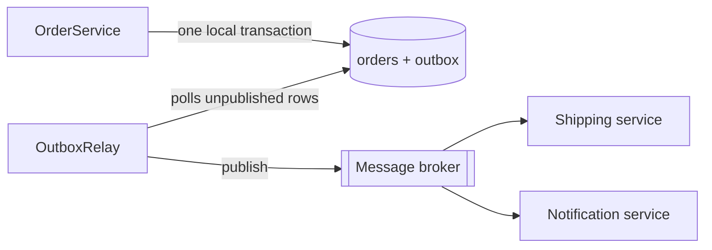

# Transactional Outbox

> 🇹🇷 [Türkçe](../../tr/microservice/transactional-outbox.md) · **Category:** Microservice / messaging (Chris Richardson) · **Code:** [`microservice/outbox`](../../../src/main/java/designpatterns/microservice/outbox)

## Intent

Update the database **and** publish an event **reliably**, without a distributed transaction: write the
event into an *outbox* table in the **same local transaction** as the business data, and publish it later.

## Problem — the dual write

```java
orderRepository.save(order);                 // 1. database
kafka.send("OrderPlaced", order);            // 2. broker
```

- The broker is down after step 1 → order saved, **event lost**; the shipping service never hears about it.
- Publish first, then the DB commit fails → event published for an order that **doesn't exist**.
- The database and the broker can't share one ACID transaction.

## Solution



1. `OrderService` inserts the order and an `OutboxMessage` row in **one** transaction – both or neither.
2. A separate **relay** reads unpublished rows, publishes them and marks them as published.
3. If the broker is down, rows simply wait; the relay retries on the next run.

| Role | Class |
|---|---|
| Business service | [`OrderService`](../../../src/main/java/designpatterns/microservice/outbox/OrderService.java) |
| Database with local transactions | [`Database`](../../../src/main/java/designpatterns/microservice/outbox/Database.java) |
| Outbox row | [`OutboxMessage`](../../../src/main/java/designpatterns/microservice/outbox/OutboxMessage.java) |
| Message relay | [`OutboxRelay`](../../../src/main/java/designpatterns/microservice/outbox/OutboxRelay.java) |
| Broker | [`MessageBroker`](../../../src/main/java/designpatterns/microservice/outbox/MessageBroker.java) |

Demo: [`OutboxDemo.java`](../../../src/main/java/designpatterns/microservice/outbox/OutboxDemo.java)

## Things to know

- Delivery is **at-least-once**: the relay can crash after publishing but before marking the row, so the
  event is sent again. Consumers must be **idempotent** (e.g. store processed event ids – *Inbox* pattern).
- Relay options: **polling** (simple, small delay) or **change data capture** reading the DB log
  (Debezium) – no polling load, near real time.
- Clean up or archive published rows periodically.

## Pros and cons

| ✅ Pros | ❌ Cons |
|---|---|
| No lost or phantom events | Extra table and relay process |
| Uses only local ACID transactions | Duplicates possible → idempotent consumers |
| Events are published in commit order | Small publishing delay |

## Real world usage

- Debezium Outbox Event Router, Spring Modulith event publication registry, Eventuate Tram,
  MassTransit / NServiceBus outbox (.NET), Axon

## Related patterns

- **Saga** – each saga step publishes its events through an outbox.
- **Observer / Publish-Subscribe** – the broker distributes the events to subscribers.
- **Inbox / Idempotent Consumer** – the receiving side of the same problem.
- **Event Sourcing** – the event store itself is the source of truth, so no dual write exists.
