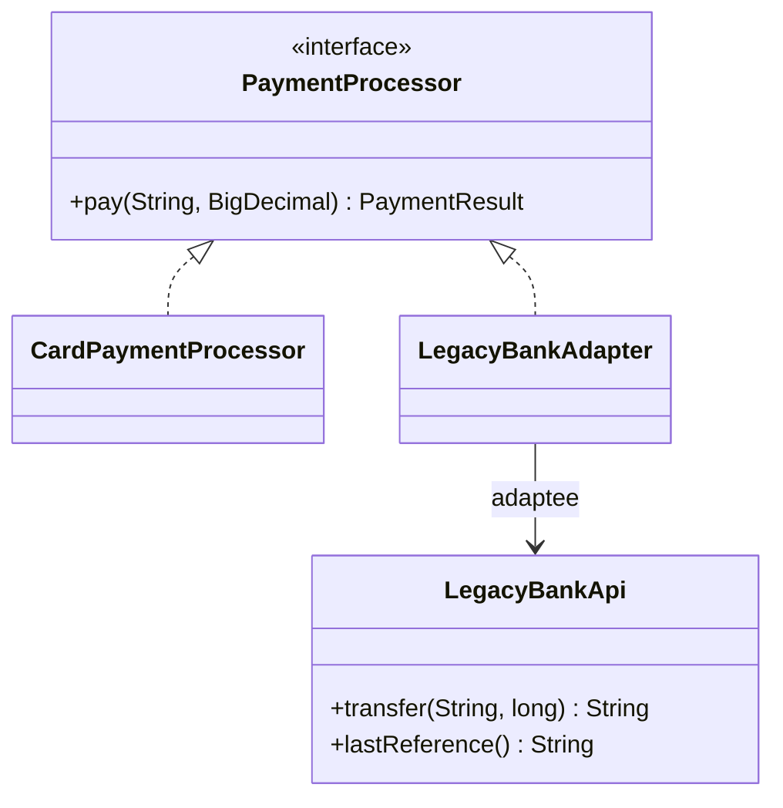

# Adapter

> 🇹🇷 [Türkçe](../../tr/structural/adapter.md) · **Category:** Structural · **Code:** [`structural/adapter`](../../../src/main/java/designpatterns/structural/adapter)

## Intent

Convert the interface of a class into another interface clients expect. Adapter lets classes work
together that couldn't otherwise because of **incompatible interfaces**.

## Problem

Our checkout code works with `PaymentProcessor.pay(customerId, BigDecimal amount)`. The bank we
must integrate with offers a legacy API: `transfer(String accountNo, long amountInCents)` that
returns status codes like `"00"` and `"51"`. We cannot change the bank's code, and we do not want
bank specific details to leak into the checkout.

## Solution

Write an **adapter** that implements the interface the client expects and internally calls the
legacy API, translating parameters and results.



| Role | Class |
|---|---|
| Target | [`PaymentProcessor`](../../../src/main/java/designpatterns/structural/adapter/PaymentProcessor.java) |
| Adaptee | [`LegacyBankApi`](../../../src/main/java/designpatterns/structural/adapter/LegacyBankApi.java) |
| Adapter | [`LegacyBankAdapter`](../../../src/main/java/designpatterns/structural/adapter/LegacyBankAdapter.java) |
| Client | [`AdapterDemo`](../../../src/main/java/designpatterns/structural/adapter/AdapterDemo.java) |

```java
public PaymentResult pay(String customerId, BigDecimal amount) {
    long cents = amount.movePointRight(2).longValueExact();      // BigDecimal -> cents
    String status = bankApi.transfer("TR-" + customerId, cents);  // call the adaptee
    boolean success = "00".equals(status);                       // status code -> boolean
    return new PaymentResult(success, success ? bankApi.lastReference() : null);
}
```

## Object adapter vs class adapter

- **Object adapter** (used here) – the adapter *holds* the adaptee (composition). Works with any
  subclass of the adaptee and is the preferred form in Java.
- **Class adapter** – the adapter *extends* the adaptee and implements the target. Requires
  multiple inheritance of classes, so in Java it is only possible when the target is an interface.

## When to use

- You want to use an existing class whose interface does not match what you need.
- Integrating third party libraries, legacy systems or external APIs (anti-corruption layer).

## Pros and cons

| ✅ Pros | ❌ Cons |
|---|---|
| Client code is isolated from the external API | One more class/layer |
| Single Responsibility: conversion logic in one place | Sometimes simpler to change the service itself, if you own it |
| Open/Closed: new adapters without touching the client | |

## Real world usage

- `java.util.Arrays.asList()` – array → `List`
- `java.io.InputStreamReader` – byte stream → character stream
- `java.util.Collections.enumeration()` / `list()` – `Iterator` ↔ `Enumeration`
- Spring MVC `HandlerAdapter`

## Related patterns

- **Bridge** is designed up front; Adapter is used to make existing things work together.
- **Decorator** keeps the interface and adds behaviour; Adapter changes the interface.
- **Facade** defines a *new simpler* interface for a whole subsystem; Adapter makes an existing
  interface usable.
- **Proxy** keeps the same interface.
