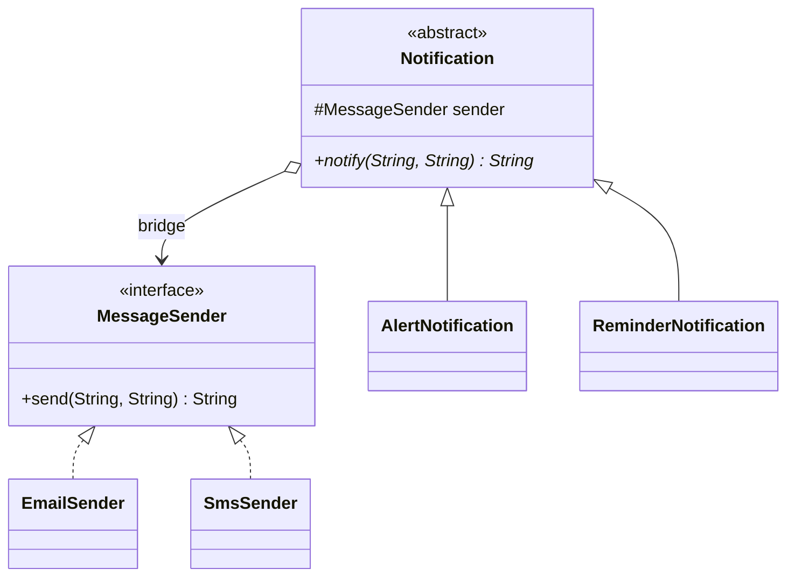

# Bridge

> 🇹🇷 [Türkçe](../../tr/structural/bridge.md) · **Category:** Structural · **Code:** [`structural/bridge`](../../../src/main/java/designpatterns/structural/bridge)

## Intent

**Decouple an abstraction from its implementation** so that the two can vary independently.

## Problem

We send notifications. There are two kinds (alert, reminder) and two channels (e-mail, SMS).
With inheritance we would need `AlertEmail`, `AlertSms`, `ReminderEmail`, `ReminderSms`. Adding
push notifications doubles the classes again: the hierarchy grows as **kinds × channels**.

## Solution

Split the problem into two hierarchies and connect them with composition (the "bridge"):

- **Abstraction** – *what* to send: `Notification`, `AlertNotification`, `ReminderNotification`
- **Implementor** – *how* to send: `MessageSender`, `EmailSender`, `SmsSender`

The abstraction holds a reference to an implementor. Now the class count grows as
**kinds + channels**.



| Role | Class |
|---|---|
| Abstraction | [`Notification`](../../../src/main/java/designpatterns/structural/bridge/Notification.java) |
| Refined abstractions | [`AlertNotification`](../../../src/main/java/designpatterns/structural/bridge/AlertNotification.java), [`ReminderNotification`](../../../src/main/java/designpatterns/structural/bridge/ReminderNotification.java) |
| Implementor | [`MessageSender`](../../../src/main/java/designpatterns/structural/bridge/MessageSender.java) |
| Concrete implementors | [`EmailSender`](../../../src/main/java/designpatterns/structural/bridge/EmailSender.java), [`SmsSender`](../../../src/main/java/designpatterns/structural/bridge/SmsSender.java) |

```java
new AlertNotification(new SmsSender()).notify("cem", "server is down");
new ReminderNotification(new EmailSender()).notify("cem", "meeting in 10 minutes");
```

Demo: [`BridgeDemo.java`](../../../src/main/java/designpatterns/structural/bridge/BridgeDemo.java)

## When to use

- A class has two (or more) independent dimensions that should be extended separately.
- You want to switch the implementation at runtime.
- You want to avoid a "class explosion" caused by inheritance.

## Pros and cons

| ✅ Pros | ❌ Cons |
|---|---|
| Abstraction and implementation evolve independently | More indirection, harder to understand at first |
| Open/Closed in both hierarchies | Overkill for a single, cohesive class |
| Platform independent abstractions | |

## Real world usage

- **JDBC**: your code uses `Connection`/`Statement` (abstraction), each driver provides the
  implementation.
- **SLF4J**: logging API (abstraction) bridged to Logback, Log4j2... (implementation).
- `java.util.logging.Handler` ↔ `Formatter`

## Related patterns

- **Adapter** is applied after the fact to make unrelated classes work together; Bridge is
  designed up front.
- **Abstract Factory** can create and configure a particular bridge.
- **Strategy** has a similar structure, but its goal is to switch algorithms, not to separate two
  hierarchies.
