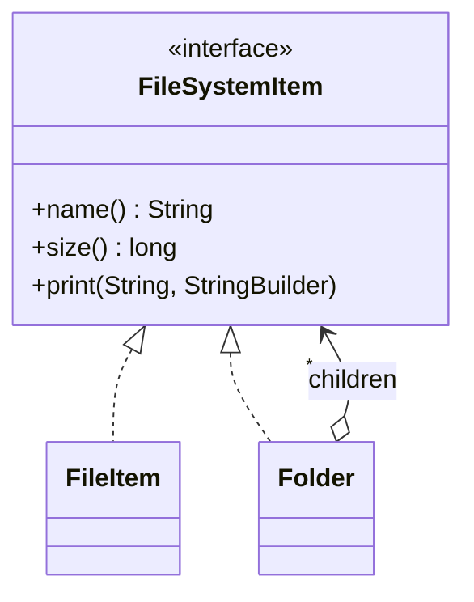

# Composite

> 🇹🇷 [Türkçe](../../tr/structural/composite.md) · **Category:** Structural · **Code:** [`structural/composite`](../../../src/main/java/designpatterns/structural/composite)

## Intent

Compose objects into **tree structures** to represent part-whole hierarchies. Composite lets
clients treat individual objects and compositions of objects **uniformly**.

## Problem

A file system contains files and folders; folders contain files *and other folders*. To calculate
the size of a folder, code full of `instanceof` checks and nested loops is needed, and it must be
updated every time a new kind of node appears.

## Solution

Define a common interface (`FileSystemItem`) for leaves and containers. A container (`Folder`)
stores children of that interface type and implements operations by delegating to its children,
recursively. The client calls `size()` without caring whether it is a file or a whole tree.



| Role | Class |
|---|---|
| Component | [`FileSystemItem`](../../../src/main/java/designpatterns/structural/composite/FileSystemItem.java) (sealed interface) |
| Leaf | [`FileItem`](../../../src/main/java/designpatterns/structural/composite/FileItem.java) (record) |
| Composite | [`Folder`](../../../src/main/java/designpatterns/structural/composite/Folder.java) |

```java
@Override
public long size() {
    return children.stream().mapToLong(FileSystemItem::size).sum(); // recursion
}
```

Demo: [`CompositeDemo.java`](../../../src/main/java/designpatterns/structural/composite/CompositeDemo.java)

## Transparency vs safety

Where should `add()`/`remove()` be declared?

- In the **component** (transparent): the client treats everything the same, but calling `add()`
  on a leaf must throw an exception.
- Only in the **composite** (safe, used here): type safe, but the client must know when it has a
  composite.

## When to use

- You need to represent a tree: menus, file systems, organization charts, UI components,
  expression trees, product bundles.
- Clients should ignore the difference between single objects and groups.

## Pros and cons

| ✅ Pros | ❌ Cons |
|---|---|
| Simple client code thanks to polymorphism and recursion | The common interface may become too general |
| Easy to add new node types (Open/Closed) | Hard to restrict which children a composite accepts |

## Real world usage

- `java.awt.Container` / `Component`, JavaFX `Parent` / `Node`
- The HTML DOM, JSON / XML trees
- `javax.faces.component.UIComponent`

## Related patterns

- **Iterator** can traverse a composite; **Visitor** can apply operations to all nodes.
- **Decorator** looks similar (recursive composition) but has only one child and adds behaviour.
- **Flyweight** can be used for shared leaf nodes.
- **Builder** is useful for creating complex composite trees.
