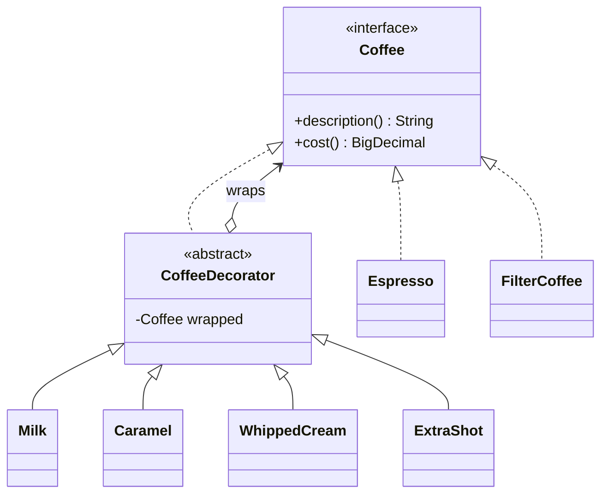

# Decorator

> 🇹🇷 [Türkçe](../../tr/structural/decorator.md) · **Category:** Structural · **Code:** [`structural/decorator`](../../../src/main/java/designpatterns/structural/decorator)

## Intent

**Attach additional responsibilities to an object dynamically.** Decorators provide a flexible
alternative to subclassing for extending functionality.

## Problem

A coffee shop sells espresso and filter coffee, with optional milk, caramel, whipped cream and
extra shots. A subclass for every combination (`EspressoWithMilkAndCaramel`...) explodes
combinatorially and cannot be changed at runtime.

## Solution

Wrap the object in decorator objects that implement the **same interface**. Each decorator holds
the wrapped object, forwards the call and adds its own behaviour before/after. Decorators can be
stacked in any order and any number.



| Role | Class |
|---|---|
| Component | [`Coffee`](../../../src/main/java/designpatterns/structural/decorator/Coffee.java) |
| Concrete components | [`Espresso`](../../../src/main/java/designpatterns/structural/decorator/Espresso.java), [`FilterCoffee`](../../../src/main/java/designpatterns/structural/decorator/FilterCoffee.java) |
| Base decorator | [`CoffeeDecorator`](../../../src/main/java/designpatterns/structural/decorator/CoffeeDecorator.java) |
| Concrete decorators | `Milk`, `Caramel`, `WhippedCream`, `ExtraShot` |

```java
Coffee coffee = new Caramel(new Milk(new Espresso()));
coffee.description(); // "Espresso + milk + caramel"
coffee.cost();        // 60.00 + 12.50 + 15.00 = 87.50
```

Demo: [`DecoratorDemo.java`](../../../src/main/java/designpatterns/structural/decorator/DecoratorDemo.java)

## When to use

- You need to add responsibilities to individual objects at runtime, without affecting others.
- Extension by subclassing is impractical (too many combinations) or impossible (`final` class).
- Cross-cutting concerns: logging, caching, retry, compression, encryption, metrics.

## Pros and cons

| ✅ Pros | ❌ Cons |
|---|---|
| Combine behaviours at runtime | Many small objects, harder to debug |
| Single Responsibility: one feature per decorator | Order of the wrappers matters |
| No subclass explosion | Removing a specific wrapper from the middle of the stack is hard |

## Real world usage

- **java.io**: `new BufferedReader(new InputStreamReader(new FileInputStream(file)))`
- `Collections.unmodifiableList()`, `Collections.synchronizedMap()`, `Collections.checkedList()`
- Spring `TransactionAwareDataSourceProxy`, servlet `HttpServletRequestWrapper`

## Related patterns

- **Adapter** changes the interface; Decorator keeps it and enhances behaviour.
- **Proxy** has the same structure but controls access; the proxy usually manages the lifecycle of
  its subject, while decorators are composed by the client.
- **Composite** – a decorator is like a composite with only one child.
- **Strategy** changes the "guts" of an object, Decorator changes its "skin".
