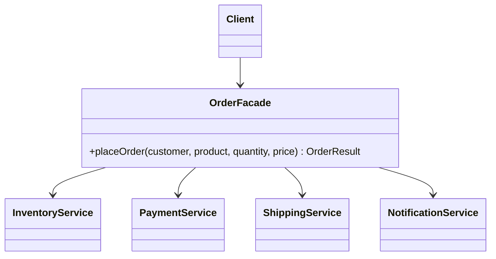

# Facade

> 🇹🇷 [Türkçe](../../tr/structural/facade.md) · **Category:** Structural · **Code:** [`structural/facade`](../../../src/main/java/designpatterns/structural/facade)

## Intent

Provide a **unified, simple interface** to a set of interfaces in a subsystem. Facade defines a
higher-level interface that makes the subsystem easier to use.

## Problem

Placing an order needs four services, called in the right order with the right error handling:
check stock → take payment → reserve stock → create shipment → send e-mail. If every controller
does this itself, the logic is duplicated and every client is coupled to all four services.

## Solution

Create a **facade** class with one method, `placeOrder(...)`, that coordinates the subsystem.
Clients talk only to the facade. The subsystem classes are still available for clients that
need advanced features.



| Role | Class |
|---|---|
| Facade | [`OrderFacade`](../../../src/main/java/designpatterns/structural/facade/OrderFacade.java) |
| Subsystem | [`InventoryService`](../../../src/main/java/designpatterns/structural/facade/InventoryService.java), [`PaymentService`](../../../src/main/java/designpatterns/structural/facade/PaymentService.java), [`ShippingService`](../../../src/main/java/designpatterns/structural/facade/ShippingService.java), [`NotificationService`](../../../src/main/java/designpatterns/structural/facade/NotificationService.java) |

```java
OrderResult result = shop.placeOrder("cem", "BOOK-1", 2, new BigDecimal("150"));
```

Demo: [`FacadeDemo.java`](../../../src/main/java/designpatterns/structural/facade/FacadeDemo.java)

## When to use

- You want a simple entry point to a complex subsystem or library.
- You want to layer your system (each layer talks to the next one through a facade).
- You want to reduce coupling between clients and many subsystem classes.

## Pros and cons

| ✅ Pros | ❌ Cons |
|---|---|
| Hides complexity, simple API | Can become a "god object" coupled to everything |
| Clients are decoupled from subsystem details | May hide features some clients need |
| Subsystem can change without breaking clients | |

## Real world usage

- A **service layer** in Spring applications (`OrderService` coordinating repositories and clients)
- `javax.faces.context.FacesContext`
- `java.net.URL.openStream()` hides sockets, protocols and handlers
- SLF4J's `LoggerFactory` is a facade over logging implementations

## Related patterns

- **Adapter** makes one existing interface usable; Facade defines a new, simpler interface for
  *many* objects.
- **Mediator** also coordinates objects, but the colleagues know the mediator and communicate
  through it; subsystem classes are unaware of the facade.
- A facade is often a **Singleton**.
- **Abstract Factory** can be used with Facade to hide how subsystem objects are created.
