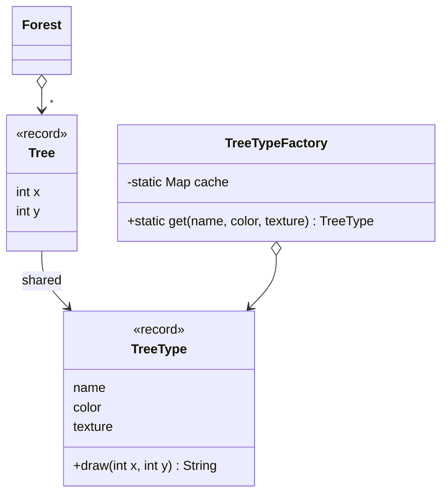

# Flyweight

> 🇹🇷 [Türkçe](../../tr/structural/flyweight.md) · **Category:** Structural · **Code:** [`structural/flyweight`](../../../src/main/java/designpatterns/structural/flyweight)

## Intent

Use **sharing** to support large numbers of fine-grained objects efficiently.

## Problem

A game renders a forest of 100 000 trees. Each tree has a position, plus a name, color and a
texture of several megabytes. If every tree stores its own texture, memory runs out — but there
are only three kinds of trees.

## Solution

Split the state of the object in two:

- **Intrinsic state** – shared, immutable, identical for many objects (name, color, texture)
  → stored in the **flyweight** (`TreeType`).
- **Extrinsic state** – unique per object (x, y) → stored in the context (`Tree`) or passed
  as method parameters.

A **flyweight factory** caches flyweights and returns the existing one when it is requested again.

| Role | Class |
|---|---|
| Flyweight | [`TreeType`](../../../src/main/java/designpatterns/structural/flyweight/TreeType.java) |
| Flyweight factory | [`TreeTypeFactory`](../../../src/main/java/designpatterns/structural/flyweight/TreeTypeFactory.java) |
| Context | [`Tree`](../../../src/main/java/designpatterns/structural/flyweight/Tree.java) |
| Client | [`Forest`](../../../src/main/java/designpatterns/structural/flyweight/Forest.java) |

Result of the demo: **100 000** `Tree` objects, but only **3** `TreeType` objects in memory.

Demo: [`FlyweightDemo.java`](../../../src/main/java/designpatterns/structural/flyweight/FlyweightDemo.java)

## When to use

- The application uses a huge number of similar objects and memory is a concern.
- Most of the object state can be made extrinsic.
- Object identity is not important (shared objects must be immutable).

## Pros and cons

| ✅ Pros | ❌ Cons |
|---|---|
| Saves a lot of RAM | Code becomes more complex |
| | Trades memory for CPU (extrinsic state must be computed/passed) |
| | Flyweights must be immutable; thread safety of the factory |

## Real world usage

- `Integer.valueOf()` caches -128..127 (also `Long`, `Short`, `Byte`, `Character`, `Boolean`)
- The **String pool** / `String.intern()`
- Glyphs in text editors, tiles in games

## Related patterns

- **Composite** leaf nodes can be implemented as flyweights.
- **Singleton** is similar but there is only one instance; flyweights have one instance *per
  intrinsic state*, and they are immutable.
- **Factory Method** / simple factories are used to obtain flyweights.
