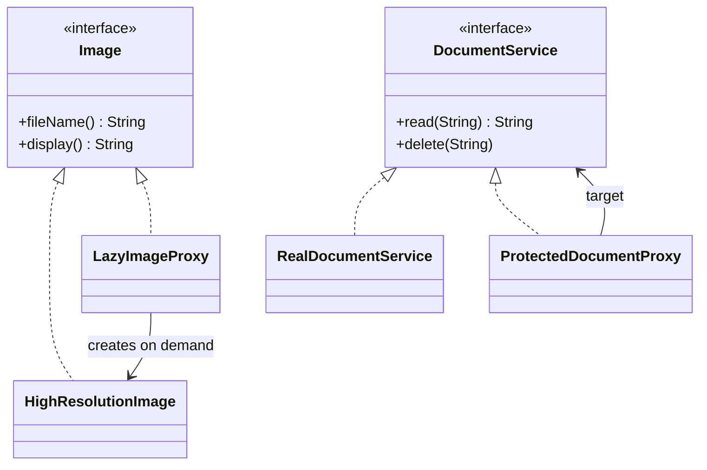

# Proxy

> 🇹🇷 [Türkçe](../../tr/structural/proxy.md) · **Category:** Structural · **Code:** [`structural/proxy`](../../../src/main/java/designpatterns/structural/proxy)

## Intent

Provide a **surrogate or placeholder** for another object to **control access** to it.

## Problem

- A gallery shows 100 thumbnails, but loading every full resolution image at startup takes
  seconds and a lot of memory — most of them will never be opened.
- A document service must check permissions and keep an audit log, but we don't want to mix
  security code into the service itself.

## Solution

Create a proxy that implements the **same interface** as the real object. The client cannot tell
the difference. The proxy decides when and whether to delegate to the real object, and can do
extra work before/after.

| Proxy type | Class | What it does |
|---|---|---|
| Virtual proxy | [`LazyImageProxy`](../../../src/main/java/designpatterns/structural/proxy/LazyImageProxy.java) | Creates the expensive object on first use |
| Protection proxy | [`ProtectedDocumentProxy`](../../../src/main/java/designpatterns/structural/proxy/ProtectedDocumentProxy.java) | Checks the role, writes an audit log |

Demo: [`ProxyDemo.java`](../../../src/main/java/designpatterns/structural/proxy/ProxyDemo.java)

## Kinds of proxies

| Kind | Purpose | Example |
|---|---|---|
| Virtual | Lazy initialization of a heavy object | Hibernate lazy loaded entities |
| Protection | Access control | Spring Security method security |
| Remote | Represents an object in another address space | Java RMI stubs, gRPC/Feign clients |
| Caching | Returns cached results | Spring `@Cacheable` |
| Logging / Smart reference | Logging, counting references, locking | Spring `@Transactional` |

## When to use

- Lazy loading, access control, logging, caching or remote access should be added **transparently**.

## Pros and cons

| ✅ Pros | ❌ Cons |
|---|---|
| Control the real object without the client knowing | Adds a layer, may add latency |
| Open/Closed: add new proxies without changing the service | More classes (unless dynamic proxies are used) |
| Works even if the real object is not ready / available | |

## Real world usage

- `java.lang.reflect.Proxy` – **dynamic proxies** created at runtime
- Spring AOP: `@Transactional`, `@Cacheable`, `@Async` are implemented with JDK/CGLIB proxies
- Hibernate lazy loading proxies, `Collections.unmodifiableList()` (also a protection proxy)

## Related patterns

- **Adapter** provides a different interface, Proxy the same interface, **Decorator** an enhanced
  interface.
- Decorator and Proxy have the same structure; Proxy usually manages its subject's lifecycle,
  decorators are composed by the client.
- **Facade** is similar to a proxy in that it buffers a complex entity, but it has a different interface.
