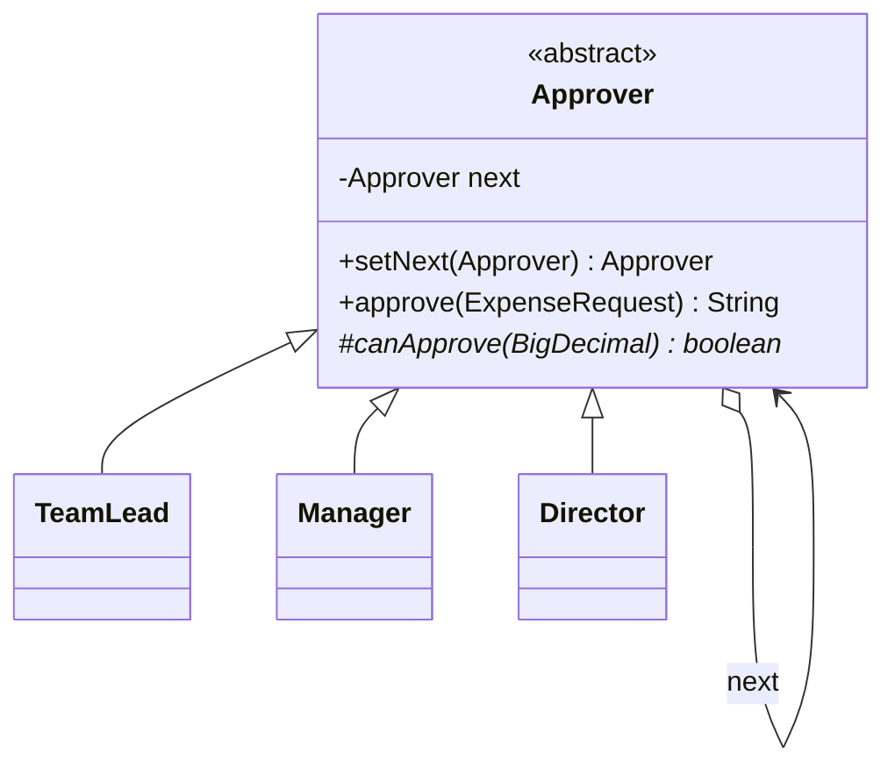
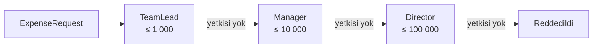

# Chain of Responsibility (Sorumluluk Zinciri)

> 🇬🇧 [English](../../en/behavioral/chain-of-responsibility.md) · **Kategori:** Davranışsal (Behavioral) · **Kod:** [`behavioral/chainofresponsibility`](../../../src/main/java/designpatterns/behavioral/chainofresponsibility)

## Amaç

Bir isteği **birden fazla nesneye işleme şansı vererek**, isteği gönderen ile alan arasındaki
bağımlılığı ortadan kaldırmak. Alıcı nesneler zincir halinde bağlanır ve istek, bir nesne onu
işleyene kadar zincir boyunca iletilir.

## Problem

Masraf onayı: takım lideri 1 000 TL'ye, müdür 10 000 TL'ye, direktör 100 000 TL'ye kadar onay
verebiliyor. Bunu tek bir metotta `if/else if` ile yazmak, çalışanı tüm onaylayıcılara bağlar;
hiyerarşi değiştiğinde o metot da değişmek zorunda kalır.

## Çözüm

Her onaylayıcı, bir sonraki handler'a referans tutan bir **handler**'dır. Handler isteği ya işler ya
da bir sonrakine iletir. İstemci yalnızca ilk handler'ı bilir.





| Rol | Sınıf |
|---|---|
| Handler | [`Approver`](../../../src/main/java/designpatterns/behavioral/chainofresponsibility/Approver.java) |
| Concrete handlers | [`TeamLead`](../../../src/main/java/designpatterns/behavioral/chainofresponsibility/TeamLead.java), [`Manager`](../../../src/main/java/designpatterns/behavioral/chainofresponsibility/Manager.java), [`Director`](../../../src/main/java/designpatterns/behavioral/chainofresponsibility/Director.java) |
| Request (İstek) | [`ExpenseRequest`](../../../src/main/java/designpatterns/behavioral/chainofresponsibility/ExpenseRequest.java) |

```java
Approver chain = new TeamLead();
chain.setNext(new Manager()).setNext(new Director());
chain.approve(new ExpenseRequest("cem", "conference trip", new BigDecimal("8500")));
// -> "Manager approved 8500 TL for conference trip"
```

Örnek: [`ChainOfResponsibilityDemo.java`](../../../src/main/java/designpatterns/behavioral/chainofresponsibility/ChainOfResponsibilityDemo.java)

## İki çeşidi

1. **İlk uygun handler'da dur** (burada kullanılan, klasik GoF): isteği tam olarak bir handler işler.
2. **Pipeline / filtre zinciri**: her handler kendi işini yapar ve isteği iletir
   (kimlik doğrulama → loglama → sıkıştırma). Servlet filtreleri böyle çalışır.

## Ne zaman kullanılır?

- Bir isteği birden fazla nesne işleyebilir ve hangisinin işleyeceği önceden bilinmiyorsa.
- Handler'ların kümesi ve sırası çalışma zamanında yapılandırılabilmeliyse.

## Artıları ve eksileri

| ✅ Artıları | ❌ Eksileri |
|---|---|
| Gönderen ile alıcılar birbirinden bağımsız | İstek zincirin sonuna kadar işlenmeden gidebilir |
| Handler eklemek/çıkarmak/sıralamak serbest | Debug etmek ve izlemek zor |
| Her handler için Single Responsibility | Uzun zincirler performansı etkileyebilir |

## Gerçek dünyadan örnekler

- `jakarta.servlet.Filter` / `FilterChain`, Spring Security filtre zinciri
- `java.util.logging.Logger`'ın kayıtları üst logger'lara iletmesi
- Exception yönetimi: `try/catch` yığını bir sorumluluk zinciridir
- Spring `HandlerInterceptor`, Netty `ChannelPipeline`

## İlişkili kalıplar

- Sıklıkla **Composite** ile kullanılır: istek bir çocuktan ebeveynine doğru iletilir.
- Zincirde dolaşan istekler genellikle **Command** nesneleridir.
- **Decorator** benzer özyinelemeli yapıya sahiptir ama her dekoratör mutlaka devreder ve akışı durduramaz.
