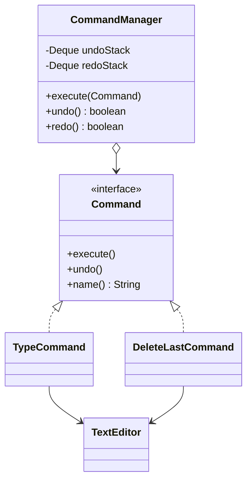

# Command (Komut)

> 🇬🇧 [English](../../en/behavioral/command.md) · **Kategori:** Davranışsal (Behavioral) · **Kod:** [`behavioral/command`](../../../src/main/java/designpatterns/behavioral/command)

## Amaç

**Bir isteği nesne olarak kapsüllemek**; böylece istemcileri farklı isteklerle parametrelendirmek,
istekleri kuyruğa almak veya loglamak ve **geri alınabilir (undo) işlemleri** desteklemek.

## Problem

Bir metin editöründe aynı işi yapan butonlar, menü öğeleri ve klavye kısayolları var. Ayrıca
**geri al / yinele (undo/redo)** gerekiyor. Butonlar editörü doğrudan çağırırsa mantık tekrarlanır
ve *ne yapıldığını* hatırlayan hiçbir şey olmadığı için işlem geri alınamaz.

## Çözüm

Her eylemi, `execute()` ve `undo()` metotlarına sahip `Command` arayüzünü uygulayan bir nesneye
dönüştür. Komut, ihtiyaç duyduğu her şeyi (receiver, parametreler, geri alma için gereken durum)
saklar. Bir **invoker** komutları çalıştırır ve bir geçmiş yığınında tutar.



| Rol | Sınıf |
|---|---|
| Command | [`Command`](../../../src/main/java/designpatterns/behavioral/command/Command.java) |
| Concrete commands | [`TypeCommand`](../../../src/main/java/designpatterns/behavioral/command/TypeCommand.java), [`DeleteLastCommand`](../../../src/main/java/designpatterns/behavioral/command/DeleteLastCommand.java) |
| Receiver (Alıcı) | [`TextEditor`](../../../src/main/java/designpatterns/behavioral/command/TextEditor.java) |
| Invoker (Çağıran) | [`CommandManager`](../../../src/main/java/designpatterns/behavioral/command/CommandManager.java) |

```java
manager.execute(new TypeCommand(editor, "Hello"));
manager.execute(new DeleteLastCommand(editor, 2));
manager.undo();   // silinen karakterler geri gelir
manager.redo();
```

Örnek: [`CommandDemo.java`](../../../src/main/java/designpatterns/behavioral/command/CommandDemo.java)

## Ne zaman kullanılır?

- Undo/redo, transaction davranışı, makrolar (komut listesi).
- İstekleri kuyruğa almak, zamanlamak veya uzakta çalıştırmak (job kuyrukları, mesaj broker'ları).
- Çökme sonrası sistemi yeniden kurabilmek için istekleri loglamak (event sourcing).
- UI elemanlarını iş mantığından ayırmak.

## Artıları ve eksileri

| ✅ Artıları | ❌ Eksileri |
|---|---|
| Invoker ve receiver birbirinden bağımsız | Her eylem için bir sınıf (basit komutlarda lambda işe yarar) |
| Undo/redo, kuyruk, makro, loglama | Undo, durumun dikkatli yönetilmesini gerektirir |
| Open/Closed: mevcut koda dokunmadan yeni komutlar | |

## Gerçek dünyadan örnekler

- `ExecutorService`'e gönderilen `java.lang.Runnable` ve `java.util.concurrent.Callable`
- `javax.swing.Action`
- Spring Batch adımları, CQRS command handler'ları, mesaj kuyruğu tüketicileri

## İlişkili kalıplar

- **Memento**, bir komutun undo için ihtiyaç duyduğu durumu saklayabilir.
- **Chain of Responsibility** komutları bir zincir boyunca iletebilir.
- **Strategy** de davranışı bir nesneye sarar; ancak command *yapılacak bir eylemi*, strategy ise
  *aynı işi yapmanın bir yolunu* temsil eder.
- Komutları geçmişe kopyalamak için **Prototype** yardımcı olur.
