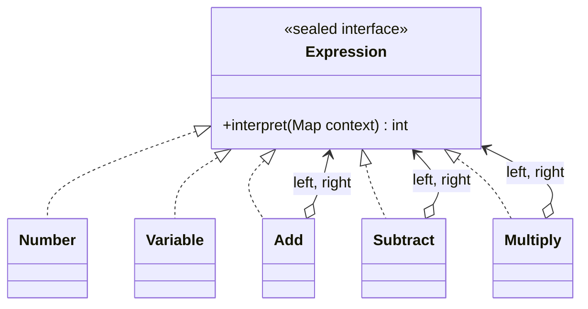

# Interpreter (Yorumlayıcı)

> 🇬🇧 [English](../../en/behavioral/interpreter.md) · **Kategori:** Davranışsal (Behavioral) · **Kod:** [`behavioral/interpreter`](../../../src/main/java/designpatterns/behavioral/interpreter)

## Amaç

Bir dil için **dilbilgisinin (grammar) bir temsilini** ve bu temsili kullanarak o dildeki cümleleri
yorumlayan bir yorumlayıcı tanımlamak.

## Problem

Bir fiyatlandırma sisteminin kullanıcıları `price quantity * discount -` gibi küçük formüller yazmak
istiyor. Her formülü koda gömmek imkânsız.

## Çözüm

Her dilbilgisi kuralını bir sınıfla temsil et. **Terminal ifadeler** (sayılar, değişkenler)
yapraklardır; **non-terminal ifadeler** (toplama, çıkarma, çarpma) başka ifadeleri içerir. Cümle bir
**soyut sözdizimi ağacına** (AST) dönüşür ve `interpret(context)` onu özyinelemeli olarak hesaplar.

```text
expression ::= number | variable | expression expression operator
operator   ::= '+' | '-' | '*'
```



`"price quantity * discount -"` şu ağaca dönüşür:

```text
        Subtract
        /      \
   Multiply   Variable(discount)
    /     \
price   quantity
```

| Rol | Sınıf |
|---|---|
| Abstract expression | [`Expression`](../../../src/main/java/designpatterns/behavioral/interpreter/Expression.java) (sealed interface) |
| Terminal expressions | `Expression.Number`, `Expression.Variable` (record) |
| Non-terminal expressions | `Expression.Add`, `Expression.Subtract`, `Expression.Multiply` |
| Context (Bağlam) | Değişken değerlerini tutan `Map<String, Integer>` |
| Parser (İstemci) | [`ExpressionParser`](../../../src/main/java/designpatterns/behavioral/interpreter/ExpressionParser.java) |

Örnek: [`InterpreterDemo.java`](../../../src/main/java/designpatterns/behavioral/interpreter/InterpreterDemo.java)

## Ne zaman kullanılır?

- Dilbilgisi **basitse** ve verimlilik birinci öncelik değilse: kural motorları, filtreler, arama
  sorguları, konfigürasyon DSL'leri.
- Karmaşık dilbilgileri için bunun yerine parser üreteçleri (ANTLR, JavaCC) kullanın.

## Artıları ve eksileri

| ✅ Artıları | ❌ Eksileri |
|---|---|
| Dilbilgisini değiştirmek ve genişletmek kolay | Karmaşık dilbilgilerinin bakımı zorlaşır |
| Her kural küçük ve test edilebilir bir sınıf | Derlenmiş çözümlere göre yavaş |

## Gerçek dünyadan örnekler

- `java.util.regex.Pattern` (regex'i düğümlerden oluşan bir ağaca derler)
- `java.text.Format` alt sınıfları, Spring Expression Language (SpEL), JPQL / HQL, SQL motorları

## İlişkili kalıplar

- AST bir **Composite**'tir.
- Ağacı **Iterator** dolaşabilir, **Visitor** yeni işlemler ekleyebilir (yazdırma, optimizasyon, tip kontrolü).
- Terminal semboller **Flyweight** ile paylaşılabilir.
