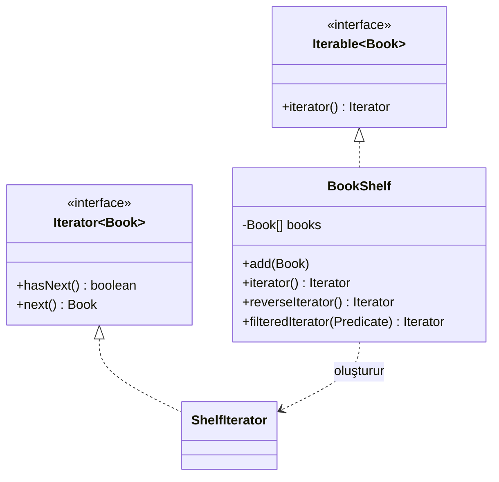

# Iterator (Yineleyici)

> 🇬🇧 [English](../../en/behavioral/iterator.md) · **Kategori:** Davranışsal (Behavioral) · **Kod:** [`behavioral/iterator`](../../../src/main/java/designpatterns/behavioral/iterator)

## Amaç

Bir koleksiyonun elemanlarına, **iç yapısını açığa çıkarmadan sırayla erişmenin** bir yolunu sağlamak.

## Problem

`BookShelf` bugün kitapları bir dizide tutuyor; yarın bağlı liste veya ağaç olabilir. İstemciler
diziyi doğrudan dolaşırsa iç yapıdaki her değişiklik onları bozar. Ayrıca farklı dolaşma şekilleri
istiyoruz: ileri, geri, filtreli.

## Çözüm

Dolaşma işini, kendi imlecini (cursor) tutan ayrı bir **iterator** nesnesine taşı. Koleksiyon
iterator döndürür; istemciler yalnızca `hasNext()` / `next()` kullanır. `Iterable`'ı uygulamak
koleksiyonu `for-each` döngüsünde de kullanılabilir yapar.



| Rol | Sınıf |
|---|---|
| Iterator | `java.util.Iterator<Book>` |
| Concrete iterator | `BookShelf.ShelfIterator` (inner class) |
| Aggregate (Koleksiyon) | `java.lang.Iterable<Book>` |
| Concrete aggregate | [`BookShelf`](../../../src/main/java/designpatterns/behavioral/iterator/BookShelf.java) |

```java
for (Book book : shelf) { ... }                              // ileri
Iterator<Book> it = shelf.reverseIterator();                 // geri
Iterator<Book> modern = shelf.filteredIterator(b -> b.year() > 2000);
```

Örnek: [`IteratorDemo.java`](../../../src/main/java/designpatterns/behavioral/iterator/IteratorDemo.java)

## İç ve dış iterator

- **Dış iterator** (`Iterator`) – dolaşmayı istemci `hasNext/next` ile kontrol eder.
- **İç iterator** (`forEach`, Stream API) – dolaşmayı koleksiyon kontrol eder, istemci bir fonksiyon
  verir. `Spliterator` paralel dolaşma desteği ekler.

## Ne zaman kullanılır?

- Bir koleksiyonun iç yapısını gizlemek için.
- Aynı koleksiyon için birden fazla dolaşma algoritması sunmak için.
- Farklı koleksiyonları tek tip bir yolla dolaşmak için.

## Artıları ve eksileri

| ✅ Artıları | ❌ Eksileri |
|---|---|
| Koleksiyon ile dolaşma algoritmaları ayrıdır | Basit koleksiyonlar için gereksiz |
| Aynı anda birden fazla dolaşma yapılabilir (her iterator'ın kendi durumu var) | Doğrudan erişimden daha az verimli olabilir |

## Gerçek dünyadan örnekler

- `java.util` içinde `Iterable` uygulayan her şey; `Iterator`, `ListIterator`, `Spliterator`
- `java.util.Scanner`, `java.sql.ResultSet`, `DirectoryStream`

## İlişkili kalıplar

- **Composite** ağaçları iterator'larla dolaşılır.
- **Factory Method**: `iterator()`, koleksiyona özgü iterator döndüren bir factory method'dur.
- **Memento** dolaşma durumunu saklayabilir.
- **Visitor**, Iterator ile birlikte her elemanı işlemek için kullanılabilir.
