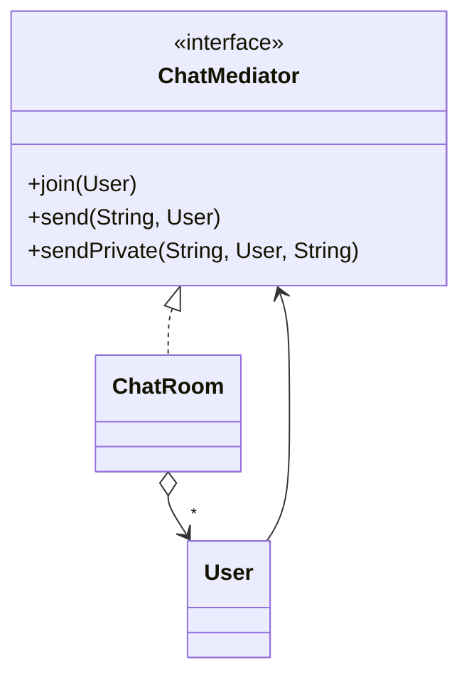

# Mediator (Arabulucu)

> 🇬🇧 [English](../../en/behavioral/mediator.md) · **Kategori:** Davranışsal (Behavioral) · **Kod:** [`behavioral/mediator`](../../../src/main/java/designpatterns/behavioral/mediator)

## Amaç

Bir grup nesnenin **birbiriyle nasıl etkileşeceğini kapsülleyen** bir nesne tanımlamak. Mediator,
nesnelerin birbirine doğrudan referans vermesini engelleyerek gevşek bağlılık sağlar.

## Problem

Bir sohbette her kullanıcı diğer bütün kullanıcıların referansını tutarsa *n* kullanıcı için
*n × (n-1)* bağlantı gerekir. "Spam'i engelle" veya "özel mesaj" gibi kurallar bütün kullanıcılara
dağılır.

## Çözüm

Kullanıcılar (colleague) yalnızca bir **mediator** (sohbet odası) ile konuşur. Mediator bütün
kullanıcıları bilir ve tüm iletişim kurallarını içerir. Çoka-çok ilişkiler bire-çok hale gelir.



| Rol | Sınıf |
|---|---|
| Mediator | [`ChatMediator`](../../../src/main/java/designpatterns/behavioral/mediator/ChatMediator.java) |
| Concrete mediator | [`ChatRoom`](../../../src/main/java/designpatterns/behavioral/mediator/ChatRoom.java) |
| Colleague (Meslektaş) | [`User`](../../../src/main/java/designpatterns/behavioral/mediator/User.java) |

```java
ChatMediator room = new ChatRoom();
User cem = new User("Cem", room);
User ayse = new User("Ayşe", room);
cem.send("Hello everyone!");          // mesajı kimin alacağına oda karar verir
```

Örnek: [`MediatorDemo.java`](../../../src/main/java/designpatterns/behavioral/mediator/MediatorDemo.java)

## Ne zaman kullanılır?

- Nesneler karmaşık şekillerde iletişim kuruyor ve bağımlılıkları anlamak zorsa.
- Şu an çok fazla bileşene bağımlı olan bir bileşeni yeniden kullanmak istiyorsanız.
- Alanların birbirini etkilediği UI diyalogları, hava trafik kontrolü, sohbet odaları, iş akışı motorları.

## Artıları ve eksileri

| ✅ Artıları | ❌ Eksileri |
|---|---|
| Bileşenler arası bağımlılıklar azalır | Mediator bir "god object"e dönüşebilir |
| İletişim kuralları tek yerde | Tek hata noktası (single point of failure) |
| Bileşenleri yeniden kullanmak kolaylaşır | |

## Gerçek dünyadan örnekler

- `java.util.Timer` (görevleri zamanlar), `java.util.concurrent.ExecutorService`
- Spring MVC `DispatcherServlet`
- Mesaj broker'ları / event bus'lar, MediatR tarzı kütüphaneler

## İlişkili kalıplar

- **Facade** bir alt sistemi basitleştirir ama alt sistem facade'ı bilmez; meslektaşlar ise
  mediator'larını bilir.
- Mediator ile meslektaşlar arasındaki iletişim sıklıkla **Observer** ile kurulur.
- **Chain of Responsibility**, **Command**, **Mediator** ve **Observer**, gönderenlerle alıcıları
  bağlamanın farklı yollarıdır.
