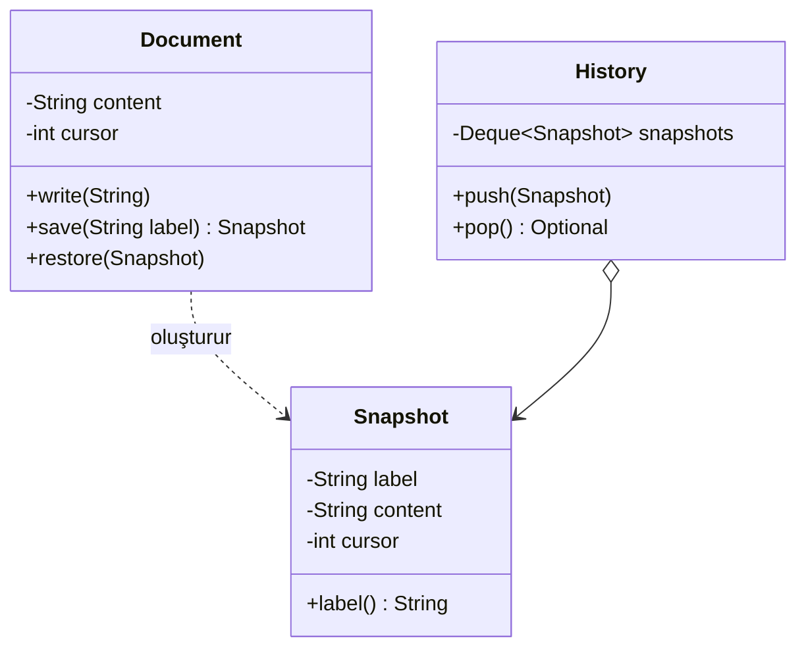

# Memento (Hatıra)

> 🇬🇧 [English](../../en/behavioral/memento.md) · **Kategori:** Davranışsal (Behavioral) · **Kod:** [`behavioral/memento`](../../../src/main/java/designpatterns/behavioral/memento)

## Amaç

Kapsüllemeyi (encapsulation) bozmadan **bir nesnenin iç durumunu yakalayıp dışarıda saklamak**,
böylece nesnenin daha sonra bu duruma geri döndürülebilmesini sağlamak.

## Problem

Bir doküman editörü "önceki sürüme dön" özelliğine ihtiyaç duyuyor. Durumu kaydetmek için başka bir
nesnenin dokümanın private alanlarını okuması gerekir — bu kapsüllemeyi bozar — ya da alanlar
public yapılmalıdır.

## Çözüm

Durumu kaydedilen nesne (**originator**) anlık görüntüyü (snapshot) kendisi oluşturur. Görüntü
(**memento**) değişmez ve opaktır: yalnızca originator içini okuyabilir. Bir **caretaker** memento'ları
saklar ama asla içlerine bakmaz.



| Rol | Sınıf |
|---|---|
| Originator (Kaynak) | [`Document`](../../../src/main/java/designpatterns/behavioral/memento/Document.java) |
| Memento | `Document.Snapshot` (iç sınıf, private constructor ve alanlar) |
| Caretaker (Bakıcı) | [`History`](../../../src/main/java/designpatterns/behavioral/memento/History.java) |

```java
history.push(document.save("v1"));
document.write("Oops! ");
history.pop().ifPresent(document::restore);
```

`Snapshot` iç sınıf (nested class) olduğu için `Document` onun private alanlarını okuyabilir;
caretaker ise yalnızca `label()` çağırabilir.

Örnek: [`MementoDemo.java`](../../../src/main/java/designpatterns/behavioral/memento/MementoDemo.java)

## Ne zaman kullanılır?

- Undo/redo, kontrol noktaları (checkpoint), "oyunu kaydet", bir transaction'ı geri almak.
- Nesnenin alanlarına doğrudan erişmek kapsüllemeyi bozacaksa.

## Artıları ve eksileri

| ✅ Artıları | ❌ Eksileri |
|---|---|
| Kapsüllemeyi bozmadan anlık görüntü | Görüntüler büyük veya sıksa bellek kullanımı |
| Originator sadeleşir (geçmiş başka yerde tutulur) | Caretaker'lar yaşam döngüsünü yönetmeli (eski görüntüleri silmek) |

## Gerçek dünyadan örnekler

- Nesne durumunu saklayıp geri yüklemek için kullanılan `java.io.Serializable`
- Editörlerde geri alma, oyun kayıt sistemleri, veritabanı transaction'ları / savepoint'ler

## İlişkili kalıplar

- **Command** + Memento: komut, undo için bir memento saklar.
- **Iterator**, dolaşma durumunu yakalamak için memento kullanabilir.
- Nesneyi kopyalamak basitse **Prototype** daha basit bir alternatif olabilir.
