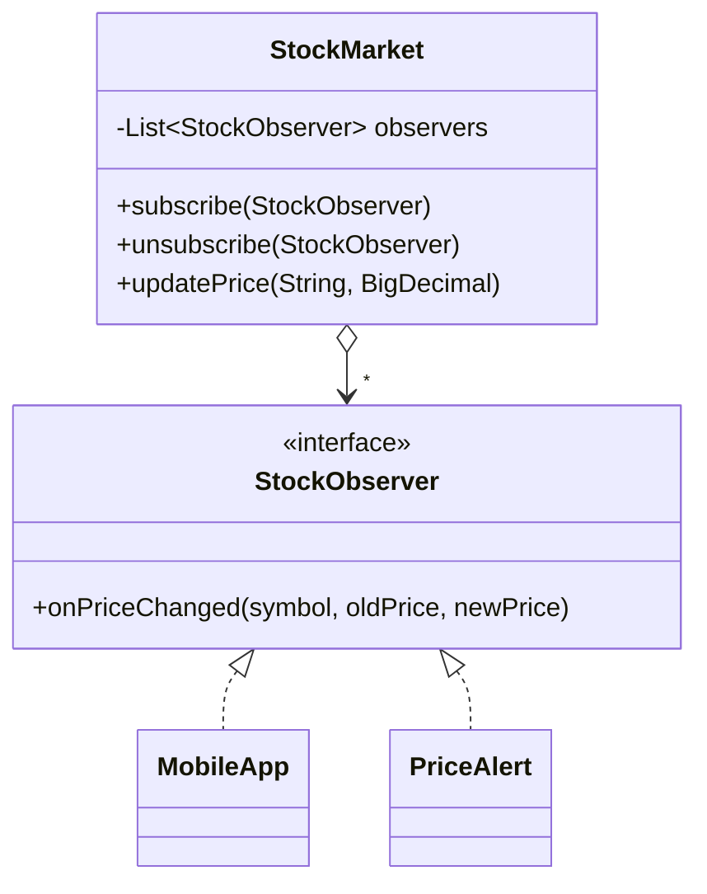

# Observer (Gözlemci)

> 🇬🇧 [English](../../en/behavioral/observer.md) · **Kategori:** Davranışsal (Behavioral) · **Kod:** [`behavioral/observer`](../../../src/main/java/designpatterns/behavioral/observer)

## Amaç

Nesneler arasında **bire-çok bir bağımlılık** tanımlamak; böylece bir nesnenin durumu değiştiğinde
ona bağlı bütün nesneler **otomatik olarak haberdar edilip güncellenir**. *Publish/Subscribe* olarak
da bilinir.

## Problem

Bir hisse fiyatı değiştiğinde mobil uygulama yenilenmeli, fiyat alarmları kontrol edilmeli ve
değişiklik loglanmalı. Borsa bu sınıfları doğrudan çağırırsa hepsine bağımlı olur ve her yeni
tüketici için değiştirilmesi gerekir. Sürekli "fiyat değişti mi?" diye sormak (polling) ise
kaynak israfıdır.

## Çözüm

**Subject (konu)**, ortak bir arayüzü uygulayan **observer**'ların listesini tutar. Observer'lar
çalışma zamanında abone olur / abonelikten çıkar. Her değişiklikte subject hepsini bilgilendirir.



| Rol | Sınıf |
|---|---|
| Subject (Yayıncı) | [`StockMarket`](../../../src/main/java/designpatterns/behavioral/observer/StockMarket.java) |
| Observer (Abone) | [`StockObserver`](../../../src/main/java/designpatterns/behavioral/observer/StockObserver.java) |
| Concrete observers | [`MobileApp`](../../../src/main/java/designpatterns/behavioral/observer/MobileApp.java), [`PriceAlert`](../../../src/main/java/designpatterns/behavioral/observer/PriceAlert.java), bir lambda |

```java
market.subscribe(new MobileApp());
market.subscribe((symbol, oldPrice, newPrice) -> log(symbol)); // lambda observer
market.updatePrice("THYAO", new BigDecimal("301.25"));         // herkes bilgilendirilir
```

Örnek: [`ObserverDemo.java`](../../../src/main/java/designpatterns/behavioral/observer/ObserverDemo.java)

## Push ve pull

- **Push** (burada kullanılan): subject değişen veriyi observer'lara gönderir.
- **Pull**: subject sadece "bir şey değişti" der, observer'lar ihtiyaç duyduklarını sorgular.

## Dikkat edilmesi gerekenler

- **Bellek sızıntısı** (lapsed listener problemi): abonelikten çıkmayı unutmak observer'ları hayatta tutar.
- Bildirim sırası garanti değildir; observer'lar birbirine bağımlı olmamalıdır.
- Bir observer'daki exception diğerlerini durdurabilir — hataları subject içinde yönetin.
- Bildirim sırasında observer listesinin değişmesi → burada `CopyOnWriteArrayList` kullanıldı.

## Ne zaman kullanılır?

- Bir nesnedeki değişiklik başka nesneleri de değiştirmeyi gerektiriyor ve kaç tane oldukları bilinmiyorsa.
- Olay tabanlı sistemler, UI olayları, domain event'ler, reaktif akışlar.

## Artıları ve eksileri

| ✅ Artıları | ❌ Eksileri |
|---|---|
| Open/Closed: yayıncıyı değiştirmeden yeni aboneler | Beklenmedik güncelleme zincirleri |
| Gevşek bağlılık, ilişkiler çalışma zamanında kurulur | Abonelikten çıkılmazsa bellek sızıntısı |

## Gerçek dünyadan örnekler

- `java.beans.PropertyChangeListener`, Swing/JavaFX event listener'ları
- `java.util.concurrent.Flow` (Reactive Streams), RxJava, Project Reactor
- Spring `ApplicationEventPublisher` + `@EventListener`
- `java.util.Observer` / `Observable` hâlâ var ama **Java 9'dan beri deprecated**

## İlişkili kalıplar

- **Mediator** iletişim için sıklıkla Observer kullanır.
- **Singleton** event bus'lar yaygındır.
- **Chain of Responsibility**, **Command**, **Mediator** ve **Observer**, gönderenlerle alıcıları
  bağlamanın farklı yollarıdır.
