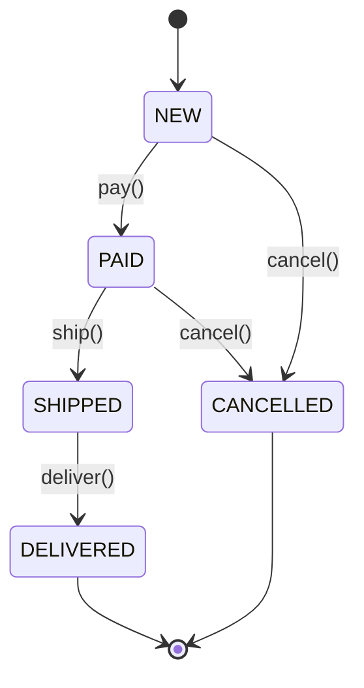
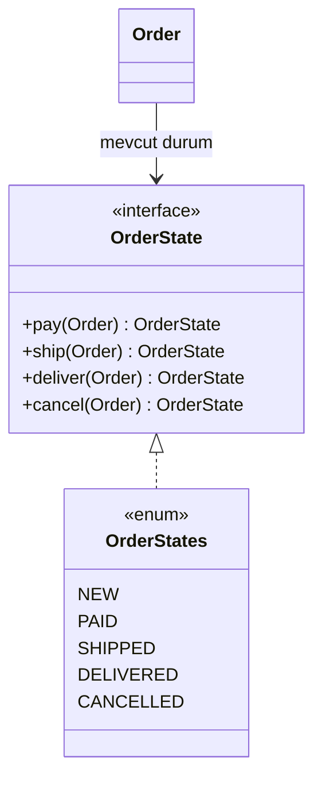

# State (Durum)

> 🇬🇧 [English](../../en/behavioral/state.md) · **Kategori:** Davranışsal (Behavioral) · **Kod:** [`behavioral/state`](../../../src/main/java/designpatterns/behavioral/state)

## Amaç

Bir nesnenin **iç durumu değiştiğinde davranışını da değiştirebilmesini** sağlamak. Nesne sanki
sınıfını değiştirmiş gibi görünür.

## Problem

Bir sipariş `NEW → PAID → SHIPPED → DELIVERED` aşamalarından geçer ve kargoya verilmeden önce
`CANCELLED` olabilir. Her metot (`pay`, `ship`, `deliver`, `cancel`) aynı durumları içeren bir
`switch (status)` barındırır. Yeni bir durum eklemek her metodu değiştirmek demektir ve geçersiz
geçişleri gözden kaçırmak kolaydır.

## Çözüm

Her durum için bir sınıf (burada: bir enum sabiti) oluştur. Her durum yalnızca izin verdiği
geçişleri uygular ve bir sonraki durumu döndürür. Bağlam (`Order`) işi o anki durum nesnesine devreder.





| Rol | Sınıf |
|---|---|
| Context (Bağlam) | [`Order`](../../../src/main/java/designpatterns/behavioral/state/Order.java) |
| State | [`OrderState`](../../../src/main/java/designpatterns/behavioral/state/OrderState.java) (default metotlar exception fırlatır) |
| Concrete states | [`OrderStates`](../../../src/main/java/designpatterns/behavioral/state/OrderStates.java) enum sabitleri |

```java
public void pay() {
    state = state.pay(this);   // switch yok
}
```

Örnek: [`StateDemo.java`](../../../src/main/java/designpatterns/behavioral/state/StateDemo.java)

## Ne zaman kullanılır?

- Bir nesne durumuna göre farklı davranıyor ve çok sayıda durum varsa.
- Metotlar bir durum alanı üzerinde koşullarla doluysa.
- İş akışları, sipariş/ödeme yaşam döngüleri, TCP bağlantıları, otomatlar, oyun karakterleri.

## Artıları ve eksileri

| ✅ Artıları | ❌ Eksileri |
|---|---|
| Duruma özgü kod tek yerde | 2-3 basit durum için gereksiz |
| Geçersiz geçişler açıkça belirtilir | Daha fazla sınıf |
| Bağlamı değiştirmeden yeni durumlar | |

## Gerçek dünyadan örnekler

- Spring State Machine
- `java.lang.Thread.State` (veri olarak), JSF/servlet yaşam döngüleri
- E-ticaret sistemlerindeki sipariş/ödeme akışları

## İlişkili kalıplar

- **Strategy** aynı yapıya sahiptir. Strategy'leri genellikle *istemci* seçer ve birbirlerini
  bilmezler; state'ler ise *kendilerini* değiştirir ve bir sonraki durumu bilirler.
- Durumlar sıklıkla **Singleton** / **Flyweight**'tir (burada durumsuz enum sabitleri).
