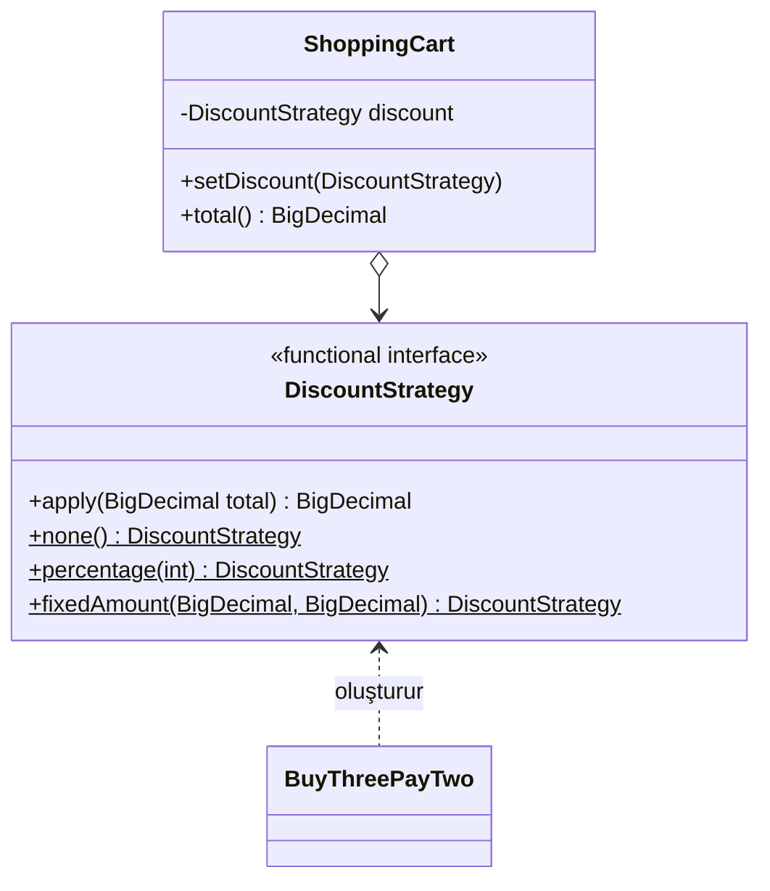

# Strategy (Strateji)

> 🇬🇧 [English](../../en/behavioral/strategy.md) · **Kategori:** Davranışsal (Behavioral) · **Kod:** [`behavioral/strategy`](../../../src/main/java/designpatterns/behavioral/strategy)

## Amaç

Bir **algoritma ailesi** tanımlamak, her birini kapsüllemek ve onları **birbirinin yerine
kullanılabilir** hale getirmek. Strategy, algoritmanın onu kullanan istemcilerden bağımsız olarak
değişmesini sağlar.

## Problem

Bir alışveriş sepeti farklı kampanyaları destekliyor: indirim yok, %10 indirim, 1500 TL üzeri
200 TL indirim, 3 al 2 öde, Black Friday... `total()` içindeki `switch (campaign)` her kampanyayla
büyür ve pazarlama ekibinin her yeni fikrinde sepet sınıfı değişmek zorunda kalır.

## Çözüm

Her algoritmayı ortak bir arayüzü uygulayan kendi nesnesine çıkar. Bağlam (sepet) bir strateji
referansı tutar ve işi ona devreder. Strateji çalışma zamanında değiştirilebilir. Modern Java'da
tek metotlu bir strateji bir **functional interface**'tir; dolayısıyla lambda'lar da çalışır.



| Rol | Sınıf |
|---|---|
| Strategy | [`DiscountStrategy`](../../../src/main/java/designpatterns/behavioral/strategy/DiscountStrategy.java) |
| Concrete strategies | `none()`, `percentage()`, `fixedAmount()`, [`BuyThreePayTwo`](../../../src/main/java/designpatterns/behavioral/strategy/BuyThreePayTwo.java), herhangi bir lambda |
| Context (Bağlam) | [`ShoppingCart`](../../../src/main/java/designpatterns/behavioral/strategy/ShoppingCart.java) |

```java
cart.setDiscount(DiscountStrategy.percentage(10));
cart.setDiscount(total -> total.subtract(new BigDecimal("50"))); // anlık strateji
```

Örnek: [`StrategyDemo.java`](../../../src/main/java/designpatterns/behavioral/strategy/StrategyDemo.java)

Önce / sonra: [refactoring örneği](../refactoring.md#strategy)

## Ne zaman kullanılır?

- Bir algoritmanın birden fazla çeşidi çalışma zamanında seçilebilmeliyse.
- Bir sınıfta, birkaç davranıştan birini seçen büyük bir koşul bloğu varsa.
- Algoritma detaylarını iş mantığından yalıtmak istiyorsanız (Open/Closed).

## Artıları ve eksileri

| ✅ Artıları | ❌ Eksileri |
|---|---|
| Algoritmaları çalışma zamanında değiştirme | İstemciler stratejiler arasındaki farkı bilmeli |
| Kalıtım yerine kompozisyon | Sadece birkaç sabit algoritma varsa gereksiz |
| Open/Closed; her stratejiyi ayrı test etmek kolay | |

## Gerçek dünyadan örnekler

- `List.sort()` / `Collections.sort()`'a verilen `java.util.Comparator`
- `java.util.concurrent.RejectedExecutionHandler`
- Spring: `PasswordEncoder`, `ResourceLoader`, `AuthenticationProvider`, aynı arayüzün farklı bean'lerini inject etmek

## İlişkili kalıplar

- **State** – aynı yapı, farklı amaç (State sayfasına bakın).
- **Template Method** algoritmanın parçalarını değiştirmek için kalıtım kullanır; Strategy bütün
  algoritmayı değiştirmek için kompozisyon kullanır.
- **Decorator** nesnenin dışını, Strategy içini değiştirir.
- **Command** – ikisi de davranışı bir nesneye sarar.
