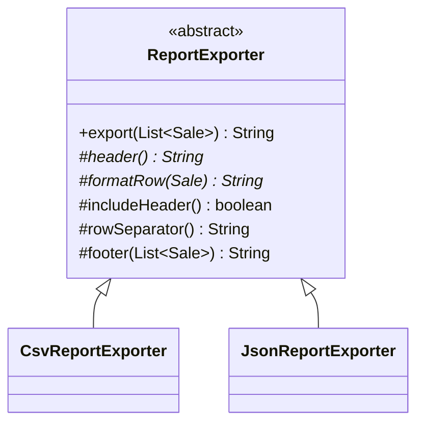

# Template Method (Şablon Metot)

> 🇬🇧 [English](../../en/behavioral/template-method.md) · **Kategori:** Davranışsal (Behavioral) · **Kod:** [`behavioral/templatemethod`](../../../src/main/java/designpatterns/behavioral/templatemethod)

## Amaç

Bir işlemde **algoritmanın iskeletini** tanımlayıp bazı adımları alt sınıflara bırakmak. Template
Method, alt sınıfların algoritmanın yapısını değiştirmeden belirli adımları yeniden tanımlamasını sağlar.

## Problem

Satış raporları CSV ve JSON olarak dışa aktarılıyor. İki dışa aktarıcı da geçersiz satırları
filtreler, başlık yazar, her satırı biçimlendirir ve bir alt bilgi yazar — sadece biçimlendirme
farklıdır. Akışı her dışa aktarıcıya kopyalamak, her hatayı iki kez düzeltmek demektir.

## Çözüm

Algoritmayı soyut bir sınıfın **final** metoduna koy (template method). Değişen adımlar
`abstract` metotlar (**primitive operations**) veya varsayılan davranışı olan override edilebilir
metotlardır (**hook**).



| Rol | Sınıf |
|---|---|
| Abstract class | [`ReportExporter`](../../../src/main/java/designpatterns/behavioral/templatemethod/ReportExporter.java) |
| Concrete classes | [`CsvReportExporter`](../../../src/main/java/designpatterns/behavioral/templatemethod/CsvReportExporter.java), [`JsonReportExporter`](../../../src/main/java/designpatterns/behavioral/templatemethod/JsonReportExporter.java) |

```java
// ReportExporter.export() metodunun sadeleştirilmiş hali
public final String export(List<Sale> sales) {          // template method
    List<Sale> valid = filterInvalid(sales);
    if (includeHeader()) out.append(header());           // hook + primitive
    valid.forEach(sale -> out.append(formatRow(sale)));  // primitive
    out.append(footer(valid));                           // hook
}
```

Örnek: [`TemplateMethodDemo.java`](../../../src/main/java/designpatterns/behavioral/templatemethod/TemplateMethodDemo.java)

## Hollywood İlkesi

*"Bizi aramayın, biz sizi ararız."* Alt sınıf metotlarını üst sınıf çağırır, tersi değil. Alt
sınıflar sadece boşlukları doldurur.

## Ne zaman kullanılır?

- Birkaç sınıf küçük farklarla aynı algoritmayı içeriyorsa.
- Alt sınıfların algoritmanın tamamını değil, yalnızca belirli adımlarını genişletmesini istiyorsanız.
- Framework'ler: akışın sahibi framework'tür, uygulamalar adımları sağlar.

## Artıları ve eksileri

| ✅ Artıları | ❌ Eksileri |
|---|---|
| Kod tekrarını ortadan kaldırır | Kalıtıma dayanır (sıkı bağlılık, tek üst sınıf) |
| Algoritmanın yapısı korunur (`final`) | Alt sınıflar adımları bastırırsa Liskov ihlal edilebilir |
| Hook'lar kontrollü genişleme noktaları sunar | Adım sayısı arttıkça bakım zorlaşır |

## Gerçek dünyadan örnekler

- `java.io.InputStream#read(byte[], int, int)` soyut `read()` metodunu kullanır
- `java.util.AbstractList` / `AbstractMap` (`get` ve `size`'ı siz yazarsınız, gerisi hazırdır)
- `jakarta.servlet.http.HttpServlet#service()`; `doGet`, `doPost`... metotlarını çağırır
- Spring `JdbcTemplate`, `RestTemplate`, `AbstractController`

## İlişkili kalıplar

- **Factory Method** sıklıkla bir template method'un adımlarından biridir.
- **Strategy** bütün algoritmayı kompozisyonla, Template Method parçalarını kalıtımla değiştirir.
  Modern kod genellikle Strategy'yi tercih eder (adımları lambda olarak geçirmek).
