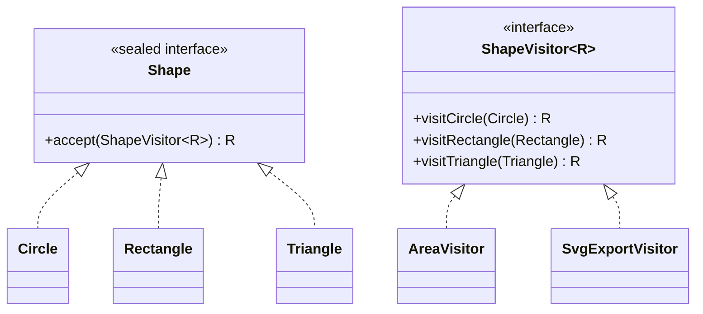

# Visitor (Ziyaretçi)

> 🇬🇧 [English](../../en/behavioral/visitor.md) · **Kategori:** Davranışsal (Behavioral) · **Kod:** [`behavioral/visitor`](../../../src/main/java/designpatterns/behavioral/visitor)

## Amaç

Bir nesne yapısının **elemanları üzerinde yapılacak bir işlemi temsil etmek**. Visitor, üzerinde
çalıştığı elemanların sınıflarını değiştirmeden yeni bir işlem tanımlamanızı sağlar.

## Problem

Bir çizim uygulamasında daire, dikdörtgen ve üçgen var. Bugün alan hesabı, yarın SVG dışa aktarma,
haftaya JSON dışa aktarma ve sınır kutusu hesabı gerekiyor. Her yeni işlem için her şekil sınıfına
bir metot eklemek, şekilleri ilgisiz sorumluluklarla kirletir.

## Çözüm

Her işlemi, her eleman tipi için bir `visitX` metodu olan bir **visitor** sınıfına koy. Elemanların
tek bir metodu vardır: doğru `visitX` metodunu çağıran `accept(visitor)`. Bu hileye
**double dispatch** denir: çalışacak metot hem visitor tipine hem de eleman tipine bağlıdır.



| Rol | Sınıf |
|---|---|
| Visitor | [`ShapeVisitor`](../../../src/main/java/designpatterns/behavioral/visitor/ShapeVisitor.java) |
| Concrete visitors | [`AreaVisitor`](../../../src/main/java/designpatterns/behavioral/visitor/AreaVisitor.java), [`SvgExportVisitor`](../../../src/main/java/designpatterns/behavioral/visitor/SvgExportVisitor.java) |
| Element | [`Shape`](../../../src/main/java/designpatterns/behavioral/visitor/Shape.java) |
| Concrete elements | [`Circle`](../../../src/main/java/designpatterns/behavioral/visitor/Circle.java), [`Rectangle`](../../../src/main/java/designpatterns/behavioral/visitor/Rectangle.java), [`Triangle`](../../../src/main/java/designpatterns/behavioral/visitor/Triangle.java) |

```java
// Circle
public <R> R accept(ShapeVisitor<R> visitor) {
    return visitor.visitCircle(this);   // ikinci dispatch
}
```

Örnek: [`VisitorDemo.java`](../../../src/main/java/designpatterns/behavioral/visitor/VisitorDemo.java)

## Modern Java alternatifi

**Sealed interface**'ler ve **switch için pattern matching** (Java 21) ile `accept` kalıp kodunu
çoğu zaman atlayabilirsiniz. Derleyici yine her tipin ele alındığını kontrol eder:

```java
double perimeter = switch (shape) {
    case Circle c    -> 2 * Math.PI * c.radius();
    case Rectangle r -> 2 * (r.width() + r.height());
    case Triangle t  -> t.base() + t.height() + Math.hypot(t.base(), t.height());
};
```

## Ne zaman kullanılır?

- Sabit bir eleman sınıfları kümesi üzerinde çok sayıda ilgisiz işlem gerekiyorsa (AST'ler, dokümanlar, şekiller).
- Eleman hiyerarşisi nadiren değişiyor ama sık sık yeni işlem ekleniyorsa.

## Artıları ve eksileri

| ✅ Artıları | ❌ Eksileri |
|---|---|
| Elemanları değiştirmeden yeni işlemler (Open/Closed) | Yeni bir **eleman** tipi eklemek bütün visitor'ları değiştirir |
| İlgili davranış tek sınıfta toplanır | Visitor'ların elemanların private alanlarına erişmesi gerekebilir |
| Dolaşırken durum biriktirebilir | Basit bir metottan daha karmaşık |

## Gerçek dünyadan örnekler

- `Files.walkFileTree()` ile `java.nio.file.FileVisitor`
- `javax.lang.model.element.ElementVisitor` (annotation processing)
- Derleyiciler, ASM bytecode kütüphanesi (`ClassVisitor`), JSqlParser

## İlişkili kalıplar

- Sıklıkla bir **Composite** yapı üzerinde, bir **Iterator** ile birlikte kullanılır.
- **Interpreter** AST'leri işlemler için genellikle visitor kullanır.
- **Command** – visitor, farklı nesne tipleri üzerinde çalışabilen daha güçlü bir komut gibidir.
