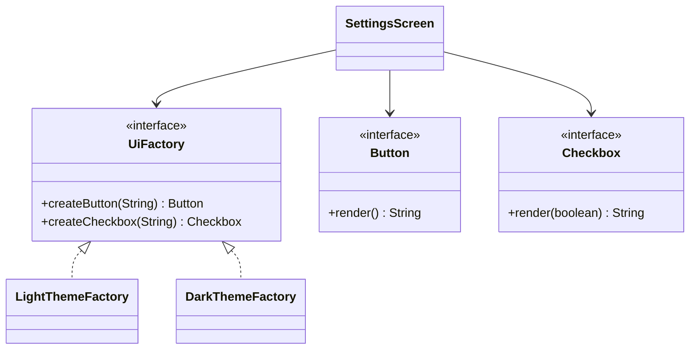

# Abstract Factory (Soyut Fabrika)

> 🇬🇧 [English](../../en/creational/abstract-factory.md) · **Kategori:** Oluşturucu (Creational) · **Kod:** [`creational/abstractfactory`](../../../src/main/java/designpatterns/creational/abstractfactory)

## Amaç

Somut sınıflarını belirtmeden, **birbiriyle ilişkili veya bağımlı nesne ailelerini** oluşturmak
için bir arayüz sağlamak.

## Problem

Bir arayüzde butonlar ve checkbox'lar var; iki tema mevcut: açık ve koyu. Açık bir checkbox'ın
yanında koyu bir buton bozuk görünür. Ekran kodu doğrudan `new DarkButton()` ve
`new LightCheckbox()` çağırırsa bu karışıklığı engelleyen hiçbir şey olmaz; üçüncü bir tema eklemek
de bütün ekranları değiştirmek demektir.

## Çözüm

Her ürün için bir oluşturma metodu olan bir arayüz tanımla (`createButton`, `createCheckbox`).
Her tema bu arayüzü uygular ve yalnızca kendi ürünlerini üretir. İstemci bir fabrika alır ve hiçbir
somut tema sınıfının adını anmaz; böylece ürünler her zaman uyumlu olur.



| Rol | Sınıf |
|---|---|
| Abstract factory | [`UiFactory`](../../../src/main/java/designpatterns/creational/abstractfactory/UiFactory.java) |
| Concrete factories | [`LightThemeFactory`](../../../src/main/java/designpatterns/creational/abstractfactory/LightThemeFactory.java), [`DarkThemeFactory`](../../../src/main/java/designpatterns/creational/abstractfactory/DarkThemeFactory.java) |
| Abstract products | [`Button`](../../../src/main/java/designpatterns/creational/abstractfactory/Button.java), [`Checkbox`](../../../src/main/java/designpatterns/creational/abstractfactory/Checkbox.java) |
| Client (İstemci) | [`SettingsScreen`](../../../src/main/java/designpatterns/creational/abstractfactory/SettingsScreen.java) |

```java
UiFactory factory = darkMode ? new DarkThemeFactory() : new LightThemeFactory();
SettingsScreen screen = new SettingsScreen(factory);   // temayı hiç bilmez
```

`Button` ve `Checkbox` tek soyut metoda sahip olduğu için bu örnekte somut ürünler lambda olarak
yazıldı. Gerçek bir projede genellikle tam sınıflar olurlar.

> 2016 sürümündeki örnek elma/biber ürünleri üreten tek bir fabrikadan oluşuyordu. Kalıbın asıl
> gücü olan "birden fazla uyumlu aile" fikrini göstermek için tema örneğine geçildi.

Örnek: [`AbstractFactoryDemo.java`](../../../src/main/java/designpatterns/creational/abstractfactory/AbstractFactoryDemo.java)

## Ne zaman kullanılır?

- Kod, ilişkili ürünlerden oluşan birden fazla aileyle çalışmalı (temalar, veritabanı üreticileri,
  işletim sistemleri, bulut sağlayıcıları) ve somut sınıflara bağımlı olmamalıysa.
- Farklı ailelerin ürünlerinin asla karışmamasını garanti etmek istiyorsanız.

## Artıları ve eksileri

| ✅ Artıları | ❌ Eksileri |
|---|---|
| Aynı ailenin ürünleri birbiriyle uyumludur | **Yeni bir ürün tipi** (örn. `Slider`) eklemek tüm fabrikaları değiştirir |
| Somut sınıflar istemciden yalıtılır | Çok sayıda arayüz ve sınıf |
| Bütün aileyi değiştirmek tek satırlık iştir | |

## Gerçek dünyadan örnekler

- `javax.xml.parsers.DocumentBuilderFactory`, `javax.xml.transform.TransformerFactory`
- JDBC: bir `Connection`, aynı sürücüye ait `Statement`, `PreparedStatement`, `Blob`... üretir
- Swing pluggable look-and-feel (`UIManager`)

## İlişkili kalıplar

- Somut fabrikalar çoğunlukla **Singleton**'dır ve **Factory Method**'larla yazılır.
- **Builder** karmaşık tek bir nesneyi adım adım oluşturur; Abstract Factory ürünü hemen döndürür.
- Platforma özgü sınıfları gizlemek için **Facade**'a alternatif olabilir.
