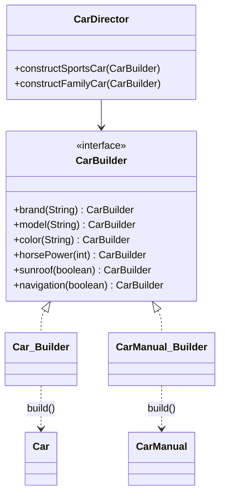

# Builder (İnşa Edici)

> 🇬🇧 [English](../../en/creational/builder.md) · **Kategori:** Oluşturucu (Creational) · **Kod:** [`creational/builder`](../../../src/main/java/designpatterns/creational/builder)

## Amaç

Karmaşık bir nesnenin oluşturulmasını temsilinden ayırarak **aynı oluşturma sürecinin farklı
temsiller üretebilmesini** sağlamak.

## Problem

Bir araba siparişinde zorunlu alanlar (marka, model) ve çok sayıda isteğe bağlı alan (renk,
beygir gücü, sunroof, navigasyon...) vardır. Alışılmış iki çözüm de kötüdür:

- *Teleskopik constructor'lar*: `new Car("Audi", "A4", "Kırmızı", 150, true, false)` – `true` neydi?
- *JavaBeans setter'ları*: nesne değiştirilebilir (mutable) olur ve yarı oluşturulmuş haliyle kullanılabilir.

## Çözüm

Oluşturma işini, her adım için bir metodu olan ayrı bir **builder** nesnesine taşı. Her metot
builder'ın kendisini döndürür, böylece çağrılar zincirlenebilir. `build()` her şeyi doğrular ve
**değişmez (immutable)** bir nesne döndürür. Bir **director**, sık kullanılan adım dizilerini
(spor araba, aile arabası) saklayabilir ve *herhangi bir* builder ile çalışabilir.



| Rol | Sınıf |
|---|---|
| Builder | [`CarBuilder`](../../../src/main/java/designpatterns/creational/builder/CarBuilder.java) |
| Concrete builders | [`Car.Builder`](../../../src/main/java/designpatterns/creational/builder/Car.java), [`CarManual.Builder`](../../../src/main/java/designpatterns/creational/builder/CarManual.java) |
| Products (Ürünler) | `Car` (immutable), `CarManual` (record) |
| Director | [`CarDirector`](../../../src/main/java/designpatterns/creational/builder/CarDirector.java) |

```java
Car car = Car.builder()
        .brand("BMW")
        .model("Z4")
        .color("Mavi")
        .horsePower(340)
        .build();                       // zorunlu alanları doğrular

CarManual.Builder manual = CarManual.builder();
new CarDirector().constructSportsCar(manual); // aynı adımlar, farklı ürün
```

Örnek: [`BuilderDemo.java`](../../../src/main/java/designpatterns/creational/builder/BuilderDemo.java)

## Builder'ın iki çeşidi

1. **GoF Builder** – director + builder arayüzü + farklı temsiller üreten birden fazla builder
   (burada `Car` ve `CarManual`). 2016 sürümündeki `SiparisManager` / `AudiSiparisBuilder` yapısı bu
   çeşidin ilk haliydi.
2. **Akıcı (fluent) / Effective Java Builder** – teleskopik constructor'lardan kaçınmak için
   kullanılan static iç `Builder` sınıfı. Java kodunda en sık görülen budur (Lombok'un `@Builder`
   anotasyonu da bunu üretir).

## Ne zaman kullanılır?

- Çok sayıda isteğe bağlı parametresi olan veya çok adımlı oluşturulan nesneler.
- Değişmez nesneler istiyor ama devasa constructor'lar istemiyorsanız.
- Aynı adımların farklı temsiller üretmesi gerekiyorsa.

## Artıları ve eksileri

| ✅ Artıları | ❌ Eksileri |
|---|---|
| Okunabilir, kendini belgeleyen oluşturma kodu | Daha fazla kod (her ürün için ek sınıf) |
| Değişmez ürünler, doğrulama tek yerde | Builder, ürünün alanlarını tekrar eder |
| Adım adım / ertelenmiş oluşturma | |

## Gerçek dünyadan örnekler

- `StringBuilder`, `java.util.stream.Stream.builder()`
- `java.net.http.HttpRequest.newBuilder()`, `HttpClient.newBuilder()`
- `Locale.Builder`, `ProcessBuilder`
- Lombok `@Builder`, Spring `UriComponentsBuilder`, `ResponseEntity.ok().body(...)`

## İlişkili kalıplar

- **Abstract Factory** ürünü hemen döndürür; Builder adım adım oluşturur.
- **Composite** ağaçları genellikle builder'larla oluşturulur.
- Builder'lar **Singleton** olabilir veya **Prototype** ile oluşturulabilir.
