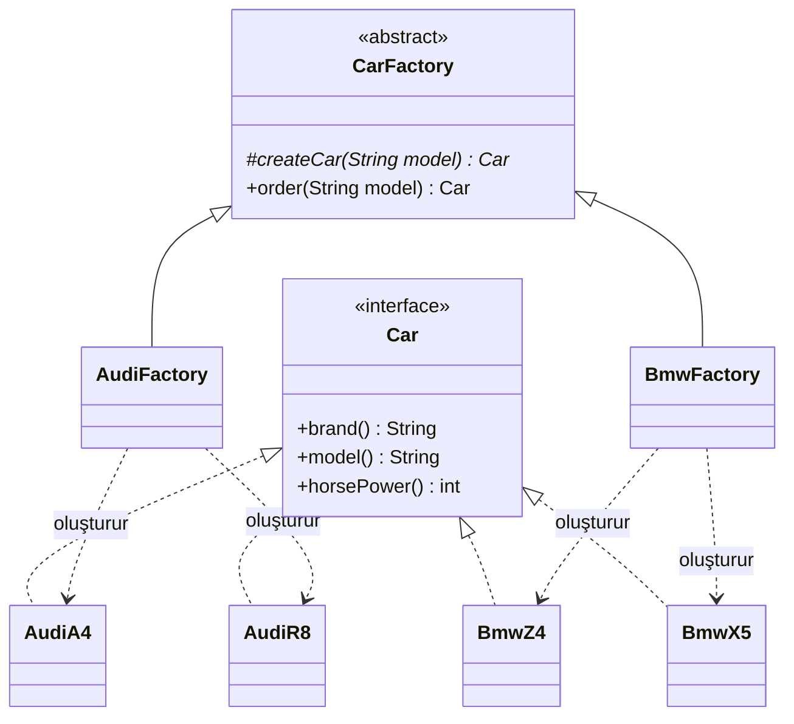

# Factory Method (Fabrika Metodu)

> 🇬🇧 [English](../../en/creational/factory-method.md) · **Kategori:** Oluşturucu (Creational) · **Kod:** [`creational/factorymethod`](../../../src/main/java/designpatterns/creational/factorymethod)

## Amaç

Nesne oluşturmak için bir arayüz tanımlamak, ancak **hangi sınıftan nesne oluşturulacağına alt
sınıfların karar vermesini** sağlamak. Factory Method, nesne oluşturmayı alt sınıflara bırakır.

## Problem

Bir araba fabrikasının üretim süreci (üret → kalite kontrol → kaydet) her marka için aynıdır,
sadece *üretilen araba* değişir. Süreç içine `if (marka.equals("Audi")) ...` yazmak, her yeni
markada test edilmiş kodu değiştirmek demektir (Open/Closed ilkesi ihlal edilir).

## Çözüm

`new` çağrısını ayrı ve override edilebilir bir metoda taşı: **factory method**. Üst sınıf ortak
iş mantığını içerir ve sadece `Car` arayüzünü bilir; her alt sınıf factory method'u override ederek
kendi arabasını döndürür.



| Rol | Sınıf |
|---|---|
| Product (Ürün) | [`Car`](../../../src/main/java/designpatterns/creational/factorymethod/Car.java) |
| Concrete products | `AudiA4`, `AudiR8`, `BmwZ4`, `BmwX5` (record) |
| Creator (Oluşturucu) | [`CarFactory`](../../../src/main/java/designpatterns/creational/factorymethod/CarFactory.java) |
| Concrete creators | [`AudiFactory`](../../../src/main/java/designpatterns/creational/factorymethod/AudiFactory.java), [`BmwFactory`](../../../src/main/java/designpatterns/creational/factorymethod/BmwFactory.java) |

```java
public abstract class CarFactory {
    protected abstract Car createCar(String model);   // factory method

    public final Car order(String model) {             // iş mantığı
        Car car = createCar(model);
        qualityCheck(car);
        producedCars.add(car);
        return car;
    }
}
```

Örnek: [`FactoryMethodDemo.java`](../../../src/main/java/designpatterns/creational/factorymethod/FactoryMethodDemo.java)

Önce / sonra: [refactoring örneği](../refactoring.md#factory-method)

## Simple Factory ile farkı

**Simple factory** (static bir metot içinde `switch` ile `CarFactory.create("audi", "A4")`) bir GoF
kalıbı değildir, kapsüllenmiş bir `switch`'ten ibarettir. Küçük durumlar için yeterlidir ama yeni
ürün eklemek yine o metodu değiştirmeyi gerektirir. **Factory Method** ise kalıtım kullanır: yeni
marka eklemek, mevcut koda dokunmadan yeni bir alt sınıf yazmaktır.

> 2016 sürümündeki `ArabaFabrika` örneği nesneleri constructor içinde listeye ekliyordu; bu sürümde
> gerçek bir factory method yapısına dönüştürüldü.

## Ne zaman kullanılır?

- Kodun hangi somut tiplerle çalışacağını önceden bilmiyorsanız.
- Kütüphane/framework kullanıcılarının iç bileşenleri genişletebilmesini istiyorsanız.
- Her seferinde yeni nesne oluşturmak yerine mevcut nesneleri yeniden kullanmak (havuz, önbellek) istiyorsanız.

## Artıları ve eksileri

| ✅ Artıları | ❌ Eksileri |
|---|---|
| Creator ile somut ürünler arasında gevşek bağlılık | Her ürün ailesi için bir alt sınıf, hiyerarşi büyüyebilir |
| Open/Closed: istemci kodu değişmeden yeni ürün | Basit durumlar için fazla karmaşık |
| Oluşturma kodu tek yerde (Single Responsibility) | |

## Gerçek dünyadan örnekler

- `java.util.Calendar.getInstance()`, `NumberFormat.getInstance()`
- `java.util.Collection.iterator()` – her koleksiyon kendi iterator tipini döndürür
- `java.nio.charset.Charset.forName()`
- Spring: `FactoryBean#getObject()`

## İlişkili kalıplar

- **Abstract Factory** genellikle birden fazla factory method ile yazılır.
- **Template Method**: `order()` bir template method, `createCar()` ise onun adımlarından biridir.
- **Prototype** alt sınıf gerektirmez ama kopyalanacak hazır bir nesne gerektirir.

## Mülakat soruları

- *Factory Method ile Abstract Factory arasındaki fark?* Factory Method kalıtım ile **tek** bir ürün
  oluşturur; Abstract Factory kompozisyon ile (istemciye bir fabrika nesnesi verilir) birbiriyle
  ilişkili ürünlerden oluşan bir **aile** oluşturur.
