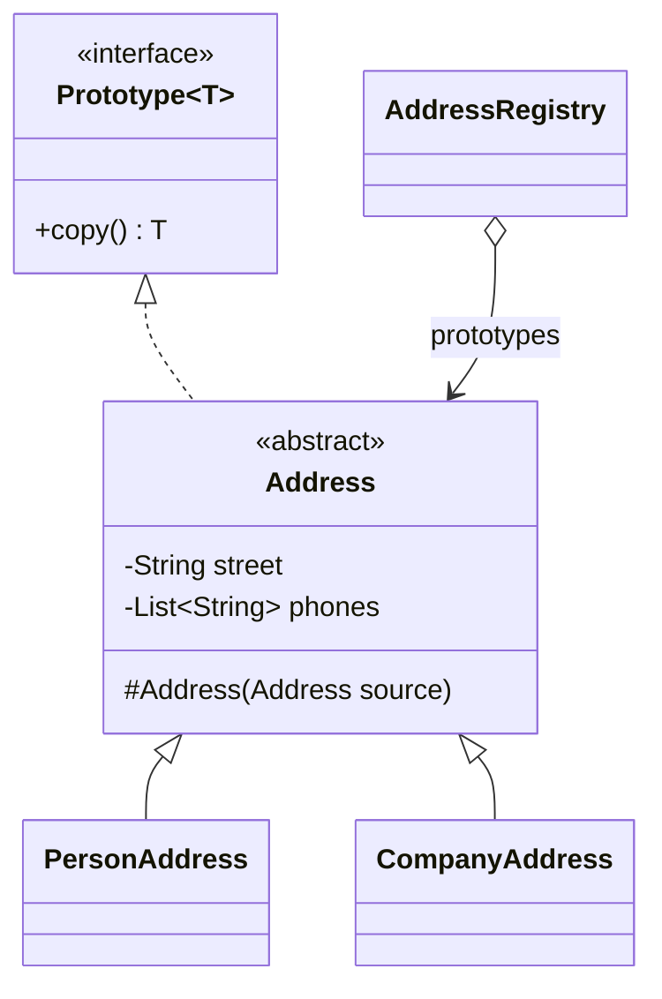

# Prototype (Prototip)

> 🇬🇧 [English](../../en/creational/prototype.md) · **Kategori:** Oluşturucu (Creational) · **Kod:** [`creational/prototype`](../../../src/main/java/designpatterns/creational/prototype)

## Amaç

Oluşturulacak nesnelerin türünü **örnek (prototip) bir nesne** ile belirlemek ve yeni nesneleri bu
prototipi **kopyalayarak** oluşturmak.

## Problem

Bir nesnenin birebir kopyasını istiyorsunuz. Dışarıdan kopyalamak her zaman mümkün değildir: bazı
alanlar private'tır ve istemci somut sınıfı (`PersonAddress` veya `CompanyAddress`) değil, yalnızca
bir arayüzü (`Address`) biliyor olabilir. Ayrıca nesneyi sıfırdan oluşturmak pahalı olabilir
(veritabanı sorguları, dosya okuma, ağır konfigürasyon).

## Çözüm

Nesnenin kendisini kopyalamasına izin ver. Her prototip bir `copy()` metodu uygular; istemci somut
tipi bilmeden bu metodu çağırır. Bir **registry (kayıt defteri)** önceden yapılandırılmış
prototipleri tutup istendiğinde kopyalarını döndürebilir.



| Rol | Sınıf |
|---|---|
| Prototype | [`Prototype`](../../../src/main/java/designpatterns/creational/prototype/Prototype.java) |
| Concrete prototypes | [`PersonAddress`](../../../src/main/java/designpatterns/creational/prototype/PersonAddress.java), [`CompanyAddress`](../../../src/main/java/designpatterns/creational/prototype/CompanyAddress.java) |
| Registry | [`AddressRegistry`](../../../src/main/java/designpatterns/creational/prototype/AddressRegistry.java) |

```java
protected Address(Address source) {          // kopyalama constructor'ı
    this.street = source.street;
    this.phones = new ArrayList<>(source.phones); // değişebilir listenin derin kopyası
}

@Override
public PersonAddress copy() {
    return new PersonAddress(this);
}
```

Örnek: [`PrototypeDemo.java`](../../../src/main/java/designpatterns/creational/prototype/PrototypeDemo.java)

## Sığ kopya (shallow) ve derin kopya (deep)

- **Sığ kopya** alanların değerlerini kopyalar. Referans alanları hâlâ *aynı* nesneleri gösterir
  (iki adres aynı telefon listesini paylaşır).
- **Derin kopya** referans verilen değişebilir nesneleri de kopyalar. Değişmez nesneler
  (`String`, record'lar, `List.of`) güvenle paylaşılabilir.

## Neden `Cloneable` değil?

Bu reponun 2016 sürümü kendi boş `Cloneable` arayüzünü tanımlıyor ve `super.clone()` kullanıyordu.
`java.lang.Cloneable` genel kabul görmüş şekilde sorunludur (Effective Java, Madde 13): içinde
`clone()` metodu yoktur, `Object.clone()` protected'dır, checked exception fırlatır, sığ kopya yapar
ve `final` alanlarla çalışmaz. **Kopyalama constructor'ı** veya **kopyalama factory metodu** daha
basit ve güvenlidir.

## Ne zaman kullanılır?

- Nesne oluşturmak pahalıysa ve benzer nesnelere ihtiyaç varsa.
- Kod, kopyaladığı nesnelerin somut sınıflarına bağımlı olmamalıysa.
- Yalnızca başlangıç ayarları farklı olan alt sınıfların sayısını azaltmak istiyorsanız.

## Artıları ve eksileri

| ✅ Artıları | ❌ Eksileri |
|---|---|
| Somut sınıflara bağlanmadan kopyalama | Döngüsel referanslı nesne grafiklerini derin kopyalamak zordur |
| Tekrarlanan pahalı başlatmalardan kaçınma | Hiyerarşideki her sınıf kopyalamayı uygulamalı |
| Registry'de hazır konfigürasyonlar | |

## Gerçek dünyadan örnekler

- `Object.clone()`, `ArrayList(Collection)` gibi kopyalama constructor'ları
- Spring `@Scope("prototype")` bean'leri (her istekte yeni nesne – isim bu kalıptan gelir)
- JavaScript'in prototip tabanlı kalıtımı

## İlişkili kalıplar

- **Abstract Factory**, `new` yerine prototipleri saklayıp kopyalayabilir.
- Durum basitse **Memento** bazen Prototype ile yazılabilir.
- **Composite** ve **Decorator** ağırlıklı tasarımlarda karmaşık yapıları kopyalamak için faydalıdır.
