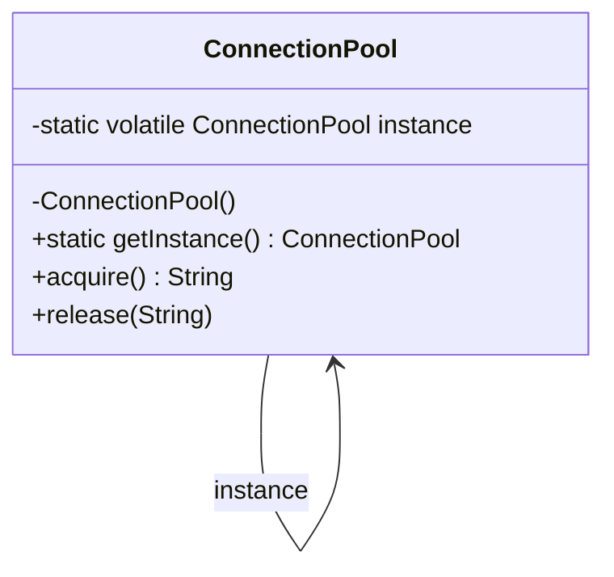

# Singleton (Tekil Nesne)

> 🇬🇧 [English](../../en/creational/singleton.md) · **Kategori:** Oluşturucu (Creational) · **Kod:** [`creational/singleton`](../../../src/main/java/designpatterns/creational/singleton)

## Amaç

Bir sınıftan **yalnızca bir nesne** oluşturulmasını garanti etmek ve bu nesneye **global bir erişim
noktası** sağlamak.

## Problem

Bazı nesnelerin uygulamada tam olarak bir kez bulunması gerekir: bağlantı havuzu (connection pool),
konfigürasyon nesnesi, önbellek (cache), logger... Kodun her yerinde `new` çağrılırsa her biri kendi
pahalı bağlantılarını açan onlarca havuz ve tutarsız bir durum ortaya çıkar.

## Çözüm

1. Constructor'ı `private` yaparak dışarıdan `new` ile nesne oluşturulmasını engelle.
2. Tek nesneyi `static` bir alanda tut.
3. İlk çağrıda nesneyi oluşturan, sonraki çağrılarda aynı nesneyi döndüren `static` bir metot
   (`getInstance()`) sun.



## Bu repodaki gerçekleştirimler

| Sınıf | Teknik | Lazy | Thread safe | Not |
|---|---|---|---|---|
| [`ConnectionPool`](../../../src/main/java/designpatterns/creational/singleton/ConnectionPool.java) | Double-checked locking | ✅ | ✅ | Alan **mutlaka** `volatile` olmalı |
| [`AppSettings`](../../../src/main/java/designpatterns/creational/singleton/AppSettings.java) | Holder idiom (Bill Pugh) | ✅ | ✅ | Kilit yok, güvenliği JVM garanti eder |
| [`IdGenerator`](../../../src/main/java/designpatterns/creational/singleton/IdGenerator.java) | `enum` | ❌ | ✅ | Reflection ve serialization'a karşı güvenli |

```java
public static ConnectionPool getInstance() {
    ConnectionPool result = instance;
    if (result == null) {                       // 1. kontrol, kilitsiz
        synchronized (ConnectionPool.class) {
            result = instance;
            if (result == null) {               // 2. kontrol, kilitli
                instance = result = new ConnectionPool();
            }
        }
    }
    return result;
}
```

> ⚠️ Bu reponun 2016'daki ilk sürümünde double-checked locking `volatile` **olmadan**
> kullanılmıştı. `volatile` olmazsa JVM komutları yeniden sıralayabilir ve başka bir thread,
> constructor'ı henüz bitmemiş bir nesnenin referansını görebilir.

Örnek: [`SingletonDemo.java`](../../../src/main/java/designpatterns/creational/singleton/SingletonDemo.java)

## Ne zaman kullanılır?

- Tam olarak bir nesnenin bulunması ve paylaşılması gerekiyorsa (havuz, kayıt defteri, ayarlar).
- Nesne gerçekten ihtiyaç duyulduğunda, geç (lazy) oluşturulmalıysa.

## Artıları ve eksileri

| ✅ Artıları | ❌ Eksileri |
|---|---|
| Tek nesne garantisi | Global durum, gizli bağımlılıklar |
| Lazy initialization yapılabilir | Unit test yazmak / mock'lamak zor |
| Global erişim noktası | Single Responsibility ilkesini ihlal eder (kendi yaşam döngüsünü de yönetir) |
| | Çok thread'li kodda dikkat ister |

## Gerçek dünyadan örnekler

- `java.lang.Runtime.getRuntime()`
- `java.awt.Desktop.getDesktop()`
- Spring bean'leri varsayılan olarak **container başına** singleton'dır (`@Scope("singleton")`),
  ancak static bir metotla değil container tarafından oluşturulurlar. Genellikle daha iyi tercih
  budur: tek nesne elde edersiniz ama test sorunları yaşamazsınız.

## İlişkili kalıplar

- **Abstract Factory**, **Builder** ve **Prototype** çoğunlukla singleton olarak yazılır.
- Tek bir **Facade** yeterli olduğu için facade'lar sıklıkla singleton'dır.
- **Flyweight** benzer görünür ama her iç durum (intrinsic state) için ayrı bir paylaşılan nesne vardır.

## Mülakat soruları

- *Double-checked locking'de neden `volatile` gerekir?* Nesne oluşturma atomik değildir
  (bellek ayır → başlat → referansı ata). `volatile` olmadan atama, başlatma bitmeden diğer
  thread'lere görünebilir.
- *Singleton nasıl bozulur?* Reflection (`setAccessible(true)`), serialization (`readResolve()` ile
  düzeltilir), clone ve birden fazla class loader. `enum` versiyonu ilk üçüne karşı bağışıktır.
- *Singleton ile static sınıf arasındaki fark?* Singleton interface uygulayabilir, parametre olarak
  geçirilebilir, lazy oluşturulabilir ve testlerde değiştirilebilir; static metotlu yardımcı sınıf
  bunları yapamaz.
