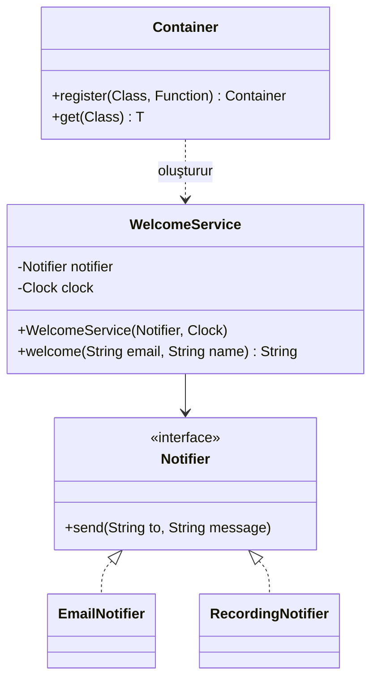

# Dependency Injection (Bağımlılık Enjeksiyonu)

> 🇬🇧 [English](../../en/enterprise/dependency-injection.md) · **Kategori:** Kurumsal (Enterprise) · **Kod:** [`enterprise/dependencyinjection`](../../../src/main/java/designpatterns/enterprise/dependencyinjection)

## Amaç

Bir nesne, ihtiyaç duyduğu nesneleri kendisi oluşturmak ya da aramak yerine **dışarıdan alır**. Nesne
grafiğini kimin kuracağı (`main` metodunuz, Spring, Guice...) tek bir yerde, **composition root**'ta belirlenir.

## Problem

```java
public class WelcomeService {
    private final EmailNotifier notifier = new EmailNotifier();   // sabit bağlanmış
    public String welcome(String email, String name) {
        int hour = LocalTime.now().getHour();                     // sistem saatine gizli bağımlılık
        ...
    }
}
```

- Gerçek e-posta göndermeden test edemezsiniz.
- Testi akşam çalıştırmadıkça "iyi akşamlar" durumunu test edemezsiniz.
- SMS'e geçmek bu sınıfı değiştirmeyi gerektirir (Open/Closed ve Dependency Inversion ihlali).

## Çözüm

Soyutlamalara (`Notifier`, `java.time.Clock`) bağımlı olun ve onları **constructor üzerinden** alın.
Hangi gerçekleştirmenin verileceğine sınıfın dışındaki bir yer karar verir.



| Rol | Sınıf |
|---|---|
| Servis (istemci) | [`WelcomeService`](../../../src/main/java/designpatterns/enterprise/dependencyinjection/WelcomeService.java) |
| Soyutlama | [`Notifier`](../../../src/main/java/designpatterns/enterprise/dependencyinjection/Notifier.java), `java.time.Clock` |
| Gerçekleştirmeler | [`EmailNotifier`](../../../src/main/java/designpatterns/enterprise/dependencyinjection/EmailNotifier.java), [`RecordingNotifier`](../../../src/main/java/designpatterns/enterprise/dependencyinjection/RecordingNotifier.java) (test dublörü) |
| Enjektör | [`Container`](../../../src/main/java/designpatterns/enterprise/dependencyinjection/Container.java) – 30 satırlık bir IoC container ya da düz `main` |

```java
var service = new WelcomeService(new RecordingNotifier(), Clock.fixed(evening, UTC));
service.welcome("ayse@example.com", "Ayşe");   // "Good evening, Ayşe!" – deterministik, hiçbir şey gönderilmez
```

Örnek: [`DependencyInjectionDemo.java`](../../../src/main/java/designpatterns/enterprise/dependencyinjection/DependencyInjectionDemo.java)

### Enjeksiyon türleri

| Tür | Nasıl | Not |
|---|---|---|
| **Constructor** | `new Service(dep)` | Tercih edilen. Bağımlılıklar zorunlu, alanlar `final` olabilir, nesne asla yarım kalmaz. |
| Setter | `service.setDep(dep)` | Opsiyonel bağımlılıklar için. Nesne hazır olmadan kullanılabilir. |
| Field | `@Autowired private Dep dep;` | Kısa ama bağımlılıkları gizler, testte framework ya da reflection gerekir. Kaçının. |

## Ne zaman kullanılır?

- Dış dünyayla konuşan (DB, HTTP, mail, zaman, rastgelelik) servislerde neredeyse her zaman.
- Ortama göre (test, dev, prod) farklı gerçekleştirme kullanmak istiyorsanız.
- Değer nesneleri, record'lar ve saf yardımcı fonksiyonlar için gerekmez.

## Artıları ve eksileri

| ✅ Artıları | ❌ Eksileri |
|---|---|
| Test edilebilir: sahte nesne / mock verilir | Daha fazla tip ve bağlama kodu |
| Gevşek bağlılık, Open/Closed | Framework "sihri" akışı takip etmeyi zorlaştırabilir |
| Yapılandırma tek bir yerde | Container bağımlılığı çözemezse hata çalışma zamanında çıkar |

## Gerçek dünyadan örnekler

- Spring (`@Component` + constructor injection), Jakarta CDI (`@Inject`), Google Guice, Dagger, Micronaut
- `java.util.ServiceLoader`, JDK'nın hafif service locator / eklenti mekanizmasıdır

## İlişkili kalıplar

- **Service Locator** – ters yön: sınıf bağımlılıklarını bir kayıt defterinden *ister*. Bağımlılıkları
  gizlediği için genelde DI tercih edilir ([anti-pattern'ler](../anti-patterns.md) sayfasına bakın).
- **Factory / Abstract Factory** – container aslında büyük, yapılandırılabilir bir fabrikadır.
- **Strategy** – enjekte edilen bağımlılık çoğu zaman bir stratejidir.
- **Singleton** – container'lar statik Singleton kalıbı olmadan "singleton scope" sağlar.

## Mülakat soruları

1. *Dependency Injection, Dependency Inversion ve Inversion of Control arasındaki fark nedir?*
   – DIP bir tasarım ilkesidir (soyutlamalara bağımlı ol). IoC, framework'ün sizin kodunuzu çağırması
   fikridir. DI ise IoC'yi gerçekleştirmenin bir yoludur: bağımlılıklar nesneye verilir.
2. *Spring'de neden constructor injection önerilir?* – değişmezlik, zorunlu bağımlılıklar, Spring olmadan
   kolay test; ayrıca çok fazla constructor parametresi göze batan bir kötü koku (smell) olur.
