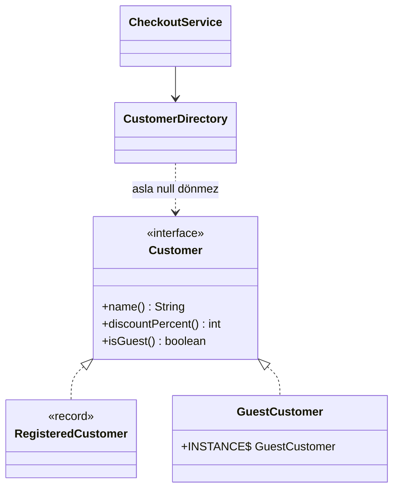

# Null Object (Boş Nesne)

> 🇬🇧 [English](../../en/enterprise/null-object.md) · **Kategori:** Davranışsal (Bobby Woolf, *PLoPD 3*) · **Kod:** [`enterprise/nullobject`](../../../src/main/java/designpatterns/enterprise/nullobject)

## Amaç

`null` yerine kullanılan, **nötr ve hiçbir şey yapmayan davranışa** sahip bir nesne sağlamak; böylece
istemciler null kontrolü yapmak zorunda kalmaz.

## Problem

```java
Customer customer = directory.find(id);
String name = customer != null ? customer.name() : "Guest";
int discount = customer != null ? customer.discountPercent() : 0;
if (customer != null && customer.isVip()) { ... }
```

Null kontrolleri her yerde tekrarlanır; birini unutmak production'da `NullPointerException` demektir.

## Çözüm

Arayüzün "hiçbir şey"i temsil eden bir gerçekleştirmesini yazın: `GuestCustomer`'ın adı "Guest", indirimi
%0'dır. Arama metodu `null` yerine onu döndürür.



| Rol | Sınıf |
|---|---|
| Soyutlama | [`Customer`](../../../src/main/java/designpatterns/enterprise/nullobject/Customer.java) |
| Gerçek nesne | [`RegisteredCustomer`](../../../src/main/java/designpatterns/enterprise/nullobject/RegisteredCustomer.java) |
| Null object | [`GuestCustomer`](../../../src/main/java/designpatterns/enterprise/nullobject/GuestCustomer.java) – durumsuz olduğu için tek bir paylaşılan örnek |
| İstemci | [`CheckoutService`](../../../src/main/java/designpatterns/enterprise/nullobject/CheckoutService.java) |

Örnek: [`NullObjectDemo.java`](../../../src/main/java/designpatterns/enterprise/nullobject/NullObjectDemo.java)

Önce / sonra: [refactoring örneği](../refactoring.md#null-object)

## Null Object mi `Optional` mı?

| | Null Object | `Optional<T>` |
|---|---|---|
| Verdiği mesaj | "yokluğun mantıklı bir varsayılan davranışı var" | "yokluğu çağıran ele almalı" |
| İstemci kodu | değişmez, kontrol yok | `orElse`, `map`, `ifPresent`... |
| Uygun olduğu yer | logger, listener, misafir kullanıcı, boş strateji | "bulunamadı"nın önemli olduğu arama metotlarının dönüş değeri |

"Bulunamadı" durumu çağıranın fark etmesi gereken bir hataysa null object kullanmayın; hatayı gizler.

## Artıları ve eksileri

| ✅ Artıları | ❌ Eksileri |
|---|---|
| Tekrarlayan null kontrollerini kaldırır | Yanlış kullanılırsa gerçek hataları gizler |
| Koşullar yerine polimorfizm | Her arayüz için bir sınıf daha |

## Gerçek dünyadan örnekler

- `Collections.emptyList()`, `Map.of()`, `InputStream.nullInputStream()`, `OutputStream.nullOutputStream()`,
  `Writer.nullWriter()` (Java 11+)
- SLF4J `NOPLogger`, Spring `NoOpCache`, `NoOpPasswordEncoder`

## İlişkili kalıplar

- **Strategy** – "hiçbir şey yapma" stratejisi (`DiscountStrategy.none()`) bir null object'tir.
- **Singleton** – null object'ler durumsuzdur, tek bir örnek paylaşılır.
- **Special Case** (Fowler) – genelleştirilmiş hali: `UnknownCustomer`, `MissingAddress`...
